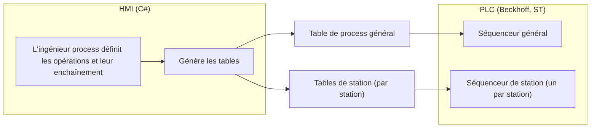
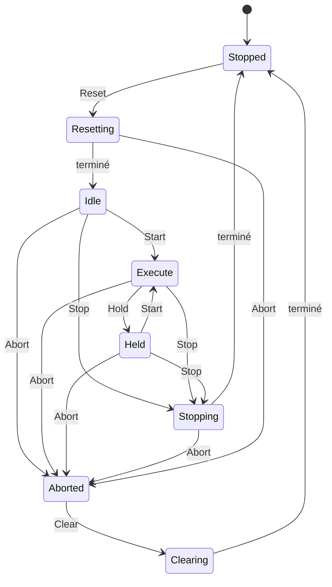

# Spécifications logicielles – HMI C# / PLC Beckhoff ST

Ce document décrit l'architecture logicielle de la machine standard. La définition de la machine (stations, movers, position, fonctions requises, suivi) est dans `01-definition-machine.md`.

## Principe général

L'objectif est un logiciel le plus flexible possible, avec une architecture la plus basique possible. Toute la séquence est définie dans la HMI (C#) puis transmise au PLC (Beckhoff, ST) sous forme de tables : le PLC n'embarque pas la logique du process, il exécute les tables.

La HMI génère une table de process général et une ou plusieurs tables par station ; un séquenceur général et un séquenceur par station les exécutent côté PLC.

## Niveaux d'abstraction

La flexibilité vient d'un empilement de niveaux : chaque niveau se construit à partir de celui du dessous, et l'ingénieur process peut intervenir sur les niveaux supérieurs sans toucher au PLC de base.

| Niveau | Contenu | Exemple |
| --- | --- | --- |
| 1. Devices | Éléments physiques déclarés dans une station | 2 vérins, 3 axes linéaires, 1 module aspi/soufflage |
| 2. Actions de base | Actions disponibles sur chaque device | Vérin : move travail, move repos. Axe : power on / init, move. Aspi/soufflage : aspirer, souffler, couper |
| 3. Modules standard | Ensemble de devices fournissant des fonctions de plus haut niveau | Robot XYZ : prise, place, goto |
| 4. Opérations de station | Opérations disponibles sur une station, issues des modules standard ou créées par l'ingénieur process | Prise modifiée copiée depuis la prise standard |
| 5. Process général | Enchaînement des opérations de la machine, défini par l'ingénieur process | Table de process général |

Des modules avec des opérations standard sont fournis. L'ingénieur process peut partir de ces modules pour en créer de nouveaux.

## Exemple : un module robot XYZ

Une station déclare ses devices : 2 vérins, 3 axes linéaires et un module aspi/soufflage. Avec ces devices, on peut fournir un module standard « robot XYZ » qui expose des fonctions de plus haut niveau (prise, place, goto, etc.).

| Device | Actions disponibles |
| --- | --- |
| Vérin | Move travail, move repos |
| Axe linéaire | Power on / init, move |
| Module aspi/soufflage | Aspirer, souffler, couper aspi/soufflage |

La fonction **prise** standard s'écrit comme une suite d'actions de base :

1. Move XY
2. Move Z
3. Aspirer
4. Move Z final

L'ingénieur process peut copier cette fonction et la modifier pour en créer une variante. Par exemple, une prise qui enchaîne : move X, move Y, move Z, aspirer, move Z. Les fonctions fournies restent disponibles ; les variantes s'ajoutent sans modifier le module standard.

## Tables et séquenceurs

L'ingénieur process définit l'enchaînement des opérations dans la HMI. La HMI génère ensuite les tables, que le PLC exécute sans connaître la logique du process.

| Élément | Rôle | Nombre |
| --- | --- | --- |
| Table de process général | Décrit le process général de la machine | une |
| Table(s) de station | Décrit chacun des process disponibles sur la station | une ou plusieurs par station |
| Séquenceur général (PLC) | Exécute la table de process général | un |
| Séquenceur de station (PLC) | Exécute les tables de sa station | un par station |

L'ingénieur process peut aussi définir des sous-opérations à l'intérieur de chaque station, à partir des modules standard fournis (voir l'exemple du robot XYZ). Les tables sont transmises au PLC par ADS. Le process de la machine définit l'action suivante à réaliser sur un composant (mover ou pièce) selon son état. Les tables ne sont modifiées que machine à l'arrêt : le versionnage n'est donc pas nécessaire pour le moment.

## Modèle d'états (inspiré de PackML)

PackML est un standard (ISA-TR88.00.02, OMAC) qui définit un modèle d'états, des commandes, des modes et des tags communs pour les machines. Il ne décrit pas le contenu du process : il complète les tables sans les remplacer. Nous en reprenons une version réduite : 8 états, 6 commandes et 2 modes.

### États retenus

| État | Rôle |
| --- | --- |
| Stopped | Machine à l'arrêt. Les tables ne sont modifiées que dans cet état |
| Resetting | Initialisation (power on / init des axes, vérins en position repos) |
| Idle | Prête à démarrer |
| Execute | Production (regroupe Starting et Completing de PackML) |
| Held | Pause : les opérations en cours se terminent, puis le séquenceur attend (regroupe Holding, Held et Unholding) |
| Stopping | Arrêt ordonné, mène à Stopped |
| Aborted | Arrêt sur défaut, mouvements stoppés immédiatement (regroupe Aborting et Aborted) |
| Clearing | Acquittement du défaut (reprise, pièce à retirer), mène à Stopped |

**Commandes** : Reset, Start, Stop, Hold, Abort, Clear.

**Modes** : Production et Maintenance. Le mode Maintenance permet de lancer à la main les opérations d'une station pour les tester.

L'Abort est possible depuis tout état (hors Stopped, Aborted et Clearing dans ce schéma).

### Hiérarchie

Chaque station a son séquenceur avec ces mêmes états. Le séquenceur général agrège l'état des stations ; la HMI lui envoie les commandes, qu'il transmet aux stations.

## Stations de même fonction et Aborted

L'Aborted d'une station est local à la station : la machine ne s'arrête que si aucune autre station ne peut assurer la même fonction.

- **Groupe de stations** : les stations de même fonction sont déclarées dans un groupe côté HMI, et le process général référence la fonction plutôt qu'une station précise.
- **Choix de la station** : pour chaque pièce, le séquenceur général choisit une station disponible du groupe, selon son état.
- **Station en Aborted** : elle devient indisponible pour le routage et les autres stations du groupe continuent en Execute : la production continue, avec une indication visuelle sur la balise machine. Chaque station a aussi sa propre balise qui indique son état. La pièce déjà engagée sur la station sort en rebut pour le moment.
- **Retour** : après Clear et Reset, la station réintègre le groupe.
- **Arrêt machine** : le séquenceur général passe en Aborted si tout un groupe est indisponible, si la station en défaut n'a pas d'équivalent, ou en cas de défaut machine (arrêt d'urgence, mover planaire).

## Mode manuel des stations

Le mode manuel s'applique à toute la machine : chaque action de chaque élément (device), et de chaque groupe d'éléments (module), de chaque station peut y être exécutée à la main depuis la HMI. Le passage en manuel se fait depuis l'état Stopped. Il rejoint le mode Maintenance du modèle d'états, qui sert à tester les opérations d'une station.

Pistes à valider :

- **Génération automatique** : les actions proposées viennent de la déclaration des devices et des modules (niveaux 1 à 3), la page manuelle d'une station se génère donc sans développement spécifique.
- **Droits** : le niveau d'utilisateur requis pour les actions manuelles se définit comme les autres types d'action, par le niveau admin.
- **Sécurités** : les verrouillages de la station restent actifs en manuel.

## Mode pas à pas des stations

Chaque station peut aussi s'exécuter en mode pas à pas. La différence avec le mode manuel : le manuel exécute n'importe quelle action isolée, alors que le pas à pas déroule la séquence définie dans les tables de la station, une étape à la fois. Comme dans un debugger, le pas normal exécute une opération de station entière, et l'opérateur peut entrer dans l'opération pour avancer action de base par action de base. On ne peut ni revenir en arrière ni sauter une étape : l'opérateur peut seulement abandonner avec la commande Abort.

Pistes à valider :

- **Déclenchement** : chaque étape est lancée par l'opérateur depuis la HMI, le séquenceur de station attend entre deux étapes.
- **Affichage** : la HMI montre l'étape en cours et la suivante.
- **Mode** : le pas à pas s'utilise en mode Maintenance, comme le mode manuel.
- **Droits** : le niveau d'utilisateur requis se définit par le niveau admin, comme pour les autres actions.

## Points à définir

La synchronisation entre stations n'est pas prévue pour le moment. Un point reste à définir.

### Gestion des erreurs et des reprises

Le modèle d'états réduit et les groupes de stations couvrent la base. Restent à trancher :

- **Sortie de rebut** (piste) : une pièce en échec est routée vers une station de sortie dédiée.
- **Retrait manuel** (piste) : le mover passe dans un état « à vider » jusqu'à ce que l'opérateur confirme le retrait depuis la HMI.
