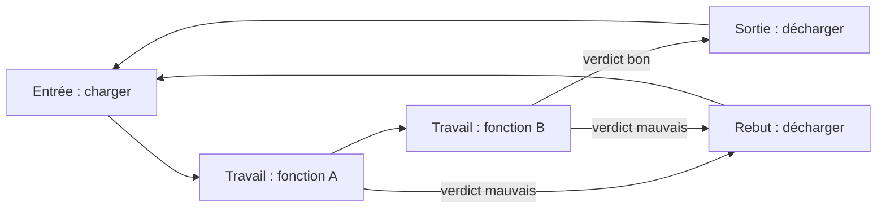

# Définition de la machine standard

Ce document décrit ce qu'est la machine standard, ce qu'elle doit faire, et la machine d'exemple qui sert de référence pour le développement, le simulateur et les démonstrations. Les termes suivent `00-glossaire.md`.

## Contexte et objectifs

L'objectif est une machine standard dont le logiciel est le plus flexible possible, parce que chaque machine livrée est fortement customisée.

- Deux parties logicielles : une HMI en C# (WPF, Windows) et un PLC Beckhoff TwinCAT 3 programmé en ST.
- Une architecture la plus basique possible : peu de concepts, appliqués partout de la même façon.
- Toute la séquence est définie dans la HMI, compilée en tables et transmise au PLC. Le PLC exécute les tables ; il ne contient aucune logique propre à une machine.
- Une nouvelle machine se crée sans écrire de code : on déclare ses stations et leurs objets, puis on dessine ses process. Le code n'est écrit que pour un nouveau type d'objet.
- À tout moment, on sait où se trouve chaque mover et chaque pièce, et dans quel état ils sont.

## Description de la machine

Un système planaire (Beckhoff Planar ou équivalent) est le centre de la machine. Les movers y circulent entre des stations disposées autour.

| Rôle d'une fonction | Ce que font ses opérations | Nombre de fonctions |
| --- | --- | --- |
| Entrée | Charger des pièces sur un mover vide et créer leurs enregistrements | une ou plusieurs |
| Travail | Réaliser des opérations sur les pièces portées par le mover | une ou plusieurs |
| Sortie | Décharger les pièces bonnes et clore leurs enregistrements | une ou plusieurs |
| Rebut | Décharger les pièces mauvaises et clore leurs enregistrements | zéro, une ou plusieurs |

- Un mover porte de 1 à 4 pièces, une par emplacement. Le nombre d'emplacements est un paramètre de la machine.
- Une **fonction** est une capacité de la machine utilisée à un moment du process général (par exemple « Pressage pignon »). Elle a un rôle et regroupe les stations qui savent la réaliser ; le process général ne parle que de fonctions, et le PLC choisit la station.
- Une station appartient à **une ou plusieurs fonctions**. Une station de pressage peut réaliser deux fonctions de pressage qui interviennent à des moments différents du cycle ; une station peut aussi charger et décharger (une fonction Entrée et une fonction Sortie). Ses movers en attente sont servis selon la priorité des fonctions.
- Chaque station a une position de travail sur le plan planaire et de 0 à 4 positions de file d'attente. La machine a aussi des positions tampon où les movers attendent.
- Une position est toujours une structure X, Y, Z, C (rotation Rz) et un frame (repère). Le frame 0 est le repère machine, celui du plan planaire.

Un mover vide repart toujours vers l'entrée : le process général boucle.

## Fonctions requises

1. **Définir la machine sans coder** : stations, fonctions, objets, modules, raccordements, positions nommées, vitesses, overrides, verrouillages.
2. **Définir les process par glisser-déposer** : les opérations de chaque station et le process général de la machine, avec En parallèle, Si / Sinon, Répéter, Attendre condition, sous-process.
3. **Valider, simuler et déployer** : vérifier un projet, le faire tourner sur le simulateur, l'envoyer au PLC machine à l'arrêt.
4. **Exploiter la machine** : commandes PackML réduites, vue en direct des movers et des stations, alarmes, overrides.
5. **Régler et tester** : mode manuel (toute action de tout objet), mode pas à pas, apprentissage des positions, simulation d'objets sans matériel.
6. **Gérer les stations défaillantes** : une station en défaut sort de ses fonctions sans arrêter la machine si d'autres stations peuvent la remplacer, puis y revient après acquittement.
7. **Suivre les pièces** : où est chaque pièce, sur quel mover, dans quel état, et l'historique de chaque opération avec ses résultats.
8. **Surveiller les rebuts** : rebuts successifs et taux par mover, station, fonction, machine et OF, avec réactions automatiques graduées et libération par une personne habilitée (`10-surveillance-des-rebuts.md`).
9. **Gérer des OF** : OF locaux pour le moment, derrière une interface qui permettra de les recevoir d'un système externe.
10. **Gérer les utilisateurs et les droits** : niveaux définissables ; un administrateur règle le niveau requis pour chaque droit.
11. **Afficher des statistiques de production** : à définir plus tard (TODO). La page existe, vide.
12. **Communiquer avec le système de l'usine** : état en direct, compteurs, temps par état, alarmes, arrêts, OF, traçabilité des pièces, qualité, journal et maintenance remontés sans perte ; OF reçus de l'usine en option (`11-interface-usine.md`). Première version : les interfaces et une page Communications qui règle et active chaque canal.
13. **Déclarer et forcer** : déclarer l'état de la machine (maintenance, attente, arrêt planifié…), retirer une station ou un mover de la production pour une intervention pendant que le reste produit, et provoquer des situations en simulation pour tester les comportements (`12-forcages-et-etats-declares.md`).

## Suivi des movers et des pièces

La machine répond à tout moment à la question « où est qui, et dans quel état ? ».

| Niveau | Ce qui est suivi | Où vit l'information |
| --- | --- | --- |
| Mover | Position sur le plan, état (libre, en route, en file, en station, à vider…), destination, étape du process général, pièces portées | PLC (vérité en direct), affiché par la HMI |
| Pièce | Identifiant, mover et emplacement, état (en cours, bonne, mauvaise, sortie, rebutée, retirée), verdict, données de pièce | PLC pour les pièces présentes, base HMI pour l'historique |
| Opération | Pour chaque opération sur chaque pièce : station, opération, heure de début et de fin, résultats, verdict | Le PLC émet une trace à la fin de l'opération ; la HMI l'enregistre |

- L'identifiant de pièce vient d'un lecteur de code si l'opération d'entrée en lit un, sinon il est généré par le PLC (numéro unique de la machine, préfixé par la date).
- Les données conservées par pièce dépendent du process défini par l'ingénieur process : il choisit quels résultats sont enregistrés comme données de pièce.
- Une pièce présente reste suivie après un redémarrage de la HMI : le PLC garde l'état des movers et des pièces en mémoire persistante.

## Machine d'exemple : ligne MX-4

Cette machine sert de jeu de données pour le simulateur, les tests et les captures d'écran. Elle n'est pas une machine réelle, mais elle exerce toutes les fonctions du standard.

**Système planaire** : 4 × 3 tuiles de 240 mm (plan de 960 × 720 mm), 6 movers à 1 emplacement, 4 positions tampon.

| Station | Fonctions | Objets |
| --- | --- | --- |
| Chargement | Chargement | Robot cartésien XYZC (axes X, Y, Z, C, aspiration/soufflage), vision Asyril Eye+, chargeur vibrant, lecteur de code DataMatrix |
| Pressage 01 | Pressage pignon, Sertissage | Robot cartésien XYZC (axes X, Y, Z, C, aspiration/soufflage), vision Asyril Eye+, chargeur vibrant, presse (axe + capteur de force), entrée « présence nid presse », compteur de rebuts |
| Pressage 02 | Pressage pignon, Sertissage | Identique à Pressage 01 |
| Contrôle | Contrôle | Vérin « descente palpeur », Keyence GT2 « palpeur hauteur », Keyence IV « présence pignon » |
| Déchargement | Déchargement | Robot cartésien XYZ avec pince, palettiseur « magasin plateaux sortie » |
| Rebut | Rebut | Vérin « éjecteur », entrée « bac rebut plein » |

| Fonction | Rôle | Priorité | Stations | Opérations |
| --- | --- | --- | --- | --- |
| Chargement | Entrée | 1 | Chargement | Charger |
| Pressage pignon | Travail | 2 | Pressage 01, Pressage 02 | Presser pignon (paramètre : recette de presse) |
| Contrôle | Travail | 3 | Contrôle | Contrôler |
| Sertissage | Travail | 4 | Pressage 01, Pressage 02 | Sertir (paramètre : recette de presse) |
| Déchargement | Sortie | 5 | Déchargement | Décharger |
| Rebut | Rebut | 5 | Rebut | Évacuer |

Objets de niveau machine : système planaire, 6 movers, balise machine, sécurités (arrêt d'urgence, 3 portes).

**Process général** :

1. Charger (fonction Chargement) : le robot prend une platine sur le chargeur, la pose sur le mover, le lecteur lit son code (identifiant de pièce).
2. Presser pignon (fonction Pressage pignon, recette de presse n° 3) : voir l'opération ci-dessous.
3. Si verdict bon : Contrôler (fonction Contrôle) : mesure de hauteur du pignon, jugement par tolérances.
4. Si verdict bon : Sertir (fonction Sertissage, recette de presse n° 5) : les mêmes stations Pressage 01 et 02, à un autre moment du cycle.
5. Si verdict bon : Décharger (fonction Déchargement), sinon Évacuer (fonction Rebut).
6. Fin : le mover vide repart vers la fonction Chargement.

**Opération « Presser pignon »** (stations Pressage 01 et 02) :

1. Trouver un pignon (vision Asyril, recette de vision « Pignon 12T ») ; sa position va dans une variable de station.
2. Prendre le pignon à la position trouvée (fonction de module Prendre pièce du robot).
3. Poser le pignon dans le nid de la presse.
4. Prendre la platine sur le mover (position nommée « Mover »), la poser sur le pignon dans la presse.
5. En parallèle : exécuter la recette de presse n° 3 ; trouver le pignon suivant ; dégager le robot en position Repos.
6. Si le jugement de la presse est bon et la force finale est entre 800 et 900 N : reprendre l'assemblage et le poser sur le mover, verdict bon. Sinon : poser l'assemblage dans le bac de rebut de la station, incrémenter le compteur de rebuts, verdict mauvais, pièce retirée.

**Opération « Sertir »** (stations Pressage 01 et 02, fonction Sertissage) : prendre la platine sur le mover, la poser dans la presse, exécuter la recette de presse donnée en paramètre, puis la reposer sur le mover (verdict bon) ou dans le bac de rebut de la station (verdict mauvais, pièce retirée).

Les stations Pressage ont donc deux process d'opération, un par fonction. Leur file d'attente sert les deux fonctions : un mover qui vient pour Sertissage (priorité 4) passe avant un mover qui vient pour Pressage pignon (priorité 2), ce qui vide la machine avant de la remplir.

Positions nommées de la station Pressage : Repos, Zone alimenteur, Dépose nid, Pose presse, Mover, Bac rebut. Axes : X 0 à 320 mm, Y 0 à 180 mm, Z −60 à 0 mm, C −180 à 180°, Z de sécurité −5 mm.

## Contraintes

- Postes Windows uniquement ; écrans tactiles industriels 1920 × 1080 (minimum supporté 1280 × 800), utilisation au doigt, éventuellement avec des gants fins.
- PLC Beckhoff TwinCAT 3, communication ADS, mouvement par NC (axes) et Tc3 Planar Motion (movers).
- La HMI doit être utilisable sans PLC, contre un simulateur fidèle, pour développer, former et démontrer.
- Textes de l'interface en français ; le code en anglais.

## Hors périmètre pour le moment

- Statistiques de production : page vide marquée « À définir ».
- Indicateurs calculés (TRS) : la machine remonte les données brutes, le calcul se fait dans le système de l'usine ou plus tard dans la page Statistiques.
- Modification des tables machine en marche : les tables ne changent que machine à l'état Stopped, donc pas de versionnage des tables.
- Synchronisation directe entre stations : deux stations ne s'attendent jamais l'une l'autre ; seul le séquenceur général les coordonne par les movers.
- Mouvements interpolés (trajectoires coordonnées de plusieurs axes) : les axes d'un module bougent indépendamment, en parallèle si besoin.
