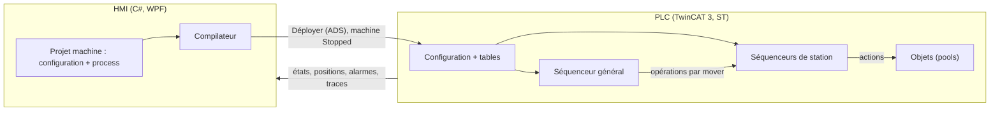
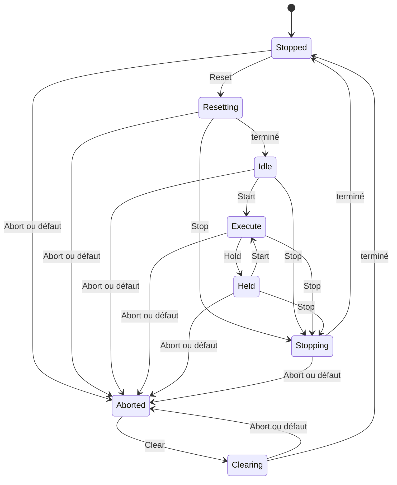

# Spécifications fonctionnelles du logiciel

Ce document décrit ce que fait le logiciel (HMI et PLC ensemble) : niveaux d'abstraction, configuration, process, modèle d'états, modes, routage des movers, alarmes, suivi des pièces, OF et droits. Le « comment » est dans les documents 04 à 08. Les termes suivent `00-glossaire.md`.

## 1. Principe général

- La HMI contient le **projet machine** : la configuration (stations, fonctions, objets, paramètres, positions…) et les process (arbres d'étapes et de blocs).
- Le **compilateur** de la HMI transforme le projet en données PLC : configuration des objets et tables d'instructions.
- Le **déploiement** envoie ces données au PLC, qui les vérifie et les active. Seulement machine à l'état Stopped.
- Le PLC contient un **code générique et figé** : les types d'objets, un interpréteur de tables, les séquenceurs. Une nouvelle machine ne demande aucun code PLC, sauf pour un nouveau type d'objet.
- Le PLC est la vérité en direct (états, positions, movers, pièces présentes). La HMI est la vérité de la configuration et de l'historique.

## 2. Niveaux d'abstraction

| Niveau | Nom | Défini par | Exemple | Exécuté par |
| --- | --- | --- | --- | --- |
| 1 | Objet | Catalogue (types) et configuration de station (instances) | Axe Z, vérin éjecteur | Code PLC du type |
| 2 | Action de base | Catalogue | Move absolu, Aspirer | Code PLC du type |
| 3 | Fonction de module | Catalogue des modules ; copiable en fonction personnalisée | Prendre pièce = aller au-dessus, descendre, aspirer, remonter | Dépliée dans les tables par le compilateur |
| 4 | Opération | Éditeur de process, niveau station | Presser pignon | Séquenceur de station |
| 5 | Process général | Éditeur de process, niveau machine | Charger → Presser → Contrôler → Décharger | Séquenceur général, une instance par mover |

Les fonctions de module n'existent pas dans le PLC : le compilateur les remplace par leurs actions de base, entourées de marqueurs qui permettent au pas à pas et à l'affichage de savoir dans quelle étape on est. Un module existe dans le PLC seulement comme nœud de l'arborescence (override, état agrégé, Abort).

## 3. Configuration de la machine

Elle se fait dans la page Configuration machine du studio.

| Élément | Contenu |
| --- | --- |
| Identité | Nom de la machine, numéro, description |
| Système planaire | Dimensions du plan (tuiles), nombre de movers, nombre d'emplacements par mover (1 à 4), vitesse et accélération par défaut des movers |
| Positions planaires | Positions de travail et de file d'attente de chaque station, positions tampon, position de parcage ; toutes en frame 0 |
| Stations | Liste ordonnée : nom, n°, emplacement sur le plan, override par défaut |
| Fonctions | Nom, rôle, priorité, stations membres, opérations de la fonction (nom et paramètres) |
| Fonction de rebut | Fonction qui reçoit les movers dont une pièce est mauvaise, si elle existe |
| Objets de niveau machine | Système planaire, balise machine, sécurités |
| Données de pièce | Liste nommée des données conservées par pièce (32 au plus), avec type et unité ; Verdict et Identifiant sont réservés |

Règles :
- Une station appartient à **une ou plusieurs fonctions** (8 au plus). Créer une station crée une fonction du même nom dont elle est membre ; on peut ensuite l'ajouter à d'autres fonctions ou la retirer de celle-ci.
- Le **rôle** (entrée, travail, sortie, rebut) appartient à la fonction. Une station a donc les rôles de ses fonctions : une station peut charger et décharger.
- Chaque station membre d'une fonction implémente toutes les opérations de la fonction (même nom, mêmes paramètres), chacune par un de ses process. Un même process de station peut implémenter des opérations de plusieurs fonctions si leurs paramètres sont identiques. Le validateur le vérifie.
- La **priorité** d'une fonction (1 à 9) décide de l'ordre de service des movers en file devant une station partagée. Par défaut, elle suit l'ordre d'apparition de la fonction dans le process général : plus la fonction est tardive dans le cycle, plus elle est prioritaire.
- 16 stations, 16 fonctions et 32 movers au plus.

## 4. Configuration d'une station

Elle se fait dans la page Configuration de station du studio.

### 4.1 Arborescence

Une station contient des objets organisés en arborescence : station ⊃ modules ⊃ objets ⊃ sous-objets. Exemple : Pressage 01 ⊃ Robot XYZC ⊃ (axe X, axe Y, axe Z, axe C, aspiration) ; Pressage 01 ⊃ Presse ⊃ (axe presse, capteur de force).

- On ajoute un objet en le glissant depuis la bibliothèque sur l'arborescence ou sur la vue de dessus.
- Glisser un **type de module** crée le module et ses enfants selon ses rôles d'enfant (robot XYZC : 4 axes et un outil au choix). On peut ensuite remplacer un enfant ou désactiver un rôle optionnel (axe C).
- On peut aussi créer un **module libre** (type « Groupe ») et y glisser des objets existants. Un groupe n'a pas de fonctions de module ; il sert à l'override et à l'organisation.
- 64 objets au plus par station, profondeur 3 au plus sous la station.

### 4.2 Paramètres d'un objet

Chaque type définit ses paramètres dans le catalogue (`03-catalogue-objets.md`). Communs à tous :

| Paramètre | Rôle |
| --- | --- |
| Nom | Nom affiché, unique dans la station |
| Simulation | L'objet n'accède pas au matériel et simule son comportement |
| Désactivé | L'objet est ignoré ; toute action sur lui est refusée (le validateur signale les étapes qui l'utilisent) |
| Timeout par défaut | Par action, surcharge le défaut du catalogue |
| Override | 0 à 100 %, défaut 100 % (seulement pour les objets qui ont des actions de mouvement, et les modules) |
| Raccordement | Références de signal (image E/S) ou élément matériel (axe NC, esclave EtherCAT) |
| Verrouillages | Conditions à respecter pour ses actions (§ 4.5) |

### 4.3 Positions nommées

- Une station a jusqu'à 64 positions nommées : nom, X, Y, Z, C, frame, et une hauteur d'approche optionnelle (utilisée par les fonctions Prendre et Poser).
- Une position est « apprise » ou « non apprise ». Une position non apprise utilisée par un process est une erreur de validation.
- Apprendre copie la position actuelle des axes concernés (mode manuel, droit Apprendre). Saisir une valeur numérique demande un droit plus élevé.
- Un axe n'utilise que sa composante. Une étape « Aller à Dépose nid » sur un robot XYZC déplace chaque axe vers sa composante.

### 4.4 Vitesses

- Chaque axe a une Vmax (paramètre global de l'axe) ; toutes ses vitesses sont en % de la Vmax.
- Vitesses n° 1 « Lente » et n° 2 « Rapide » toujours présentes ; n° 3 à 8 personnalisées (nom libre, par exemple « Approche »).
- Une étape de mouvement choisit une vitesse par son nom ou donne un % direct. Sans choix : Rapide pour un déplacement, Lente pour un jog.
- Une vitesse définie au niveau d'un module (robot) s'applique à ses axes enfants qui n'ont pas de valeur propre.

### 4.5 Verrouillages

- Un verrouillage est attaché à un objet et à une liste de ses actions (ou à toutes ses actions de mouvement) : « l'action ne démarre pas et s'arrête si la condition devient fausse ».
- La condition porte sur des signaux, des positions actuelles d'axes, des états d'objets de la même station.
- Certains modules génèrent leurs verrouillages : le robot cartésien interdit X, Y, C tant que Z est sous la hauteur de sécurité, sauf pour la remontée de Z elle-même.
- Les verrouillages sont actifs dans tous les modes, manuel compris. Un verrouillage violé donne l'alarme « Verrouillage » qui nomme la condition.

### 4.6 Initialisation par défaut

Si l'ingénieur process ne dessine pas de process d'initialisation, le compilateur en génère un :
1. Power on de tous les axes (en parallèle).
2. Init (référencement) des axes, par ordre de référencement croissant (paramètre de l'axe ; même ordre = en parallèle). Exemple robot : Z d'abord, puis X et Y ensemble, puis C.
3. Vérins vers leur position sûre, outils coupés (aspiration, soufflage), pinces dans leur état sûr.
4. Init des objets qui ont une action Init (vision, robot externe).

## 5. Process de station

### 5.1 Types de process

| Type | Quand il tourne | Nombre par station |
| --- | --- | --- |
| Opération | Appelée par le séquenceur général quand un mover est en position de travail | une ou plusieurs : au moins une par opération de chacune de ses fonctions (un process peut en implémenter plusieurs) |
| Cycle de fond | En boucle tant que la station est en Execute | zéro ou un |
| Initialisation | Pendant Resetting | un (dessiné ou généré) |
| Arrêt | Pendant Stopping, après la fin de l'opération en cours | zéro ou un |
| Calibration | Lancée à la main en Maintenance (§ 11.1) | zéro ou plusieurs |
| Vidage | Pendant Clearing, pour remettre la station en état propre (dégager le robot, vider la pince) | zéro ou un |
| Sous-process | Seulement par « Appeler sous-process » | zéro ou plusieurs |

16 process au plus par station, 512 instructions compilées au plus par station.

**Trois niveaux de travail dans une station** (pour gagner du temps de cycle) :

| Niveau | Quand | Exemple (Pressage 01) |
| --- | --- | --- |
| Cycle de fond | En boucle tant que la station est en Execute, sans mover | Chercher une pièce dans l'Asyril et ranger sa position dans une variable |
| Préparation | Dès que la position de travail est réservée à un mover, avant son arrivée | Prendre la pièce à la position trouvée par le fond |
| Avec le mover | Quand le mover est en position de travail | Déposer la pièce dans le nid, presser, contrôler |

La préparation n'est pas un type de process : c'est le début d'une opération, séparé de la suite par l'étape **Mover requis**. Sans cette étape, toute l'opération attend le mover (comportement inchangé).

### 5.2 Étapes disponibles (palette niveau station)

| Groupe de palette | Étapes |
| --- | --- |
| Un groupe par objet ou module de premier niveau | Ses actions de base, celles de ses enfants, et ses fonctions de module (et fonctions personnalisées) |
| Logique | Mover requis, Réinitialiser les variables du mover, Attendre condition, Si / Sinon, Répéter N fois, En parallèle, Appeler sous-process, Définir variable, Signaler défaut, Fin |

- Une étape a des paramètres (ceux de l'action), des liaisons de résultats (chaque résultat, appelé sortie de l'étape, peut être rangé dans une variable de process, une variable de station, une donnée de pièce, le verdict ou l'identifiant ; l'éditeur crée la variable à la demande), un timeout (défaut du catalogue) et une politique d'échec.
- Mover requis : séparateur d'une opération. Les étapes qui le précèdent forment la préparation : elles ne peuvent lire ni écrire les données de la pièce (Verdict, Identifiant, « pièce retirée », données de pièce), ni désigner l'emplacement ; elles peuvent utiliser les variables, les variables du mover réservé, les positions, les paramètres d'opération et tous les objets de la station. Une seule étape Mover requis par opération, au premier niveau de la séquence (ni dans un bloc, ni dans un sous-process), et seulement dans une opération.
- À l'arrêt (Stop), la préparation déjà faite est perdue : le process d'Arrêt doit remettre la station en état (par exemple reposer la pièce prise). En pause (Pause), la préparation va jusqu'à l'étape Mover requis et attend.
- En parallèle : 2 à 4 branches ; les branches s'attendent à la fin du bloc. Deux branches ne peuvent pas utiliser le même objet (erreur de validation). Blocs imbriqués autorisés jusqu'à 3 niveaux, dans la limite de 8 contextes d'exécution par station.
- Si / Sinon : une condition, deux branches (Alors, Sinon) ; la branche Sinon peut être vide.
- Répéter N fois : N de 1 à 1000, ou tant qu'une condition est vraie, avec un maximum.
- Fin : termine le process. Pour une opération : fin de l'opération. Pour le cycle de fond : reprend au début.

### 5.3 Variables de process et de station, paramètres d'opération, données de pièce

- Variables de station : nom, type (nombre, booléen, position), valeur initiale. Elles sont partagées par tous les process de la station (c'est ainsi que le cycle de fond prépare une pièce pour l'opération).
- Variables de process : mêmes champs, mais visibles seulement dans leur process (portée par défaut d'une variable créée depuis une sortie d'étape). Le compilateur les place après les variables de station, une place chacune. Au total, variables de station, de process et cachées (compteurs de boucle) ne dépassent pas 64 par station. Rendre une variable de process « partagée » en fait une variable de station de même identifiant.
- Une variable de process garde sa valeur d'un passage à l'autre ; la validation avertit (V115) quand elle est lue sur un chemin où elle n'est pas écrite avant, et refuse (V020) son usage dans un autre process.
- **Variables de mover** : jusqu'à 16, déclarées dans la configuration machine (Studio machine › Variables de mover) : nom, type (nombre, booléen, position), unité, valeur initiale, **règle de remise à zéro**. Chaque mover a son propre jeu de valeurs ; elles appartiennent au mover (pas à la pièce), restent quand il est vide et changent de pièce, et persistent d'un Stop à un Start et d'une coupure. Règles de remise à zéro, au choix pour chaque variable :
  - **Jamais** : la valeur survit au Stop, au Reset, à un redéploiement (reconnue par l'identifiant de la variable) et à un redémarrage du PLC (exemple : décalage de calibration propre au mover).
  - **Au déploiement** : remise à la valeur initiale à chaque activation d'un déploiement.
  - **Quand le mover est vide** : remise à la valeur initiale dès que la dernière pièce du mover le quitte (sortie, rebut, retrait confirmé ou pièce marquée « retirée »).
  - Un simple Reset ou Stop de la machine ne remet jamais une variable à zéro. L'étape « Réinitialiser les variables du mover » les remet à leur valeur initiale (une variable choisie, ou toutes celles dont la règle n'est pas « jamais »).
  - **Accès** : une opération lit et écrit les variables du mover qui lui est attribué (dès la réservation de la position de travail, donc aussi dans la préparation) ; le process général lit et écrit celles du mover dont il exécute le fil ; une calibration lancée avec un mover y a accès. Le cycle de fond, l'initialisation, l'arrêt et le vidage n'ont pas de mover : leur usage y est refusé (V026). Elles s'emploient comme valeur, dans une condition, comme cible d'une sortie d'étape et dans « Définir variable », comme une variable de station.
  - **Modification à la main** : en Maintenance, depuis le tiroir du mover, droit `mover.var.edit` (niveau Régleur). Journalisée.
- Une opération peut avoir jusqu'à 8 paramètres (nom, type, unité), donnés par l'étape du process général qui l'appelle (par exemple la recette de presse à utiliser).
- Variables système en lecture : mover présent, emplacement courant, numéro d'OF, compteur de cycles, temps de la dernière opération.
- Une opération lit et écrit les données de pièce de l'emplacement courant (Verdict, Identifiant, et les données définies dans la configuration machine). Elle peut marquer la pièce « retirée » (rebut interne à la station : la pièce quitte la machine à cette station).

### 5.4 Politique d'échec d'une étape

| Politique | Effet | Défaut pour |
| --- | --- | --- |
| Arrêter la station | Alarme de défaut, la station passe Aborted | Actions de mouvement et d'outil |
| Refaire N fois | Relance l'action jusqu'à N fois (1 à 5), puis politique suivante « Arrêter la station » | Chercher pièce (vision), Lire code |
| Pièce mauvaise | Verdict mauvais, l'opération se termine normalement | Contrôles et mesures (choix explicite) |
| Aller à l'étape | Saut vers une étape nommée du même process | — |
| Ignorer | Continue (avertissement enregistré) | — |

### 5.5 Sorties des blocs composés

Un **bloc composé** (fonction personnalisée, sous-process, opération) peut rendre des valeurs à celui qui l'appelle. Les blocs de structure (Si / Sinon, En parallèle, Répéter) n'ont pas de sortie propre ; les fonctions de module du catalogue n'en ont pas non plus dans cette version.

- **Déclaration** : jusqu'à 8 sorties par bloc : nom (facultatif : sans nom, la sortie s'appelle « Sortie 1 », « Sortie 2 »…, selon son rang), type (nombre, entier, booléen, jugement, position), unité. Pour une fonction personnalisée et un sous-process : dans le bloc lui-même. Pour une opération : dans la signature de l'opération, avec ses paramètres (Studio machine › Fonctions), donc commune à toutes les stations qui l'implémentent ; une opération rend au plus une sortie de type position, et aucune sortie texte.
- **Définition de la valeur** : par l'étape **Définir la sortie** (sortie, valeur au sélecteur habituel : constante, variable, donnée de pièce, variable de mover, paramètre), ou en liant le résultat d'une action à la sortie (la cible « Sortie » apparaît dans le choix des liaisons, à côté des variables). Une sortie est définie quand l'exécution passe par l'une de ces étapes ; une sortie qui n'est pas définie sur tous les chemins avertit (V121) et garde alors la valeur du passage précédent.
- **Utilisation à l'appel** : la carte de l'appel (fonction personnalisée, Appeler sous-process, opération du process général) a une section **Sorties** : une ligne par sortie, avec la variable qui la reçoit, choisie comme pour les sorties d'une action (« Ne pas ranger », variables compatibles, « Nouvelle variable… »). Une sortie non rangée est ignorée. Cibles possibles : variable de process ou de station (variable de mover, donnée de pièce ou verdict, selon le niveau) ; au niveau machine : variable de mover, donnée de pièce, verdict. Un type incompatible est refusé (V014).
- **Fonction personnalisée** : dépliée à la compilation ; la sortie est remplacée par la variable choisie à l'appel, sans coût d'exécution et sans limite d'appels.
- **Sous-process** : la valeur passe par un emplacement interne de la station (réservé par le compilateur, que l'ingénieur ne manipule pas), copié vers la variable choisie juste après le retour. Comme cet emplacement est partagé, **un sous-process à sorties ne peut pas être appelé depuis deux contextes qui peuvent tourner en même temps** : deux branches d'un même bloc En parallèle, ou l'opération et le cycle de fond d'une même station (V120). Les emplacements comptent dans la limite de 64 variables.
- **Opération** : les sorties sont rendues par la station au séquenceur général quand l'opération se termine bien (`Done`) ; elles sont copiées dans les cibles choisies par l'étape d'opération du process général. Si l'opération échoue ou est avortée, rien n'est copié.
- **Exemple** : le bloc « Rechercher pièce Asyril » (fonction personnalisée de la station Pressage 01) cherche la pièce (Refaire 3 fois, avec vibration de l'alimenteur) puis l'obtient. Il déclare deux sorties, « Position pièce » (position) et « Nombre » (entier), définies par les liaisons des résultats de « Obtenir pièce » et « Chercher pièce ». L'appel les range dans les variables de process `PosPignon` et `NbPièces`.
- Limites : le PLC garde 8 résultats par action, avec une seule position et un seul texte (`04`) ; l'objet à sorties variables (Keyence XG) reste à étudier plus tard.

## 6. Process général

### 6.1 Étapes disponibles (palette niveau machine)

| Groupe de palette | Étapes |
| --- | --- |
| Un groupe par fonction | Ses opérations (une étape = aller dans une station de la fonction et y exécuter l'opération) |
| Logique | Si / Sinon, Répéter (retouche, avec maximum), Attendre condition, Appeler sous-process, Définir donnée de pièce, Signaler défaut, Fin |

« En parallèle » n'existe pas au niveau machine : un mover ne peut être qu'à un endroit à la fois. Le parallélisme de la machine vient des movers qui avancent en même temps, chacun dans son process.

### 6.2 Exécution

- Chaque mover exécute sa propre instance du process général, avec son pointeur d'étape. Au démarrage, tous les movers commencent à l'étape 1.
- Une étape d'opération : le séquenceur général choisit une station disponible de la fonction (§ 10), y envoie le mover, lance l'opération avec ses paramètres, attend la fin, range les résultats, libère la station.
- Une opération d'une fonction de rôle Entrée crée les pièces : à sa fin, une pièce pour chaque emplacement visé par l'étape (identifiant lié par l'opération, par exemple lu par le lecteur de code, sinon généré). Une opération d'une fonction de rôle Sortie ou Rebut clôt les pièces déchargées. C'est le rôle de la fonction appelée qui compte, pas la station.
- Si / Sinon porte sur les données de pièce et les variables système.
- Fin : les pièces encore présentes sont signalées (le validateur avertit si un chemin arrive à Fin sans passer par une sortie), puis le mover recommence à l'étape 1.
- Une pièce mauvaise (verdict mauvais) est routée automatiquement vers la fonction de rebut dès sa prochaine étape d'opération, sauf si le process général traite lui-même le verdict mauvais avec un Si / Sinon avant. Le validateur avertit si aucun chemin ne traite le verdict mauvais et qu'aucune fonction de rebut n'existe.

## 7. Validation et déploiement

### 7.1 Validation

La validation tourne en continu dans le studio (barre de validation en bas des pages) et obligatoirement avant un déploiement. Les règles et leurs codes sont listés dans `07-hmi-architecture.md`. Résumé :
- **Erreurs** (bloquent le déploiement) : position non apprise utilisée, objet ou signal non raccordé utilisé, deux objets sur le même signal de sortie ou le même axe, objet utilisé dans deux branches parallèles, paramètre hors limites, opération manquante dans une station d'une fonction, dépassement des limites (instructions, contextes, objets), boucle Répéter sans maximum, condition incomplète.
- **Avertissements** : objet en simulation, recette de presse non vérifiée, pièce non traitée en verdict mauvais, chemin sans sortie, seuils incohérents, timeout très court pour la course demandée.

### 7.2 Déploiement

1. Machine à l'état Stopped (sinon le bouton Déployer est désactivé avec la raison).
2. Validation sans erreur.
3. Écran de déploiement : résumé des différences avec ce qui tourne dans le PLC (stations, objets, process modifiés), confirmation.
4. Envoi de la configuration puis des tables ; le PLC vérifie (structure, bornes, types, références, somme de contrôle) puis active le tout en une fois.
5. Résultat : succès (le projet déployé est enregistré comme « version déployée » avec date et auteur) ou refus détaillé (rien n'est changé dans le PLC).

Après un déploiement, les positions apprises dans le PLC et dans la HMI sont identiques. Apprendre une position en mode manuel l'écrit dans le PLC et dans le projet en même temps.

## 8. Modèle d'états (PackML réduit)

Chaque séquenceur (général et de station) applique le même modèle.

| État | Ce qui se passe | Fin (transition automatique) |
| --- | --- | --- |
| Stopped | Arrêt. Tables modifiables. Mode modifiable. Mode manuel possible (en Maintenance) | — |
| Resetting | Station : process d'initialisation. Machine : Reset des stations, activation du système planaire | Fin de l'initialisation → Idle |
| Idle | Prêt à démarrer, rien ne bouge | — |
| Execute | Production. Station : cycle de fond, opérations demandées. Machine : routage des movers | — |
| Held | Pause : l'opération en cours se termine, puis plus rien ne démarre. Les movers en route terminent leur déplacement | Start → Execute |
| Stopping | Arrêt ordonné : l'opération en cours se termine, puis process d'arrêt | Fin → Stopped |
| Aborted | Arrêt immédiat : actions stoppées, objets en état sûr | — |
| Clearing | Acquittement : alarmes acquittées, process de vidage | Fin → Stopped |

| Commande | Libellé HMI | Acceptée depuis |
| --- | --- | --- |
| Reset | Réarmer | Stopped |
| Start | Démarrer | Idle (→ Execute), Held (→ Execute) |
| Hold | Pause | Execute |
| Stop | Arrêter | Resetting, Idle, Execute, Held |
| Abort | Abort | Tous les états sauf Aborted |
| Clear | Acquitter | Aborted |

Décision : Abort est accepté aussi depuis Stopped et Clearing (un arrêt d'urgence peut arriver à tout moment), ce qui étend le schéma initial.

**Modes** : Production et Maintenance, au niveau machine, changés seulement à l'état Stopped. Toutes les stations suivent le mode de la machine, sauf une station mise hors production pour une intervention, qui peut passer seule en Maintenance (`12-forcages-et-etats-declares.md` § 3).

**Fin des pièces en cours** (`Drain`) : mode d'arrêt de la machine, à côté d'Arrêter et de Pause. Commande « Finir les pièces », acceptée en Execute et Held (droit `machine.run`).
- Plus aucune pièce n'est chargée : les opérations des fonctions de rôle Entrée ne sont plus lancées (comme à la fin d'un OF ou à l'« arrêt du chargement » qualité) ; une opération d'entrée déjà lancée se termine normalement, sa pièce est donc finie aussi.
- Toutes les autres stations continuent de produire : chaque pièce engagée parcourt son process jusqu'à sa sortie (bonne) ou au rebut (mauvaise). Les movers vides attendent en tampon, motif « Fin des pièces ».
- Quand plus aucune pièce n'est en cours, la machine exécute **Arrêter** automatiquement (cause « Machine vidée »), la balise passe en bleu clignotant et la HMI affiche « Machine vidée : plus aucune pièce en cours ». À l'arrêt, aucun mover ne porte de pièce.
- « Annuler la fin » (même droit) lève le mode tant que la machine n'est pas arrêtée : le chargement reprend. Arrêter, Abort et un défaut machine lèvent aussi le mode (la machine n'est alors pas forcément vide).
- Un mover « à vider » (pièces à retirer par l'opérateur) ou une fonction sans station disponible empêche la fin : la HMI affiche ce qui retient la machine.
- L'OF n'est pas modifié : il reste En cours avec ses compteurs, et reprend au prochain Démarrer. Le mode est volontairement distinct de l'état Held (qui fige les pièces en cours de process) et de Stopping (qui laisse les pièces sur les movers).

**Commandes de station** : en Production, les commandes viennent de la machine, sauf pour la réintégration d'une station Aborted pendant que la machine produit (Acquitter, Réarmer, Démarrer cette station seule). En Maintenance, chaque station se commande seule.

**Balises** (même table pour la balise machine et les balises de station, reproduite à l'écran) :

| État | Balise |
| --- | --- |
| Execute | Vert fixe |
| Idle | Vert clignotant |
| Held | Orange fixe |
| Resetting, Stopping, Clearing | Orange clignotant |
| Stopped | Orange fixe |
| Aborted | Rouge clignotant et buzzer (buzzer jusqu'à acquittement de l'alarme) |
| Une station Aborted pendant que la machine produit | Balise machine : vert fixe et rouge clignotant |
| Mode Maintenance, ou état déclaré maintenance, essais, nettoyage | Bleu fixe en plus |
| Opérateur attendu (mover à vider, fin d'OF, magasin vide, réaction qualité, attente amont ou aval déclarée, fonction sans station en production) | Bleu clignotant en plus |

## 9. Fonctions, stations défaillantes et Aborted

- Une station qui passe Aborted pendant que la machine produit devient indisponible pour le routage **de toutes ses fonctions** ; les autres stations de chacune de ses fonctions continuent. La balise machine le signale.
- Le mover engagé dans la station Aborted y reste jusqu'à la fin du Clearing de la station (le vidage peut dégager le robot). Ses pièces reçoivent le verdict mauvais, puis il part vers la fonction de rebut.
- Réintégration : Acquitter (Clearing), Réarmer (Resetting), Démarrer ; la station redevient disponible.
- La machine passe Aborted si : une fonction utilisée par le process général n'a plus aucune station disponible à cause de défauts (des stations retirées volontairement — hors production ou en arrêt qualité — ne déclenchent pas d'Aborted : les movers attendent) ; un défaut de niveau machine survient (arrêt d'urgence, porte, système planaire) ; un mover est en défaut.
- Une fonction dont toutes les stations sont en Held ou en Stopping ne fait pas passer la machine en Aborted : les movers attendent en tampon.

## 10. Routage des movers

- Une étape d'opération vise une fonction. Le séquenceur général choisit, parmi les stations membres de la fonction qui sont en Execute : celle qui a le moins de movers (en station + en file + en route vers elle, **toutes fonctions confondues**), puis celle qui a reçu un mover le moins récemment.
- Une station partagée par plusieurs fonctions a une seule position de travail et une seule file. La file est servie par priorité de la fonction visée par chaque mover, puis par ordre d'arrivée.
- Le mover va en file d'attente de la station si elle est occupée et qu'une place de file est libre, sinon en position tampon, sinon il reste où il est et l'étape est réessayée à chaque cycle.
- Arrivé en position de travail, le mover est confié au séquenceur de station qui exécute l'opération. À la fin, le mover est libéré et passe à l'étape suivante.
- Les trajets et l'évitement des collisions sont gérés par le système planaire. Le séquenceur général ne donne que les destinations.
- Une station en arrêt qualité et un mover hors service ne sont plus routés ; un chargement verrouillé par la qualité bloque les opérations des fonctions Entrée comme la fin d'OF (`10-surveillance-des-rebuts.md`).
- Mover « à vider » : si un mover doit aller au rebut et qu'aucune station de rebut n'est disponible pendant plus de 60 s (paramètre), ou si aucune fonction de rebut n'existe, il va en position de parcage et passe « à vider ». L'opérateur retire les pièces et le confirme dans la page Pièces ; les pièces sont clôturées « retirées » et le mover repart à l'étape 1.
- Le validateur avertit si le nombre de movers dépasse la capacité (positions de travail + files + tampons − 1), car un blocage est alors possible.

## 11. Mode manuel

- Disponible en mode Maintenance, station à l'état Stopped (machine Stopped ou station hors production).
- Toute action de base de tout objet, et toute fonction de module, peut être lancée seule, avec ses paramètres. La page est générée à partir du catalogue et de la configuration, sans code par station.
- Les axes ont un jog : mouvement tant que le bouton est maintenu, arrêt dès qu'on relâche ou si la HMI ne répond plus (garde de 300 ms).
- L'override manuel de l'axe s'applique en plus de l'override effectif.
- Les verrouillages restent actifs ; une action refusée affiche la condition qui bloque.
- Apprendre une position se fait ici.
- Chaque action manuelle est journalisée (utilisateur, objet, action, paramètres).

### 11.1 Calibrations

- **Programmation** : une calibration est un process de type Calibration, dessiné dans l'éditeur comme les autres. Une station en a zéro ou plusieurs (« Calibrer la vision Asyril », « Calibrer l'origine du robot ») ; elles comptent dans la limite de 16 process. Au niveau machine, une **calibration machine** enchaîne des calibrations de station et des demandes à l'opérateur (par exemple le robot et la caméra l'un après l'autre).
- **Étapes propres** : « Demander à l'opérateur » (message avec confirmation, ou saisie d'une valeur rangée dans une variable), « Enregistrer la position » (écrit la position actuelle d'un objet dans une position nommée, comme l'apprentissage), « Enregistrer la valeur » (Définir variable sur une variable persistante) et, au niveau machine seulement, « Calibrer la station » (station et calibration, avec politique d'échec). Les étapes ordinaires restent permises (actions, conditions, boucles) ; une calibration machine peut aussi envoyer un mover choisi au lancement vers une station (étape Route).
- **Variables persistantes** : une variable de station peut être déclarée persistante. Elle garde sa valeur d'un Stop à un Start, d'un redéploiement (reconnue par son identifiant) et d'une coupure. Seule une calibration peut l'écrire (règle V023) ; tous les process peuvent la lire.
- **Résultats mis en attente** : les positions et variables persistantes écrites par une calibration ne sont validées qu'à sa fin réussie. Un échec ou un Abort les abandonne : les anciennes valeurs restent.
- **Lancement** : en Maintenance seulement, comme le lancement d'une table (§ 11, `05` § 8) : la station (ou toutes celles de la calibration machine) en Idle, avec ou sans mover. Page Manuel, onglet « Calibrations » de la station et de la machine : liste, bouton Lancer, état (jamais faite, valide, périmée, en cours, échec), date, auteur. Droit `calibration.run` (niveau 1). Le suivi se fait carte par carte comme dans la page Station. L'opérateur répond aux demandes dans un tiroir de la page.
- **Validité** : chaque calibration a une durée de validité facultative (en jours). Une calibration jamais faite ou périmée lève un **avertissement** (alarme 912 « Calibration à refaire : <nom> ») sans bloquer le démarrage. Décidé le 2026-10-17.
- **Journal** : chaque exécution est journalisée (calibration, utilisateur, résultat, valeurs avant et après).

## 12. Mode pas à pas

- Disponible en mode Maintenance, sur une station, pour une opération, l'initialisation, le vidage ou le cycle de fond.
- On lance l'opération depuis la page de la station (avec un mover présent ou sans mover, au choix) puis on avance avec trois boutons, comme dans un débogueur :
  - **Opération** : exécute l'opération entière puis s'arrête.
  - **Étape** : exécute l'étape suivante (une carte de l'éditeur : action, fonction de module, bloc Si / Sinon évalué) puis s'arrête.
  - **Action** : exécute l'action de base suivante, y compris à l'intérieur d'une fonction de module, puis s'arrête.
- Dans un bloc En parallèle, un pas fait avancer toutes les branches actives d'une étape (ou d'une action) chacune.
- On voit l'étape en cours et la suivante, dans l'éditeur (carte en surbrillance) et dans un panneau dédié avec les paramètres résolus (position réelle visée, vitesse effective).
- Pas de retour en arrière, pas de saut d'étape. Abort abandonne. Quitter le pas à pas en cours d'opération laisse l'opération continuer normalement.

## 13. Overrides et timeouts

- L'override existe aux niveaux machine, station, module et axe (et objet à mouvement : vérin, robot externe, mover). Chaque niveau vaut de 0 à 100 %, défaut 100 %.
- L'override effectif d'un objet est le produit des overrides de tous les niveaux qui le contiennent. Exemple : machine 80 % × station 50 % × axe 100 % = 40 %.
- En mode manuel, l'override manuel de l'axe s'applique en plus.
- L'override ne ralentit que les actions de mouvement. Pour un vérin, il n'agit pas sur la vitesse physique mais rallonge son timeout (un vérin n'a pas de vitesse pilotée) ; à 0 % un vérin ne démarre pas de nouveau mouvement.
- Timeout effectif d'une action de mouvement = timeout nominal ÷ override effectif, recalculé en continu : un changement d'override pendant le mouvement est pris en compte. À 0 %, l'objet est à l'arrêt et son timeout est suspendu ; l'interface affiche « Arrêté par override », qui n'est pas un défaut.
- Les autres actions (temporisation, vide, soufflage, mesure) gardent leur timeout nominal.
- L'override machine se règle dans la barre du haut de toutes les pages ; les autres dans les panneaux de leur niveau. Chaque changement est journalisé.

## 14. Alarmes

| Gravité | Effet | Acquittement |
| --- | --- | --- |
| Information | Aucun, enregistrée dans l'historique | Aucun |
| Avertissement | Aucun arrêt, affichée en orange | Individuel, par l'opérateur |
| Défaut de station | Station → Aborted | Commande Acquitter de la station (ou de la machine) |
| Défaut machine | Machine → Aborted | Commande Acquitter de la machine |
| Qualité | Réaction de la surveillance des rebuts : arrêt qualité d'une station, mover hors service, arrêt du chargement ou arrêt de la machine (jamais Aborted) | Libération qualité (`10-surveillance-des-rebuts.md` § 6) |

- Une alarme porte : objet (ou station, ou machine), code, sous-code, gravité, horodatage d'apparition et de disparition, utilisateur qui acquitte, contexte (étape en cours, mover, pièce).
- Le texte vient du catalogue (code) et des fichiers XML de sous-alarmes existants (sous-code, par exemple les codes d'erreur NC ou Asyril).
- Une alarme active reste affichée tant que sa cause est présente ou qu'elle n'est pas acquittée.
- Chaque alarme mène, d'un toucher, à l'objet en cause (page Station, objet sélectionné, étape en cours surlignée dans l'éditeur).

## 15. Suivi des pièces et traçabilité

- Page Pièces : movers et pièces présents (où, quel état, quelle étape), recherche d'une pièce par identifiant (présente ou historique), historique d'une pièce (toutes ses opérations, résultats, verdicts, alarmes associées).
- Les traces sont émises par le PLC à la fin de chaque opération, lues par la HMI et enregistrées en base locale. Le PLC garde un tampon de 256 traces : si la HMI est arrêtée, elles sont récupérées au redémarrage.
- La courbe de force de la presse est conservée avec la trace de l'opération qui l'a produite.

## 16. Ordres de fabrication

| Champ | Contenu |
| --- | --- |
| Numéro | Unique, saisi ou reçu |
| Référence produit | Texte |
| Quantité demandée | Nombre de pièces bonnes à produire |
| Paramètres | Valeurs passées aux opérations (par exemple recette de presse, recette de vision), facultatif |
| Compteurs | Bonnes, mauvaises, en cours |
| État | Créé, En cours, Suspendu, Terminé, Annulé |
| Dates | Création, début, fin |

- Un seul OF en cours à la fois. Le lancer exige la machine en Stopped ou Idle.
- Les pièces créées sont rattachées à l'OF en cours ; les compteurs sont mis à jour à la clôture des pièces.
- Quand le nombre de pièces bonnes plus les pièces en cours atteint la quantité, l'entrée ne charge plus de nouvelles pièces. Quand la dernière pièce est sortie, la machine exécute Arrêter automatiquement, la balise passe en bleu clignotant et la HMI affiche « OF terminé ».
- Source des OF : interface `IOrderSource` ; implémentation locale (saisie dans la HMI, base locale), et implémentation usine (`PlantOrderSource`, OF reçus en MQTT, désactivée par défaut, `11-interface-usine.md` § 4.5).

## 17. Utilisateurs et droits

- Niveaux définissables : numéro (0 à 9) et nom. Par défaut : 0 Opérateur, 1 Régleur, 2 Ingénieur process, 3 Administrateur.
- Sans connexion, la HMI est au niveau 0. Connexion par identifiant et mot de passe (ou code PIN numérique, au choix de l'utilisateur, sur pavé numérique). Retour au niveau 0 après 10 minutes sans toucher (réglable).
- Au premier démarrage : un compte « admin » de niveau 3 dont le mot de passe doit être changé.
- L'administrateur règle le niveau minimal de chaque droit :

| Droit | Code | Niveau par défaut |
| --- | --- | --- |
| Démarrer, mettre en pause, arrêter la machine | `machine.run` | 0 |
| Réarmer | `machine.reset` | 0 |
| Acquitter (Clear) | `machine.clear` | 0 |
| Abort | `machine.abort` | 0, non modifiable |
| Changer de mode | `machine.mode` | 1 |
| Réintégrer une station | `station.reintegrate` | 0 |
| Commander une station seule (Maintenance) | `station.command` | 1 |
| Override machine | `override.machine` | 1 |
| Override station, module, axe | `override.local` | 1 |
| Acquitter un avertissement | `alarm.ack` | 0 |
| Mode manuel : actions | `manual.execute` | 1 |
| Mode manuel : jog | `manual.jog` | 1 |
| Modifier une variable de mover à la main | `mover.var.edit` | 1 |
| Mode pas à pas | `step.use` | 1 |
| Apprendre une position | `position.teach` | 1 |
| Saisir une position à la main | `position.edit` | 2 |
| Passer un objet en simulation | `object.simulate` | 2 |
| Modifier la configuration machine et station | `config.edit` | 2 |
| Modifier les process | `process.edit` | 2 |
| Déployer | `project.deploy` | 2 |
| Importer, exporter, restaurer un projet | `project.manage` | 2 |
| Créer, modifier, annuler un OF | `order.manage` | 1 |
| Lancer, suspendre un OF | `order.run` | 0 |
| Confirmer le retrait d'une pièce | `part.remove` | 0 |
| Libérer après une réaction qualité | `quality.release` | 1 |
| Remettre à zéro les compteurs qualité | `quality.reset` | 2 |
| Régler les seuils qualité | `quality.config` | 2 |
| Gérer les utilisateurs | `user.manage` | 3 |
| Régler les droits et les niveaux | `permission.manage` | 3 |
| Réglages système (connexion PLC, simulateur, interface usine) | `system.settings` | 3 |
| Remettre à zéro les compteurs de production et de temps | `plant.reset` | 2 |
| Déclarer un état de la machine, qualifier un arrêt | `force.declare` | 0 |
| Déclarer un état qui bloque le démarrage | `force.declareBlocking` | 1 |
| Mettre une station hors production, la remettre | `force.station` | 1 |
| Mettre un mover hors service, le remettre | `force.mover` | 1 |
| Forçages d'essai en simulation | `force.test` | 2 |

- Un élément d'interface protégé reste visible mais grisé, avec un cadenas et le niveau requis ; le toucher propose de se connecter.
- Toute action protégée est journalisée (utilisateur, date, action, valeurs avant et après).

## 18. Statistiques

TODO, à définir. La page existe, vide, avec le texte « À définir ». Les traces et les compteurs d'OF fourniront les données.

## 19. Décisions prises et points restant ouverts

Décisions prises dans ce document (elles complètent les échanges précédents) :
- Une station appartient à une ou plusieurs fonctions ; le rôle et la priorité sont portés par la fonction ; le process général ne référence que des fonctions.
- Les fonctions de module sont dépliées à la compilation ; le PLC n'a pas de code par module.
- Abort accepté depuis tous les états sauf Aborted.
- Hold et Stop laissent finir l'opération en cours.
- Le mover engagé dans une station Aborted attend la fin de son Clearing, puis part au rebut.
- Pas à pas à trois granularités : opération, étape, action.
- Un vérin subit l'override seulement sur son timeout et son démarrage (0 % = pas de nouveau mouvement).
- Interface usine : état en direct en OPC UA (serveur TwinCAT, vocabulaire PackTags), événements en MQTT avec outbox persistante, lecture seule sauf OF entrants optionnels (`11-interface-usine.md`). Première version : contrats, modèle des messages, canal Journal de messages et page Communications seulement.
- Forçages sans jamais forcer le séquenceur ni une sécurité : états déclarés (dont certains bloquent le démarrage), station hors production pendant que le reste produit, mover hors service, forçages d'essai réservés au simulateur (`12-forcages-et-etats-declares.md`).
- Surveillance des rebuts dans le PLC, fenêtres en nombre de résultats, réactions graduées sans jamais passer en Aborted (`10-surveillance-des-rebuts.md`).

Points ouverts (sans effet sur le premier aperçu) : protocole des appareils encore inconnus (Keyence en réseau ou en signaux, visseuse, marquage, robot externe, pince électrique), type de presse, transformation entre frames (vision → machine), contenu des statistiques.
