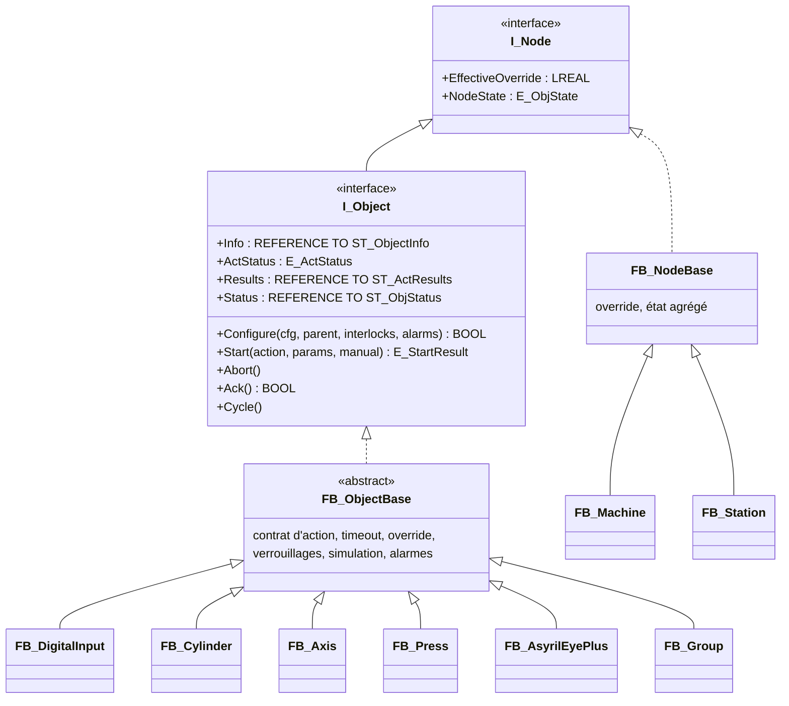
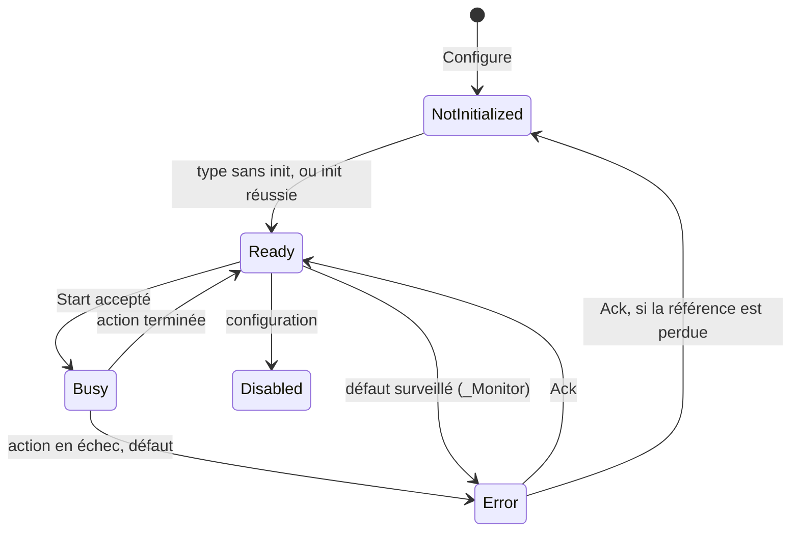

# Architecture PLC des objets élémentaires

Ce document définit l'architecture que doit avoir chaque objet élémentaire dans le PLC TwinCAT 3 pour être utilisable par les tables, le mode manuel, les overrides et la HMI sans code spécifique à une machine. Les algorithmes des séquenceurs sont dans `05-plc-sequenceurs.md`, les structures échangées avec la HMI dans `06-tables-et-interface-hmi-plc.md`.

## 1. Principes

1. **Un FB par type d'objet**, dérivé d'un FB de base abstrait qui porte tout ce qui est commun : identité, état, contrat d'action, timeout recalculé par l'override, verrouillages, simulation, alarmes, publication de l'état.
2. **Aucune connaissance de la machine** dans le code : un objet reçoit sa configuration (paramètres, signaux, matériel) par données, au déploiement.
3. **Pas d'allocation dynamique** : les instances vivent dans des pools statiques, un par type, dimensionnés par des constantes du projet PLC. La configuration attribue un élément de pool à chaque objet déclaré.
4. **Accès au matériel par indirection** : les objets lisent et écrivent des signaux par référence dans une image E/S générique ; les axes et esclaves EtherCAT sont pris dans des pools matériels reliés une fois pour toutes dans TwinCAT.
5. **Un seul point d'entrée pour agir** : `Start(action, paramètres)`, puis le statut. Le séquenceur, le mode manuel et les tests utilisent la même méthode.
6. **Le catalogue est la source** des numéros de type, d'action, de paramètre et d'erreur : une liste de variables globales constantes (`GVL_Catalog`) est générée depuis le catalogue de la HMI ; elle n'est jamais éditée à la main.
7. **Conventions reprises de la bibliothèque SWSPL** : un FB enfant n'appelle jamais `SUPER^()` depuis une méthode (seulement depuis son corps) pour éviter les cycles d'appel virtuel ; chaque objet expose son `ST_ObjectInfo` par une propriété `REFERENCE TO` ; l'état est un énumérateur unique géré par la base.
8. **Une bibliothèque autonome** `StdMachineLib`, sans dépendance à SWSPL, pour ne pas lier le standard à l'existant ; une migration de SWSPL vers ce modèle pourra se faire plus tard.

## 2. Organisation du projet TwinCAT

```
StdMachineLib (bibliothèque PLC)
├─ 00_Constants      GVL_Const (dimensions), GVL_Catalog (généré : types, actions, erreurs)
├─ 01_Types          ST_* et E_* partagés (configuration, paramètres, résultats, statuts, tables)
├─ 02_Interfaces     I_Node, I_Object, I_InterlockProvider, I_AlarmSink
├─ 03_Base           FB_ObjectBase, FB_NodeBase, FB_AlarmManager, FB_TraceBuffer, fonctions E/S
├─ 04_Objects        FB_DigitalInput … FB_Counter, FB_Group (un FB par type du catalogue)
├─ 05_Sequencers     FB_PackML, FB_Interpreter, FB_StationSequencer, FB_GeneralSequencer,
│                    FB_MoverManager, FB_ManualChannel, FB_ObjectFactory, FB_Loader
├─ 06_HmiInterface   GVL_Hmi (symboles ADS), handshakes
└─ 07_Tests          tests TcUnit

StdMachinePlc (projet PLC de la machine)
├─ GVL_IO            image E/S générique, reliée aux bornes (AT %I*, %Q*)
├─ GVL_Hw            pools matériels : AXIS_REF, groupe planaire, PDO Asyril…
├─ GVL_Pools         pools d'objets (tailles propres à la machine)
└─ MAIN              appelle FB_Machine (séquenceur général + stations)
```

**Tâches** : une tâche PLC unique de 4 ms pour les objets et les séquenceurs (ordre d'exécution déterministe), la tâche NC SAF à 2 ms pour les axes, les tâches Planar selon Beckhoff. Les durées sont calculées avec le temps de cycle réel de la tâche (`_TaskInfo[GETCURTASKINDEXEX()].CycleTime`, en unités de 100 ns).

## 3. Vue d'ensemble



- `I_Node` est tout ce qui porte un override et un état : machine, station, module, objet.
- `FB_Group` (modules) est un objet sans action : il ne sert qu'à l'override et à l'état agrégé.
- Les axes linéaires et rotatifs (types 11 et 12) partagent `FB_Axis`.

## 4. Interfaces

```iecst
INTERFACE I_Node
    PROPERTY EffectiveOverride : LREAL   // 0..100 %, produit de la chaîne des parents
    PROPERTY NodeState : E_ObjState      // pour un nœud parent : le plus grave des enfants
END_INTERFACE

INTERFACE I_Object EXTENDS I_Node
    METHOD Configure : BOOL
        VAR_INPUT
            refCfg     : REFERENCE TO ST_ObjConfig;
            ipParent   : I_Node;
            ipLocks    : I_InterlockProvider;
            ipAlarms   : I_AlarmSink;
        END_VAR
    METHOD Start : E_StartResult
        VAR_INPUT
            nAction    : UINT;
            refParams  : REFERENCE TO ST_ActParams;
            bManual    : BOOL;
        END_VAR
    METHOD Abort                          // arrêt immédiat de l'action, état sûr
    METHOD Ack : BOOL                     // acquitte l'erreur ; TRUE quand c'est fait
    METHOD Cycle                          // appelé une fois par cycle par la station
    PROPERTY Info : REFERENCE TO ST_ObjectInfo
    PROPERTY ActStatus : E_ActStatus
    PROPERTY Results : REFERENCE TO ST_ActResults
    PROPERTY Status : REFERENCE TO ST_ObjStatus
END_INTERFACE

INTERFACE I_InterlockProvider
    // 0 si autorisé, sinon n° du verrouillage violé
    METHOD Check : INT
        VAR_INPUT
            nLocalId : UINT;
            nAction  : UINT;
        END_VAR
END_INTERFACE

INTERFACE I_AlarmSink
    METHOD Raise
        VAR_INPUT
            nGlobalId : UDINT; nCode : UINT; nSubCode : UDINT; eSeverity : E_Severity;
        END_VAR
    METHOD Clear
        VAR_INPUT
            nGlobalId : UDINT; nCode : UINT;
        END_VAR
END_INTERFACE
```

## 5. Types de données

Toutes les structures échangées avec la HMI portent `{attribute 'pack_mode' := '1'}` (alignement 1 octet, côté C# `StructLayout(LayoutKind.Sequential, Pack = 1)`).

```iecst
TYPE E_ObjState : (NotInitialized := 0, Ready := 1, Busy := 2, Error := 3, Disabled := 4) USINT; END_TYPE
TYPE E_ActStatus : (Idle := 0, Busy := 1, Done := 2, Error := 3) USINT; END_TYPE
TYPE E_StartResult : (Accepted := 0, Busy := 1, NotReady := 2, UnknownAction := 3, BadParam := 4,
                      Interlocked := 5, Disabled := 6, ManualOnly := 7, NotConfigured := 8) USINT; END_TYPE
TYPE E_Judgement : (None := 0, Ok := 1, Nok := 2, High := 3, Low := 4) USINT; END_TYPE
TYPE E_Severity : (Info := 0, Warning := 1, StationFault := 2, MachineFault := 3, Quality := 4) USINT; END_TYPE
TYPE E_SignalKind : (None := 0, DI := 1, DO := 2, AI := 3, AO := 4) USINT; END_TYPE
TYPE E_ParamKind : (Unused := 0, Real := 1, Position := 2, SpeedIndex := 3, SpeedPercent := 4, Text := 5) USINT; END_TYPE

TYPE ST_Position :          // toujours X, Y, Z, C + frame
STRUCT
    fX, fY, fZ, fC : LREAL; // mm, mm, mm, degrés
    nFrame         : INT;   // 0 = repère machine
END_STRUCT END_TYPE

TYPE ST_SignalRef :
STRUCT
    eKind   : E_SignalKind;
    nIndex  : INT;          // index dans le tableau de GVL_IO correspondant
    bInvert : BOOL;
END_STRUCT END_TYPE

TYPE ST_ObjectInfo :
STRUCT
    nGlobalId   : UDINT;    // n° de station × 1000 + n° local (station 0 = machine)
    nStation    : UINT;
    nLocalId    : UINT;     // 1..64 dans la station
    nParentId   : UINT;     // n° local du parent, 0 = la station
    nType       : UINT;     // n° de type du catalogue
    nPoolIndex  : UINT;
    sName       : STRING(40);
END_STRUCT END_TYPE

TYPE ST_ObjConfig :          // écrit par la HMI au déploiement
STRUCT
    nType       : UINT;
    nLocalId    : UINT;
    nParentId   : UINT;
    sName       : STRING(40);
    bSimulated  : BOOL;
    bDisabled   : BOOL;
    fOverride   : LREAL;                        // 0..100
    aSignal     : ARRAY[1..8] OF ST_SignalRef;  // S1..S8
    nDevice     : INT;                          // D : élément de pool matériel, 0 = aucun
    aParam      : ARRAY[1..24] OF LREAL;        // P1..P24
    aSpeedPct   : ARRAY[1..8] OF LREAL;         // V1..V8, 0 = non défini
    aTimeoutMs  : ARRAY[1..16] OF UDINT;        // par n° d'action, 0 = défaut du catalogue
END_STRUCT END_TYPE

TYPE ST_ActParams :          // paramètres résolus par le séquenceur
STRUCT
    aKind  : ARRAY[1..8] OF E_ParamKind;
    aReal  : ARRAY[1..8] OF LREAL;              // valeur, ou n° de vitesse, ou % de vitesse
    stPos  : ST_Position;                       // le paramètre de type Position (un au plus)
    sText  : STRING(80);                        // le paramètre de type Text (un au plus)
    nTimeoutMs : UDINT;                         // 0 = celui de la configuration ou du catalogue
END_STRUCT END_TYPE

TYPE ST_ActResults :
STRUCT
    nCount      : USINT;
    aReal       : ARRAY[1..8] OF LREAL;
    aJudgement  : ARRAY[1..8] OF E_Judgement;
    stPos       : ST_Position;                  // le résultat de type Position, s'il y en a un
    sText       : STRING(80);                   // le résultat de type Text, s'il y en a un
END_STRUCT END_TYPE

TYPE ST_ObjStatus :          // publié à chaque cycle, lu par la HMI
STRUCT
    eState          : E_ObjState;
    eActStatus      : E_ActStatus;
    nAction         : USINT;                    // action en cours ou dernière action
    bManual         : BOOL;
    nErrorCode      : UINT;
    nSubCode        : UDINT;
    fEffOverride    : REAL;                     // %
    bOverrideHalted : BOOL;                     // mouvement suspendu par override à 0 %
    bSimulated      : BOOL;
    nInterlock      : USINT;                    // verrouillage qui bloque, 0 = aucun
    fProgress       : REAL;                     // 0..1 avancement estimé de l'action, -1 = inconnu
    nElapsedMs      : UDINT;                    // durée réelle de l'action en cours
    nActionCount    : UDINT;                    // maintenance : actions démarrées depuis la mise en service (persistant)
    nErrorCount     : UDINT;                    // maintenance : actions en erreur (persistant)
    fMotionHours    : REAL;                     // maintenance : temps cumulé en action de mouvement, h (persistant)
    nTimeoutMs      : UDINT;                    // timeout effectif estimé (pour affichage)
    aValue          : ARRAY[1..4] OF LREAL;     // E1..E4 du catalogue
END_STRUCT END_TYPE
```

## 6. Accès au matériel

### 6.1 Image E/S

```iecst
VAR_GLOBAL  // GVL_IO, dans le projet de la machine
    aDI AT %I* : ARRAY[0..GVL_Const.MAX_DI - 1] OF BOOL;   // reliés une fois aux bornes
    aDO AT %Q* : ARRAY[0..GVL_Const.MAX_DO - 1] OF BOOL;
    aAI AT %I* : ARRAY[0..GVL_Const.MAX_AI - 1] OF INT;
    aAO AT %Q* : ARRAY[0..GVL_Const.MAX_AO - 1] OF INT;
END_VAR
```

- Dimensions par défaut : 1024 DI, 1024 DO, 256 AI, 256 AO. Chaque élément est relié une fois à un canal de borne dans TwinCAT ; la liste « index → nom de borne et canal » est exportée en CSV depuis TwinCAT et importée dans la HMI (Configuration machine › Image E/S).
- Les objets n'accèdent jamais directement à `GVL_IO` : ils passent par les fonctions `F_ReadDI(ref)`, `F_WriteDO(ref, value)`, `F_ReadAI(ref)`, `F_WriteAO(ref, value)` qui appliquent l'inversion et vérifient les bornes (référence invalide → lecture FALSE / 0, écriture ignorée, et l'objet passe en erreur 10 à la configuration).
- Deux objets ne peuvent pas écrire la même sortie : le chargeur le refuse (et le validateur de la HMI l'a déjà signalé).

### 6.2 Pools matériels

```iecst
VAR_GLOBAL  // GVL_Hw
    aAxis       : ARRAY[1..GVL_Const.MAX_AXES] OF AXIS_REF;       // reliés aux axes NC
    aAsyril     : ARRAY[1..GVL_Const.MAX_ASYRIL] OF ST_AsyrilPdo; // AT %I* / %Q* dans la structure
    stPlanar    : ST_PlanarHw;                                    // groupe et movers Tc3 Planar
END_VAR
```

Le paramètre `D` d'un objet donne l'index dans le pool matériel de son type. La HMI connaît la liste des éléments matériels disponibles par le même export CSV.

### 6.3 Simulation

- Si `bSimulated` est vrai (objet) ou `GVL_Sim.bAllSimulated` (toute la machine), l'objet n'appelle pas le matériel : `_ReadHw` et `_WriteHw` sont remplacés par `_Simulate`, qui fait évoluer un état interne (temps de course d'un vérin, profil d'un axe, résultats aléatoires d'une vision).
- Le comportement simulé de chaque type est celui décrit dans `03-catalogue-objets.md` ; le simulateur de la HMI implémente les mêmes modèles, avec les mêmes durées.
- Une entrée d'un objet simulé peut être forcée depuis la HMI (mode manuel) pour tester les cas d'erreur.

## 7. FB_ObjectBase

### 7.1 États de l'objet



- Un type qui n'a pas besoin d'initialisation (entrée, sortie, vérin, aspiration…) passe Prêt dès la configuration.
- Un type qui en a besoin (axe, vision, robot externe, presse) reste Non initialisé jusqu'à son action Init (ou Power on puis Init pour un axe). En Non initialisé, seules les actions déclarées « permises sans init » par le type sont acceptées (`_IsAllowedNotInit`).

### 7.2 Variables et méthodes

| Élément | Visibilité | Rôle |
| --- | --- | --- |
| `_stInfo`, `_refCfg`, `_ipParent`, `_ipLocks`, `_ipAlarms` | interne | Identité, configuration, liens |
| `_eState`, `_eActStatus`, `_nAction`, `_stParams`, `_stResults`, `_bManual` | interne | Action en cours |
| `_fProgressMs`, `_nTimeoutMs`, `_fElapsedMs` | interne | Timeout recalculé |
| `_fEffOverride` | interne | Override effectif |
| `Configure`, `Start`, `Abort`, `Ack`, `Cycle` | public (I_Object) | Contrat |
| `_OnConfigure : BOOL` | protégé, virtuel | Lit les paramètres, vérifie le raccordement |
| `_NeedsInit : BOOL` | protégé, virtuel | FALSE par défaut |
| `_IsMotion(nAction) : BOOL` | protégé, abstrait | Action ralentie par l'override |
| `_IsAllowedNotInit(nAction) : BOOL` | protégé, virtuel | Actions permises sans init |
| `_IsManualOnly(nAction) : BOOL` | protégé, virtuel | Jog, tests de balise |
| `_ValidateParams(nAction) : BOOL` | protégé, abstrait | Vérifie `_stParams` |
| `_DefaultTimeoutMs(nAction) : UDINT` | protégé, abstrait | Défaut du catalogue (peut calculer, par exemple d'après la course) |
| `_OnStart(nAction) : E_ActStatus` | protégé, abstrait | Lance l'action ; peut répondre Done tout de suite |
| `_OnCycle(nAction) : E_ActStatus` | protégé, abstrait | Fait avancer l'action |
| `_OnAbort(nAction)` | protégé, abstrait | Arrête l'action en cours |
| `_SafeState()` | protégé, virtuel | État sûr du type |
| `_Monitor()` | protégé, virtuel | Surveillance continue (perte de capteur, seuils) |
| `_OnAck : BOOL` | protégé, virtuel | Acquittement matériel (MC_Reset…), TRUE quand fini |
| `_ReadHw()`, `_WriteHw()`, `_Simulate()` | protégé, virtuel | Accès matériel ou simulation |
| `_Publish()` | protégé, virtuel | Remplit `aValue` E1..E4 et `fProgress` |
| `_Done()`, `_Fail(nCode, nSubCode)` | protégé | Aides pour terminer une action |
| `_ApplyOverride(fPercent)` | protégé, virtuel | Applique l'override au matériel (axe : facteur NC) |

### 7.3 Start

```iecst
METHOD Start : E_StartResult
VAR_INPUT
    nAction   : UINT;
    refParams : REFERENCE TO ST_ActParams;
    bManual   : BOOL;
END_VAR
VAR
    nLock : INT;
END_VAR

IF NOT __ISVALIDREF(_refCfg) THEN Start := E_StartResult.NotConfigured; RETURN; END_IF
IF _eState = E_ObjState.Disabled THEN Start := E_StartResult.Disabled; RETURN; END_IF
IF _eState = E_ObjState.Busy THEN Start := E_StartResult.Busy; RETURN; END_IF
IF NOT F_CatalogHasAction(_stInfo.nType, nAction) THEN Start := E_StartResult.UnknownAction; RETURN; END_IF
IF _IsManualOnly(nAction) AND NOT bManual THEN Start := E_StartResult.ManualOnly; RETURN; END_IF
IF _eState = E_ObjState.Error THEN Start := E_StartResult.NotReady; RETURN; END_IF
IF _eState = E_ObjState.NotInitialized AND NOT _IsAllowedNotInit(nAction) THEN
    Start := E_StartResult.NotReady; RETURN;
END_IF

_stParams := refParams;
IF NOT _ValidateParams(nAction) THEN Start := E_StartResult.BadParam; RETURN; END_IF

nLock := _ipLocks.Check(_stInfo.nLocalId, nAction);
IF nLock <> 0 THEN
    _stStatus.nInterlock := INT_TO_USINT(nLock);
    Start := E_StartResult.Interlocked; RETURN;
END_IF

// Acceptée
_nAction := nAction;
_bManual := bManual;
_fProgressMs := 0;
_fElapsedMs := 0;
_nTimeoutMs := SEL(_stParams.nTimeoutMs > 0,
                   SEL(_refCfg.aTimeoutMs[MIN(nAction, 16)] > 0, _DefaultTimeoutMs(nAction), _refCfg.aTimeoutMs[MIN(nAction, 16)]),
                   _stParams.nTimeoutMs);
MEMSET(ADR(_stResults), 0, SIZEOF(_stResults));
_nErrorCode := 0; _nSubCode := 0;
_eState := E_ObjState.Busy;
_eActStatus := _OnStart(nAction);       // Busy, ou Done/Error immédiat
IF _eActStatus <> E_ActStatus.Busy THEN
    _EndAction();                       // repasse Ready ou Error, lève l'alarme si besoin
END_IF
Start := E_StartResult.Accepted;
```

### 7.4 Cycle (méthode « gabarit »)

```iecst
METHOD Cycle
VAR
    fCycleMs : LREAL;
    fParentOv : LREAL;
    nLock : INT;
END_VAR

fCycleMs := UDINT_TO_LREAL(TwinCAT_SystemInfoVarList._TaskInfo[GETCURTASKINDEXEX()].CycleTime) / 10000.0;

// 1. Override effectif (les parents ont déjà été calculés : la station appelle les objets parents d'abord)
fParentOv := 100.0;
IF _ipParent <> 0 THEN fParentOv := _ipParent.EffectiveOverride; END_IF
_fEffOverride := fParentOv * LIMIT(0.0, _refCfg.fOverride, 100.0) / 100.0;
IF _bManual AND _eState = E_ObjState.Busy THEN
    _fEffOverride := _fEffOverride * _ManualOverride() / 100.0;   // axe : P12, autres : 100
END_IF
_ApplyOverride(_fEffOverride);

// 2. Entrées
IF _IsSimulated() THEN _Simulate(); ELSE _ReadHw(); END_IF

// 3. Action en cours
IF _eState = E_ObjState.Busy THEN
    _fElapsedMs := _fElapsedMs + fCycleMs;
    IF _IsMotion(_nAction) THEN
        // timeout effectif = nominal / override : on fait avancer le compteur au prorata de l'override
        _fProgressMs := _fProgressMs + fCycleMs * _fEffOverride / 100.0;
        nLock := _ipLocks.Check(_stInfo.nLocalId, _nAction);
        IF nLock <> 0 THEN
            _OnAbort(_nAction);
            _stStatus.nInterlock := INT_TO_USINT(nLock);
            _Fail(2, INT_TO_UDINT(nLock));                              // erreur Verrouillage actif
        END_IF
    ELSE
        _fProgressMs := _fProgressMs + fCycleMs;
    END_IF
    IF _eState = E_ObjState.Busy THEN
        _eActStatus := _OnCycle(_nAction);
        IF _eActStatus = E_ActStatus.Busy AND _nTimeoutMs > 0 AND _fProgressMs >= _nTimeoutMs THEN
            _OnAbort(_nAction);
            _Fail(1, _nAction);                                         // erreur Timeout
        ELSIF _eActStatus <> E_ActStatus.Busy THEN
            _EndAction();
        END_IF
    END_IF
END_IF

// 4. Surveillance continue (perte de capteur, seuils, défaut drive)
_Monitor();

// 5. Sorties
IF NOT _IsSimulated() THEN _WriteHw(); END_IF

// 6. Publication pour la HMI
_stStatus.eState := _eState;
_stStatus.eActStatus := _eActStatus;
_stStatus.nAction := UINT_TO_USINT(_nAction);
_stStatus.bManual := _bManual;
_stStatus.nErrorCode := _nErrorCode;
_stStatus.nSubCode := _nSubCode;
_stStatus.fEffOverride := LREAL_TO_REAL(_fEffOverride);
_stStatus.bOverrideHalted := (_eState = E_ObjState.Busy) AND _IsMotion(_nAction) AND (_fEffOverride <= 0.0);
_stStatus.bSimulated := _IsSimulated();
_stStatus.nElapsedMs := LREAL_TO_UDINT(_fElapsedMs);
_stStatus.nTimeoutMs := _EffectiveTimeoutEstimate();
_Publish();                                                             // aValue[1..4], fProgress
```

- À override 0 %, le compteur de timeout n'avance plus : le timeout est suspendu, et `bOverrideHalted` permet à la HMI d'afficher « Arrêté par override ».
- `_EffectiveTimeoutEstimate()` = `_nTimeoutMs × 100 / override` (plafonné à 24 h, et « infini » à 0 %) ; il ne sert qu'à l'affichage.

### 7.5 Abort, Ack, fin d'action

```iecst
METHOD Abort
IF _eState = E_ObjState.Busy THEN
    _OnAbort(_nAction);
    _eActStatus := E_ActStatus.Error;
    _nErrorCode := 6;                   // Action interrompue par Abort : pas d'alarme levée
    _nSubCode := _nAction;
    _eState := E_ObjState.Ready;
END_IF
_SafeState();
IF _HardwareFault() THEN _eState := E_ObjState.Error; END_IF

METHOD Ack : BOOL
IF _eState <> E_ObjState.Error THEN Ack := TRUE; RETURN; END_IF
IF _OnAck() THEN
    _ipAlarms.Clear(_stInfo.nGlobalId, _nErrorCode);
    _nErrorCode := 0; _nSubCode := 0;
    _eState := SEL(_NeedsInit() AND NOT _IsInitialized(), E_ObjState.Ready, E_ObjState.NotInitialized);
    Ack := TRUE;
END_IF

METHOD PROTECTED _Fail
VAR_INPUT nCode : UINT; nSubCode : UDINT; END_VAR
_eActStatus := E_ActStatus.Error;
_nErrorCode := nCode; _nSubCode := nSubCode;
_eState := E_ObjState.Error;
_ipAlarms.Raise(_stInfo.nGlobalId, nCode, nSubCode, E_Severity.StationFault);
```

- Une action en échec met l'objet En erreur et lève une alarme de gravité « défaut de station » ; c'est le séquenceur qui décide ensuite, selon la politique d'échec de l'étape, d'arrêter la station ou non. Si la politique est « Refaire » ou « Pièce mauvaise », le séquenceur acquitte l'objet (`Ack`) et l'alarme passe en simple information dans l'historique.
- Les résultats (`Results`) restent lisibles jusqu'au prochain `Start`.

### 7.6 Règles pour le séquenceur

- Un objet n'exécute qu'une action à la fois. Un second `Start` pendant `Busy` est refusé (`Busy`) : le compilateur garantit que deux branches parallèles n'utilisent pas le même objet, donc ce refus signale une erreur.
- Une action « immédiate » répond `Done` dans `Start` même ; le séquenceur peut enchaîner dans le même cycle.
- Le séquenceur lit `ActStatus` puis `Results` ; il ne lit jamais les variables internes d'un objet.

## 8. Nœuds, override et ordre d'appel

- `FB_Machine`, `FB_Station` (dérivés de `FB_NodeBase`) et `FB_Group` implémentent `I_Node`. L'override effectif d'un nœud vaut l'override effectif de son parent × son override ÷ 100. La machine n'a pas de parent (parent = 100 %).
- Ordre d'appel par cycle : `FB_Machine` calcule son override, puis appelle chaque station ; chaque station calcule son override, puis appelle ses objets **dans l'ordre de leur numéro local**, que la HMI attribue parents d'abord (parcours en largeur de l'arborescence). Un enfant lit donc toujours l'override à jour de son parent.
- Un nœud parent publie un état agrégé : En erreur si un enfant est en erreur, sinon Non initialisé si un enfant l'est, sinon En cours si un enfant l'est, sinon Prêt.
- Abort d'une station : la station appelle `Abort()` sur tous ses objets, enfants d'abord.

## 9. Instanciation par la configuration

```iecst
VAR_GLOBAL  // GVL_Pools, dans le projet de la machine (tailles propres à la machine)
    aDigitalInput  : ARRAY[1..256] OF FB_DigitalInput;
    aDigitalOutput : ARRAY[1..256] OF FB_DigitalOutput;
    aCylinder      : ARRAY[1..64]  OF FB_Cylinder;
    aAxis          : ARRAY[1..64]  OF FB_Axis;
    aVacuum        : ARRAY[1..32]  OF FB_VacuumBlow;
    // … un pool par type ; un type absent de la machine a un pool de taille 1
    aGroup         : ARRAY[1..64]  OF FB_Group;
END_VAR
```

`FB_ObjectFactory` (appelé par le chargeur au déploiement, machine Stopped) :

1. Remet à zéro les compteurs d'utilisation de tous les pools. Un objet déjà présent dans le déploiement précédent (même `nStableId`) reprend le même élément de pool, pour garder ses compteurs de maintenance persistants ; un élément qui change d'objet remet ses compteurs à zéro (D92).
2. Pour chaque station puis chaque objet de sa configuration, dans l'ordre des numéros locaux : prend le prochain élément libre du pool du type, appelle `Configure` avec la configuration, le parent (`I_Node` de la station ou du module parent), le fournisseur de verrouillages de la station et le gestionnaire d'alarmes.
3. Range l'interface `I_Object` obtenue dans le registre de la station : `aObj[nLocalId]`.
4. Si un pool est plein ou une configuration refusée, le déploiement entier est refusé avec le n° de station, d'objet et la raison.

Le registre d'une station est un tableau `aObj : ARRAY[1..64] OF I_Object`. Les tables désignent les objets par leur n° local ; c'est la seule façon pour le séquenceur d'atteindre un objet.

## 10. Alarmes

- `FB_AlarmManager` (un pour la machine) garde les alarmes actives (256 au plus) et un tampon circulaire d'événements (apparition, disparition, acquittement) de 128 éléments, lu par la HMI.
- Une alarme est identifiée par (n° global d'objet, code). La lever deux fois ne la duplique pas ; la sous-alarme et l'horodatage sont mis à jour.
- La gravité vient de l'objet (défaut de station par défaut) ; un objet de niveau machine (station 0) lève des défauts machine.
- Le texte n'est jamais dans le PLC : la HMI traduit (code → catalogue, sous-code → fichiers XML de sous-alarmes existants, par type).

## 11. Exemple complet : FB_Cylinder

```iecst
FUNCTION_BLOCK FB_Cylinder EXTENDS FB_ObjectBase
VAR
    _bBistable   : BOOL;
    _tSettleMs   : LREAL;
    _tNoSensorMs : LREAL;
    _eSafe       : USINT;          // 0 Repos, 1 Travail, 2 Maintien
    _bCmdWork    : BOOL;           // sortie travail commandée
    _bAtWork, _bAtRest : BOOL;     // capteurs (lus ou simulés)
    _bHasWorkSensor, _bHasRestSensor : BOOL;
    _fSettle     : LREAL;          // temps passé capteur atteint
    _fMove       : LREAL;          // temps depuis le début du mouvement
    _fSimPos     : LREAL;          // simulation : 0 = repos, 1 = travail
END_VAR

METHOD PROTECTED _OnConfigure : BOOL
_bBistable := _refCfg.aParam[1] = 1;
_tSettleMs := _refCfg.aParam[2];
_tNoSensorMs := MAX(_refCfg.aParam[3], 10);
_eSafe := LREAL_TO_USINT(_refCfg.aParam[4]);
_bHasWorkSensor := _refCfg.aSignal[3].eKind = E_SignalKind.DI;
_bHasRestSensor := _refCfg.aSignal[4].eKind = E_SignalKind.DI;
_OnConfigure := _refCfg.aSignal[1].eKind = E_SignalKind.DO
                AND (NOT _bBistable OR _refCfg.aSignal[2].eKind = E_SignalKind.DO);

METHOD PROTECTED _IsMotion : BOOL
VAR_INPUT nAction : UINT; END_VAR
_IsMotion := nAction = 1 OR nAction = 2;

METHOD PROTECTED _ValidateParams : BOOL
VAR_INPUT nAction : UINT; END_VAR
_ValidateParams := TRUE;            // aucune action avec paramètres

METHOD PROTECTED _DefaultTimeoutMs : UDINT
VAR_INPUT nAction : UINT; END_VAR
_DefaultTimeoutMs := SEL(_bHasWorkSensor OR _bHasRestSensor, LREAL_TO_UDINT(_tNoSensorMs) + 500, 2000);

METHOD PROTECTED _OnStart : E_ActStatus
VAR_INPUT nAction : UINT; END_VAR
CASE nAction OF
    1, 2:
        _fMove := 0; _fSettle := 0;
        _OnStart := E_ActStatus.Busy;   // la commande est posée dans _OnCycle (attente si override 0 %)
    3:
        _stResults.nCount := 1;
        _stResults.aReal[1] := _PositionCode();
        _OnStart := E_ActStatus.Done;
ELSE
    _OnStart := E_ActStatus.Error;
END_CASE

METHOD PROTECTED _OnCycle : E_ActStatus
VAR_INPUT nAction : UINT; END_VAR
VAR bTarget, bSensorOk : BOOL; fCycleMs : LREAL; END_VAR
fCycleMs := F_CycleMs();
IF _fEffOverride <= 0 AND _fMove = 0 THEN _OnCycle := E_ActStatus.Busy; RETURN; END_IF   // 0 % : on attend
bTarget := nAction = 1;
_bCmdWork := bTarget;
_fMove := _fMove + fCycleMs;
IF bTarget THEN
    bSensorOk := SEL(_bHasWorkSensor, _fMove >= _tNoSensorMs, _bAtWork AND NOT _bAtRest);
ELSE
    bSensorOk := SEL(_bHasRestSensor, _fMove >= _tNoSensorMs, _bAtRest AND NOT _bAtWork);
END_IF
IF bSensorOk THEN _fSettle := _fSettle + fCycleMs; ELSE _fSettle := 0; END_IF
IF _fSettle >= _tSettleMs THEN _OnCycle := E_ActStatus.Done; ELSE _OnCycle := E_ActStatus.Busy; END_IF

METHOD PROTECTED _OnAbort
VAR_INPUT nAction : UINT; END_VAR
;                                   // l'état sûr est appliqué par _SafeState

METHOD PROTECTED _SafeState
CASE _eSafe OF
    0: _bCmdWork := FALSE;
    1: _bCmdWork := TRUE;
END_CASE                            // 2 : maintien

METHOD PROTECTED _Monitor
IF _bAtWork AND _bAtRest THEN
    _Fail(100, 0);                  // les deux capteurs actifs
END_IF

METHOD PROTECTED _ReadHw
_bAtWork := F_ReadDI(_refCfg.aSignal[3]);
_bAtRest := F_ReadDI(_refCfg.aSignal[4]);

METHOD PROTECTED _WriteHw
F_WriteDO(_refCfg.aSignal[1], _bCmdWork);
IF _bBistable THEN F_WriteDO(_refCfg.aSignal[2], NOT _bCmdWork); END_IF

METHOD PROTECTED _Simulate
VAR fStep : LREAL; END_VAR
fStep := F_CycleMs() / MAX(_tNoSensorMs, 300);
IF _bCmdWork THEN _fSimPos := MIN(1, _fSimPos + fStep); ELSE _fSimPos := MAX(0, _fSimPos - fStep); END_IF
_bAtWork := _fSimPos >= 1; _bAtRest := _fSimPos <= 0;

METHOD PROTECTED _Publish
_stStatus.aValue[1] := _PositionCode();
_stStatus.fProgress := SEL(_eState = E_ObjState.Busy, -1, LREAL_TO_REAL(MIN(1, _fMove / MAX(_tNoSensorMs, 1))));
```

(Les déclarations `METHOD … END_METHOD` sont abrégées ; dans TwinCAT chaque méthode est un objet séparé.)

## 12. Exemple : FB_Axis (points clés)

- Blocs Tc2_MC2 utilisés : `MC_Power`, `MC_Reset`, `MC_Home`, `MC_MoveAbsolute`, `MC_MoveRelative`, `MC_Halt`, `MC_Stop` (Abort), `MC_Jog`, `MC_SetOverride`, `MC_ReadActualPosition` (ou lecture directe de `NcToPlc`).
- Paramètre `D` : `GVL_Hw.aAxis[D]`.
- Vitesse d'un mouvement : `a2` de type `SpeedIndex` n → `Vmax × aSpeedPct[n] ÷ 100` ; type `SpeedPercent` → `Vmax × a2 ÷ 100`. Sans vitesse : V2 (Rapide), et V1 pour le jog.
- Override : `_ApplyOverride` appelle `MC_SetOverride(VelFactor := override effectif ÷ 100)` à chaque changement, ce qui ralentit le mouvement en cours sans le relancer. À 0 %, l'axe s'arrête en restant commandé ; à la reprise de l'override, il repart.
- Position cible : si `a1` est de type Position, la cible est la composante P13 de `stPos` (X, Y ou Z), ou `fC` pour un axe rotatif, plus le décalage `aReal[1]` (hauteur d'approche) ; sinon `aReal[1]`.
- Vérification de course avant le départ (P5, P6, P7) : sinon erreur 101.
- Timeout par défaut calculé : `2 × (|cible − position| ÷ vitesse + vitesse ÷ accélération) × 1000 + 1000` ms, à override 100 %.
- `_NeedsInit` = TRUE ; `_IsAllowedNotInit` : Power on, Power off, Init, Acquitter erreur, Lire position, Jog (le jog sans référencement est permis en manuel, limites logicielles désactivées et vitesse V1 imposée).
- `_Monitor` : erreur du drive (`MC_ReadAxisError`) → `_Fail(102, code NC)` ; perte d'alimentation → `_Fail(104)`.
- `_Publish` : E1 position, E2 vitesse, E3 alimenté, E4 référencé ; `fProgress` = distance parcourue ÷ distance totale.
- Jog : action manuelle ; le canal manuel arrête le jog si la HMI ne renouvelle plus sa garde (voir `05-plc-sequenceurs.md` § 7).
- Simulation : profil trapézoïdal calculé dans `_Simulate` avec la vitesse × override, l'accélération et la décélération ; Init dure 1,5 s.

## 13. Objets à communication (vision, Keyence réseau, robot externe…)

- Un objet qui dialogue avec un appareil garde **une seule commande en vol** : l'action envoie la commande, attend la réponse, puis répond Done ou Error. Le modèle est celui de `FB_TcpCommClient` (machine d'état de type PackML, interface de commande, découpage des trames ASCII `CMD;PARAM\r\n`), réutilisé pour les appareils en TCP.
- La perte de communication est surveillée en continu (`_Monitor`) : erreur 8, sous-code du driver.
- Asyril Eye+ (EtherCAT) : l'objet lit et écrit l'image process `GVL_Hw.aAsyril[D]` ; chaque action (`Chercher pièce`, `Obtenir pièce`) vérifie explicitement le code d'erreur de l'Eye+ et le code de retour de la commande (erreurs 102 et 103), ce qui corrige les défauts relevés lors de la revue de l'ancien `FB_AsyrilEyePlus`.

## 14. Tests PLC

- Tests TcUnit dans `07_Tests` : pour chaque type, en simulation, chaque action (cas nominal, timeout, paramètre invalide, Abort pendant l'action, verrouillage, override 0 % puis reprise, Ack).
- Un test de cohérence vérifie que `GVL_Catalog` (généré) correspond aux FB : chaque type du catalogue a un pool et un FB, chaque action déclarée est traitée par `_OnStart`.

## 15. Ajouter un type d'objet (côté PLC)

1. Fiche dans `03-catalogue-objets.md` et entrée dans le catalogue de la HMI.
2. Régénérer `GVL_Catalog` depuis le catalogue (outil de la HMI, menu Système › Exporter les constantes PLC).
3. Créer `FB_<Type> EXTENDS FB_ObjectBase` et implémenter les méthodes abstraites, `_Simulate` et `_Publish`.
4. Ajouter le pool dans `GVL_Pools` et la branche correspondante dans `FB_ObjectFactory`.
5. Écrire ses tests TcUnit.
