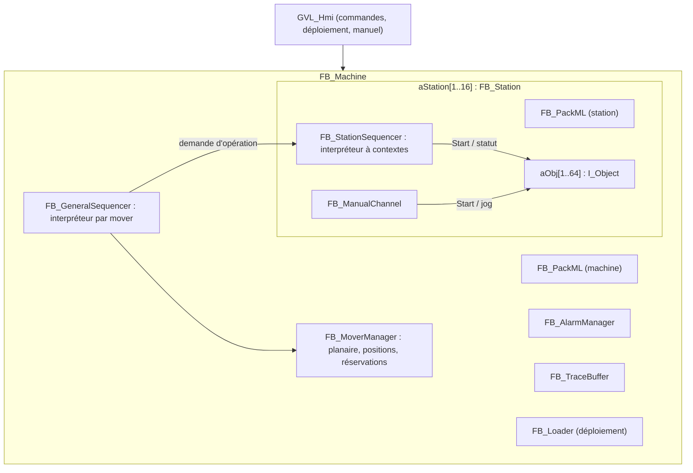
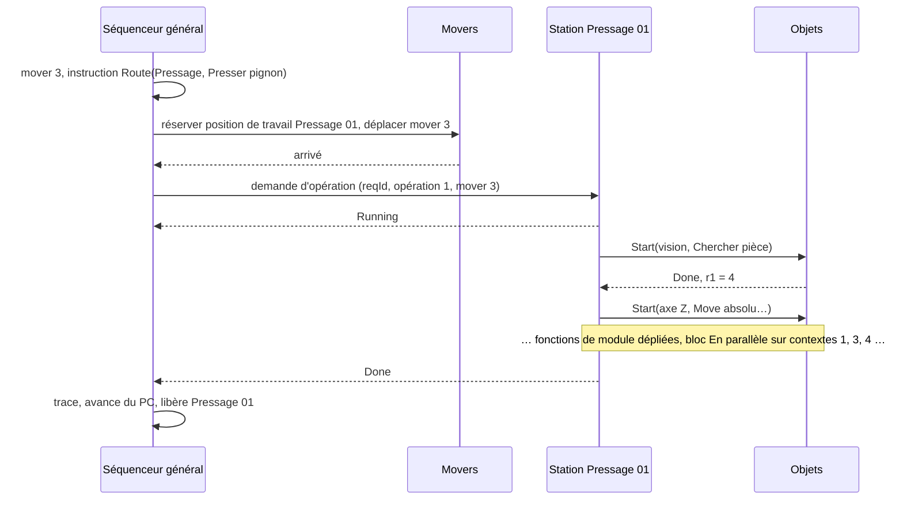
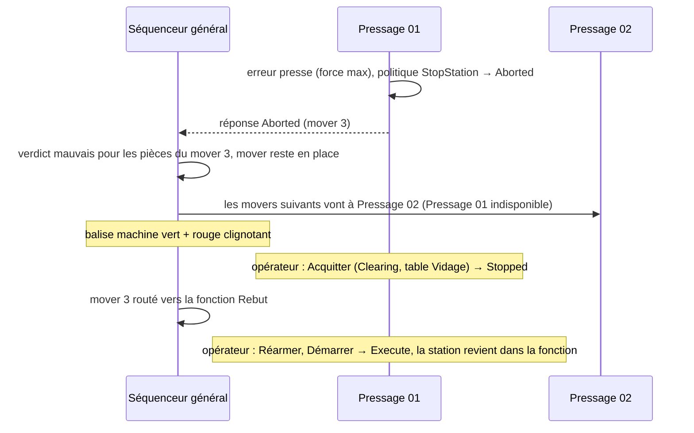

# Algorithmes des séquenceurs PLC

Ce document définit les algorithmes du PLC qui exécutent les tables : la machine d'états PackML réduite, l'interpréteur d'instructions, le séquenceur de station, le séquenceur général et la gestion des movers, le mode manuel, le pas à pas et l'activation d'un déploiement. Le simulateur de la HMI implémente **exactement** les mêmes algorithmes en C# : ce document est la spécification commune des deux. Les structures et le jeu d'instructions sont définis dans `06-tables-et-interface-hmi-plc.md`.

## 1. Vue d'ensemble



**Ordre d'exécution d'un cycle** (tâche PLC de 4 ms) :

1. Lire les commandes de la HMI (`GVL_Hmi`), traiter les handshakes.
2. `FB_Machine` : calcul de l'override machine, surveillance des défauts machine (sécurités, planaire).
3. `FB_PackML` machine : transition d'état.
4. `FB_GeneralSequencer` : propagation des commandes aux stations, agrégation, exécution du process général pour chaque mover.
5. `FB_MoverManager` : envoi des déplacements, détection des arrivées.
6. Pour chaque station configurée : `FB_PackML` station, `FB_StationSequencer` (interpréteur), `FB_ManualChannel`, puis `Cycle()` de chaque objet dans l'ordre des n° locaux.
7. Balises, publication des statuts pour la HMI, traces et alarmes, puis `FB_PlantPublisher` qui remplit `GVL_Plant` pour l'OPC UA (`11-interface-usine.md` § 3).

Les objets sont appelés après les séquenceurs : un `Start` donné au cycle N est vu par l'objet au même cycle N, et son statut est relu par le séquenceur au cycle N + 1 (sauf action immédiate, terminée dans `Start`).

## 2. Machine d'états PackML réduite — FB_PackML

Un même FB sert à la machine et à chaque station.

**Entrées** : `eCmd` (commande du cycle, `None` sinon), `bStateComplete` (le travail de l'état est fini), `bFault` (défaut qui impose Aborted), `eMode`.
**Sorties** : `eState`, `bEntry` (vrai au premier cycle dans un nouvel état), `eLastCmdResult` (Accepted, Rejected).

```iecst
bEntry := FALSE;
eNext := eState;
IF bFault AND eState <> E_State.Aborted THEN
    eNext := E_State.Aborted;
ELSE
    CASE eState OF
    E_State.Stopped:
        IF eCmd = E_Cmd.Reset THEN eNext := E_State.Resetting;
        ELSIF eCmd = E_Cmd.Abort THEN eNext := E_State.Aborted; END_IF
    E_State.Resetting:
        IF eCmd = E_Cmd.Abort THEN eNext := E_State.Aborted;
        ELSIF eCmd = E_Cmd.Stop THEN eNext := E_State.Stopping;
        ELSIF bStateComplete THEN eNext := E_State.Idle; END_IF
    E_State.Idle:
        IF eCmd = E_Cmd.Start THEN eNext := E_State.Execute;
        ELSIF eCmd = E_Cmd.Stop THEN eNext := E_State.Stopping;
        ELSIF eCmd = E_Cmd.Abort THEN eNext := E_State.Aborted; END_IF
    E_State.Execute:
        IF eCmd = E_Cmd.Hold THEN eNext := E_State.Held;
        ELSIF eCmd = E_Cmd.Stop THEN eNext := E_State.Stopping;
        ELSIF eCmd = E_Cmd.Abort THEN eNext := E_State.Aborted; END_IF
    E_State.Held:
        IF eCmd = E_Cmd.Start THEN eNext := E_State.Execute;
        ELSIF eCmd = E_Cmd.Stop THEN eNext := E_State.Stopping;
        ELSIF eCmd = E_Cmd.Abort THEN eNext := E_State.Aborted; END_IF
    E_State.Stopping:
        IF eCmd = E_Cmd.Abort THEN eNext := E_State.Aborted;
        ELSIF bStateComplete THEN eNext := E_State.Stopped; END_IF
    E_State.Aborted:
        IF eCmd = E_Cmd.Clear THEN eNext := E_State.Clearing; END_IF
    E_State.Clearing:
        IF eCmd = E_Cmd.Abort THEN eNext := E_State.Aborted;
        ELSIF bStateComplete THEN eNext := E_State.Stopped; END_IF
    END_CASE
END_IF
eLastCmdResult := SEL(eCmd = E_Cmd.None OR eNext <> eState, E_CmdResult.Rejected, E_CmdResult.Accepted);
IF eNext <> eState THEN eState := eNext; bEntry := TRUE; END_IF
```

- Une commande refusée est signalée à la HMI (statut du handshake) avec l'état courant ; elle ne lève pas d'alarme.
- Le mode (Production, Maintenance) ne change qu'en Stopped ; il est porté par la machine et recopié dans chaque station. Exception : une station **hors production** (`12-forcages-et-etats-declares.md` § 3) et Stopped peut changer de mode seule, même si la machine produit.
- Held : la commande Start sert aussi à reprendre (libellé « Démarrer » dans la HMI).

## 3. Interpréteur d'instructions — FB_Interpreter

### 3.1 Contextes

Un séquenceur de station a 8 contextes d'exécution :

| Contexte | Usage |
| --- | --- |
| 1 | Contexte principal : opération, initialisation, arrêt, vidage |
| 2 | Cycle de fond |
| 3 à 8 | Branches de blocs En parallèle (pris dans un pool libre) |

```iecst
TYPE E_CtxStatus : (Free := 0, Running := 1, WaitAction := 2, WaitCond := 3, WaitTime := 4,
                    WaitJoin := 5, WaitStep := 6, Holding := 7, Done := 8, Failed := 9) USINT; END_TYPE

TYPE ST_Context :
STRUCT
    eStatus      : E_CtxStatus;
    nTable       : USINT;                       // table en cours (n° dans le répertoire de la station)
    nPC          : INT;                         // index d'instruction absolu dans aInstr
    aRetTable    : ARRAY[1..4] OF USINT;        // pile d'appels (sous-process)
    aRetPC       : ARRAY[1..4] OF INT;
    nDepth       : USINT;
    nParent      : USINT;                       // contexte qui a fait le Fork, 0 sinon
    nForkPC      : INT;                         // Fork de rattachement
    nChildren    : USINT;                       // branches filles encore actives (pour le parent)
    nRetry       : USINT;                       // essais déjà faits sur l'instruction courante
    fWaitMs      : LREAL;                       // temps écoulé dans une attente
    nStepId      : UDINT;                       // carte en cours (dernier StepBegin ouvert)
    nStepDepth   : USINT;                       // StepBegin imbriqués (fonction de module dans une carte)
    nErrorCode   : UINT;
END_STRUCT END_TYPE
```

### 3.2 Boucle d'exécution

```iecst
FOR i := 1 TO MAX_CTX DO
    IF aCtx[i].eStatus IN [Running, WaitAction, WaitCond, WaitTime, WaitJoin, WaitStep] THEN
        nBudget := MAX_INSTR_PER_CYCLE;                       // 32
        REPEAT
            bBlocked := ExecuteOne(i);                        // exécute ou fait avancer l'instruction au PC
            nBudget := nBudget - 1;
        UNTIL bBlocked OR nBudget = 0 OR aCtx[i].eStatus IN [Done, Failed, Free] END_REPEAT
    END_IF
END_FOR
```

- Les instructions **instantanées** (saut, condition, affectation, marqueurs, Fork, Join quand les branches sont finies, Call, Return, action immédiate) s'enchaînent dans le même cycle, jusqu'à 32 par contexte et par cycle (garde contre une boucle sans fin : un dépassement répété pendant 1 s lève l'alarme 901 « Boucle sans attente » et arrête la station).
- Les instructions **bloquantes** (action non immédiate, attente de condition ou de durée, Join en attente, pause du pas à pas, Hold) rendent la main jusqu'au cycle suivant.

### 3.3 Sémantique des instructions

`I` désigne `aInstr[ctx.nPC]`. « Avancer » signifie `ctx.nPC := ctx.nPC + 1`.

| Opération | Exécution |
| --- | --- |
| `Nop` | Avancer. |
| `StepBegin` | Si le pas à pas est actif et demande une pause « étape » : passer `WaitStep` (voir § 8). Sinon : empiler la carte (`nStepId := I.nStepId`, `nStepDepth += 1`), publier l'événement « étape commencée », avancer. |
| `StepEnd` | `nStepDepth -= 1`, publier « étape terminée », avancer. |
| `Action` | Premier passage : si pas à pas « action » → `WaitStep`. Résoudre les paramètres (§ 3.4), appeler `aObj[I.nObject].Start(I.nAction, params, FALSE)`. Refus → traiter comme un échec (code du refus). Accepté → `WaitAction`. Passages suivants : lire `ActStatus` ; `Busy` → bloqué ; `Done` → ranger les résultats (§ 3.5), `nRetry := 0`, avancer ; `Error` → politique d'échec (§ 3.6). |
| `WaitCond` | Évaluer la condition `I.aArg[1]` (§ 3.7). Vraie → avancer. Fausse → `fWaitMs += cycle` ; si `I.nTimeoutMs > 0` et dépassé → échec (code 902 « Condition non atteinte »). |
| `WaitTime` | Attendre `aParam[1]` ms (temporisation implicite), puis avancer. Sensible à Hold : le temps continue de courir. |
| `Jump` | `nPC := I.aArg[1]`. |
| `JumpIfFalse` | Évaluer la condition `I.aArg[1]` ; fausse → `nPC := I.aArg[2]`, vraie → avancer. |
| `Fork` | Pour chaque branche k = 2..n (`I.aArg[2..5]` ≠ 0) : prendre un contexte libre parmi 3..8 (aucun libre → échec 903 « Plus de contexte libre »), le lancer à `aArg[k+1]` avec `nParent := ctx`, `nForkPC := nPC`. Le contexte courant prend la branche 1 : `nPC := I.aArg[2]` ; `nChildren := n − 1`. |
| `Join` | Contexte fils (`nParent` ≠ 0 et `nForkPC = I.aArg[1]`) : décrémenter `nChildren` du parent, libérer le contexte. Contexte parent : si `nChildren = 0` → avancer, sinon `WaitJoin`. Si une branche a échoué avec la politique « Arrêter la station », la station passe Aborted et tous les contextes sont tués (§ 4.4). |
| `LoopInit` | `Var[I.aArg[1]] := valeur(aParam[1])`, avancer. |
| `LoopNext` | `Var[I.aArg[1]] -= 1` ; si > 0 → `nPC := I.aArg[2]`, sinon avancer. |
| `Call` | Empiler (`nTable`, `nPC + 1`) ; profondeur > 4 → échec 904. `nTable := I.aArg[1]`, `nPC := début de la table`. |
| `Return` | Dépiler et reprendre ; pile vide → traiter comme `End`. |
| `SetOut` | Écrire la sortie n° `I.aArg[1]` de l'opération (table d'opération : `aOut` / `stOutPos` de la réponse, bit dans `nOutMask`) ; dans un sous-process : l'emplacement interne de la sortie. Une valeur de type position copie `stPos` (le décalage est ajouté à la composante utilisée). Avancer. |
| `SetVar` | Cible `aBind[1]` (variable de station, ou de process qui est allouée comme une variable de station, donnée de pièce, ou variable de mover) := / += / −= valeur de `aParam[1]` selon `I.aArg[1]` (0, 1, 2). Avancer. |
| `Alarm` | Lever l'alarme de process (code `900 + I.aArg[3]`, texte n° `I.aArg[1]`, gravité `I.aArg[2]`). Avertissement → avancer. Défaut de station → la station passe Aborted. Défaut machine → la machine passe Aborted. |
| `End` | `I.aArg[1] = 1` (cycle de fond) → `nPC := début de la table`. Sinon → `Done`. |

### 3.4 Résolution des paramètres

Pour chaque paramètre `k` de l'instruction, selon `aParam[k].eSource` :

| Source | Valeur résolue |
| --- | --- |
| `Const` | `fValue` |
| `Var` | variable de station n° `nIndex` (nombre ; ou position → `stPos`, `aKind[k] := Position`, `aReal[k] := fValue` comme décalage) |
| `PartData` | donnée n° `nIndex` de la pièce de l'emplacement courant |
| `MoverData` | variable n° `nIndex` du mover attribué à l'opération (opération de station : `I.nMover` de la demande ; process général : le mover du fil). Même traitement que `Var` pour les positions (`stPos`, décalage). Refusée dans le cycle de fond, l'initialisation, l'arrêt et le vidage (le compilateur la refuse) |
| `OpParam` | paramètre n° `nIndex` de l'opération en cours (donné par le process général) |
| `NamedPos` | position nommée n° `nIndex` de la station → `stPos`, `aKind[k] := Position`, `aReal[k] := fValue` (décalage ajouté à la composante utilisée) |
| `Speed` | `aKind[k] := SpeedIndex`, `aReal[k] := nIndex` (n° de vitesse, résolu par l'objet) ; `nIndex = 0` → `SpeedPercent` avec `fValue` |
| `Text` | texte n° `nIndex` de la table de textes → `sText` |
| `ObjValue` | valeur `E[fValue]` publiée par l'objet n° `nIndex` (`Status.aValue`) |
| `System` | variable système n° `nIndex` (mover présent, emplacement, n° d'OF, compteur de cycles, temps de cycle) |

Une position nommée non apprise ne peut pas arriver ici : le déploiement l'aurait refusée.

### 3.5 Rangement des résultats

Pour chaque `k` de 1 à 8 avec `aBind[k].eTarget` ≠ `None` : la cible reçoit le résultat `r_k` de l'objet (`Results.aReal[k]`, ou `stPos` si le résultat k est une position, ou `sText` si c'est un texte). Cibles : variable de station, donnée de pièce, identifiant de pièce (texte), verdict (le jugement `aJudgement[k]` est converti : Ok → bon, tout autre jugement ≠ None → mauvais).

### 3.6 Politique d'échec

Quand l'action de l'instruction échoue (`Error`, ou `Start` refusé) :

| `I.eOnFail` | Traitement |
| --- | --- |
| `StopStation` (défaut) | L'alarme de l'objet reste un défaut de station ; la station passe Aborted. |
| `Retry` | Si `nRetry < I.nRetries` : `Ack` de l'objet (l'alarme passe en information), `nRetry += 1`, relancer l'instruction. Sinon comme `StopStation`. |
| `PartBad` | `Ack` de l'objet, verdict de la pièce courante := mauvais, l'alarme passe en information, sauter à la fin de l'opération (instruction `End` de la table). Dans une branche parallèle : la branche saute à son `Join` et marque l'opération ; au `Join`, le contexte parent saute à la fin de la table. |
| `Goto` | `Ack` de l'objet, `nPC := I.nFailTarget` (la cible est dans la même branche ; le validateur le vérifie). |
| `Ignore` | `Ack` de l'objet, avertissement enregistré, avancer. |

### 3.7 Conditions

```iecst
TYPE ST_CondTerm : STRUCT stLeft : ST_Value; eCmp : E_Cmp; stRight : ST_Value; END_STRUCT END_TYPE
TYPE ST_Condition : STRUCT eCombine : E_Combine; nTerms : USINT; aTerm : ARRAY[1..4] OF ST_CondTerm; END_STRUCT END_TYPE
// E_Cmp : Eq, Ne, Lt, Le, Gt, Ge, IsTrue, IsFalse ; E_Combine : All, Any
```

Chaque terme compare deux valeurs résolues comme au § 3.4 (les comparaisons d'égalité sur des réels utilisent une tolérance de 1e-9). `All` : tous vrais ; `Any` : au moins un vrai. Une condition sans terme est vraie.

## 4. Séquenceur de station — FB_StationSequencer

### 4.1 Interface avec le séquenceur général

```iecst
TYPE ST_OpRequest : STRUCT
    nReqId     : UDINT;           // change à chaque nouvelle demande
    nGroup     : USINT;           // fonction visée (une station peut en avoir plusieurs)
    nOperation : USINT;           // n° de l'opération dans la fonction ; la station trouve sa table par aOpMap
    nMover     : USINT;
    nSlot      : USINT;           // emplacement visé, 0 = tous
    bMoverAtStation : BOOL;       // vrai quand le mover est en position de travail (préparation : posée avant)
    aParam     : ARRAY[1..8] OF LREAL;  // paramètres d'opération
END_STRUCT END_TYPE

TYPE ST_OpResponse : STRUCT
    nReqId     : UDINT;           // recopie de la demande traitée
    eStatus    : (Idle, Running, Done, Failed, Aborted, Preparing) USINT;   // Preparing : avant WaitMover
    nErrorCode : UINT;
    nOutMask   : UINT;                // bit k-1 = sortie k définie (opération terminée par Done)
    aOut       : ARRAY[1..8] OF LREAL;   // sorties de l'opération (booléen : 0 ou 1)
    stOutPos   : ST_Position;     // l'unique sortie de type position
END_STRUCT END_TYPE
```

Le séquenceur général ne pose une demande que si la station est en Execute et sans opération en cours. Deux cas :
- **Sans préparation** (le couple (fonction, opération) n'a pas d'instruction `WaitMover`, `bPrepare = FALSE` dans `aOpMap`) : la demande est posée quand le mover est en position de travail, comme décrit ci-dessus.
- **Avec préparation** : la demande est posée dès que la position de travail est réservée au mover (§ 5.4, étape 4, et promotion depuis la file, § 5.5) avec `bMoverAtStation = FALSE`. La station répond `Preparing` et exécute les instructions jusqu'à `WaitMover`. Quand le mover est arrivé, le séquenceur général met `bMoverAtStation := TRUE` ; `WaitMover` laisse alors passer (attache l'emplacement, recopie `nSlot` ; le mover `nMover` est déjà attribué dès la réservation, donc ses variables sont utilisables avant) et la station répond `Running`. Avant `WaitMover`, aucune instruction ne peut lire ni écrire de donnée de pièce (le compilateur et la validation le garantissent). Si la préparation finit avant l'arrivée, le contexte attend sur `WaitMover` (`WaitCond`) ; si le mover arrive avant, il n'attend rien. La station répond `Running` au cycle suivant, puis `Done` ou `Failed` (opération terminée par un échec traité, la pièce est mauvaise) ou `Aborted` (la station est passée Aborted).

### 4.2 Comportement par état

| État | Entrée dans l'état (`bEntry`) | À chaque cycle | `bStateComplete` |
| --- | --- | --- | --- |
| Stopped | Tuer tous les contextes | Canal manuel actif si mode Maintenance | — |
| Resetting | `Ack()` de tous les objets ; lancer la table Initialisation sur le contexte 1 | Interpréteur | Contexte 1 `Done` |
| Idle | — | — | — |
| Execute | Lancer le cycle de fond (s'il existe) sur le contexte 2 | Interpréteur ; accepter une demande d'opération si le contexte 1 est libre : charger sur le contexte 1 la table associée à (fonction, opération) par `aOpMap`, recopier les paramètres d'opération, attacher le mover et l'emplacement | — |
| Held | Demander la pause : `bHoldRequested := TRUE` | Le contexte 1 termine son opération (§ 4.3) ; le contexte 2 s'arrête au prochain `StepBegin` (`Holding`) ; aucune nouvelle demande acceptée | — |
| Execute (retour de Held) | `bHoldRequested := FALSE`, les contextes `Holding` reprennent | — | — |
| Stopping | Comme Held, puis, contexte 1 libre : lancer la table Arrêt (si elle existe) | Interpréteur | Table Arrêt finie (ou absente) et contexte 2 arrêté |
| Aborted | `Abort()` de tous les objets (enfants d'abord) ; tuer tous les contextes ; répondre `Aborted` à la demande en cours ; état de la balise | — | — |
| Clearing | `Ack()` de tous les objets ; lancer la table Vidage (si elle existe) sur le contexte 1 | Interpréteur | Table Vidage finie (ou absente) et tous les objets acquittés |

**Défaut** (`bFault` de la station) : un objet en erreur avec la politique `StopStation`, une instruction `Alarm` de gravité défaut, un circuit de sécurité de la station ouvert, une commande Abort. Une erreur pendant Resetting ou Clearing fait aussi passer Aborted.

### 4.2 bis Instruction WaitMover

`WaitMover` : si `bMoverAtStation` de la demande est vrai, attacher le mover et l'emplacement au contexte et avancer ; sinon rester en `WaitCond` (statut publié « attend le mover »). Hold : une préparation continue jusqu'à `WaitMover` et y attend (`Holding`) ; au Start elle reprend. Stop : le contexte 1 en préparation est tué (la table Arrêt est lancée ensuite), la demande est rendue `Aborted` avec le code « préparation annulée », et le séquenceur général remet le mover à `Ready` à son PC (il sera re-routé au prochain Start, la préparation recommence). Abort : § 4.4.

### 4.3 Hold et Stop : finir l'opération en cours

- La pause ne coupe jamais une opération : le contexte 1 continue jusqu'à `End`, puis l'opération est rendue `Done` au séquenceur général ; ensuite la station n'accepte plus de demande.
- Le cycle de fond (contexte 2) se met en `Holding` au prochain `StepBegin` : il ne s'arrête jamais au milieu d'une carte.
- Les branches parallèles du contexte 1 continuent jusqu'au `Join`.

### 4.4 Abort pendant une opération

1. Tous les contextes sont tués, tous les objets reçoivent `Abort()` et passent en état sûr.
2. La réponse à la demande en cours devient `Aborted`.
3. Le séquenceur général met le verdict « mauvais » sur les pièces du mover engagé et laisse le mover en position de travail (§ 6.4).
4. Après Clear (table Vidage) la station est Stopped ; le mover peut alors partir.

### 4.5 Statut publié pour la HMI

Par station : état PackML, mode, commande refusée éventuelle, opération en cours (n°, mover, emplacement, durée), et pour chaque contexte : statut, table, PC, carte en cours (`nStepId`), carte suivante prévue, objet et action en cours, n° d'essai, temps d'attente. Ces champs alimentent les effets visuels de l'éditeur (carte active, branches parallèles, attente) décrits dans `08-hmi-design-ecrans.md`.

## 5. Séquenceur général — FB_GeneralSequencer

### 5.1 Propagation des commandes

| Commande machine | Effet sur les stations |
| --- | --- |
| Reset (machine Stopped) | Activer le système planaire ; Reset de toutes les stations Stopped |
| Start (machine Idle ou Held) | Start de toutes les stations Idle ou Held |
| Hold | Hold de toutes les stations en Execute ; plus de nouveau routage |
| Stop | Stop de toutes les stations actives ; plus de nouveau routage |
| Abort | Abort de toutes les stations ; arrêt contrôlé de tous les movers |
| Clear | Clear de toutes les stations Aborted ; acquittement des défauts machine |

Une station réintégrée (Clear, Reset, Start donnés à la station seule pendant que la machine est en Execute) est commandée directement par la HMI ; le séquenceur général accepte ces commandes de station seulement si la machine est en Execute ou Held et la station Aborted, en cours de réintégration, ou hors production (forçage).

**Démarrage bloqué** : si l'état déclaré de la machine bloque le démarrage (`12-forcages-et-etats-declares.md` § 2), la commande Start de la machine est refusée avec ce motif ; Stop, Hold, Abort et Clear restent acceptés.

### 5.2 Agrégation et transitions automatiques de la machine

- **Resetting → Idle** quand : système planaire actif, tous les movers détectés, et chaque fonction utilisée par le process général a au moins une station en Idle. Une station qui échoue son Reset passe Aborted ; si l'une de ses fonctions n'a pas d'autre station, la machine passe Aborted.
- **Raison d'arrêt** : à chaque passage en Aborted, Held ou Stopping, le séquenceur général mémorise la première alarme cause (code, station) ou la cause système (commande opérateur, fin d'OF, qualité) ; elle est publiée dans `GVL_Plant` et dans les événements d'arrêt.
- **Stopping → Stopped** quand toutes les stations sont Stopped ou Aborted et tous les movers immobiles.
- **Clearing → Stopped** quand toutes les stations sont sorties de Clearing et les défauts machine acquittés.
- **Défaut machine** (`bFault` machine) : circuit de sécurité machine ouvert, erreur du système planaire, mover en défaut, fonction utilisée sans aucune station disponible pendant que la machine est en Execute (une station est disponible si elle est en Execute, Held, Resetting, Idle ou Clearing — c'est-à-dire pas Aborted ni Stopped ; une station **volontairement** retirée — hors production ou en arrêt qualité — ne déclenche jamais ce défaut, même Stopped : les movers qui ont besoin de la fonction attendent en tampon et la balise passe en bleu clignotant), alarme de process de gravité défaut machine.

### 5.3 Exécution du process général par mover

Chaque mover a un contexte d'exécution simple (un seul fil, pas de Fork au niveau machine) :

```iecst
TYPE E_MoverState : (Unknown := 0, Ready := 1, Routing := 2, Queued := 3, AtStation := 4,
                     Buffered := 5, ToEmpty := 6, Error := 7, Halted := 8, OutOfService := 9) USINT; END_TYPE

TYPE ST_MoverCtx : STRUCT
    eState       : E_MoverState;
    nTable, nPC  : INT;                 // position dans le process général
    aRetTable, aRetPC : ARRAY[1..4] OF INT; nDepth : USINT;
    nTargetGroup : USINT;               // fonction visée
    nStation     : USINT;               // station réservée ou occupée, 0 = aucune
    nDest        : INT;                 // position planaire de destination
    nReqId       : UDINT;
    nRouteRetry  : UDINT;               // nombre de cycles sans station disponible
    tWaitStart   : LINT;
    aSlot        : ARRAY[1..4] OF ST_Part;
    aVar         : ARRAY[1..16] OF LREAL;        // variables de mover (booléen : 0 ou 1) ; § 5.8
    aVarPos      : ARRAY[1..16] OF ST_Position;  // valeur des variables de type position
    aVarId       : ARRAY[1..16] OF UDINT;        // identifiant stable de la variable à ce rang (remappage au déploiement)
END_STRUCT END_TYPE
```

À chaque cycle, en Execute, pour chaque mover (dans l'ordre des n°, en commençant par celui qui attend depuis le plus longtemps pour éviter la famine) :

| État du mover | Traitement |
| --- | --- |
| `Ready` | Exécuter les instructions instantanées (`Jump`, `JumpIfFalse`, `SetVar` sur données de pièce ou variables de mover, `ResetMoverVars`, `LoopInit`, `LoopNext`, `Call`, `Return`, `Alarm`) jusqu'à une instruction `Route`, `WaitCond` ou `End`. `Route` → routage (§ 5.4). `End` → le mover recommence à l'étape 1 (les pièces encore présentes lèvent l'avertissement 910 « Pièce présente en fin de process »). |
| `Routing` | Attendre l'arrivée (fournie par le gestionnaire de movers). Si l'opération visée a une préparation et que la position de travail est réservée à ce mover : poser la demande dès la réservation (préparation, § 4.1).  Arrivé en file → `Queued` ; arrivé en position de travail → poser la demande d'opération → `AtStation` ; arrivé en tampon → `Buffered`. |
| `Queued` | Quand la position de travail de la station se libère et que c'est son tour : déplacer vers la position de travail → `Routing`. Ordre de la file : priorité de la fonction visée par chaque mover (la plus haute d'abord), puis ordre d'arrivée. |
| `Buffered` | Réessayer le routage à chaque cycle (§ 5.4). |
| `AtStation` | Lire la réponse de la station. `Done` ou `Failed` → § 5.5. `Aborted` → § 6.4. |
| `ToEmpty` | Attendre la confirmation de retrait de l'opérateur (HMI) → pièces clôturées « retirées », PC := 1, `Ready`. |
| `Halted` | État pendant Hold/Stop après un déplacement terminé ; revient `Ready` au Start, sans perdre son PC. |

En Held et Stopping : aucun nouveau `Route` n'est lancé ; les movers en `Routing` terminent leur déplacement, puis passent `Halted` (en tampon ou en file) ; un mover arrivé en position de travail n'y reçoit pas de demande d'opération, car une station en Held ou Stopping n'en accepte plus. Les opérations déjà lancées se terminent normalement.

### 5.4 Routage (instruction `Route`)

Paramètres de l'instruction : fonction `aArg[1]`, opération `aArg[2]`, emplacement `aArg[3]`, paramètres d'opération `aParam[1..8]`.

1. **Redirection vers le rebut** : si une pièce du mover a le verdict mauvais et que l'opération demandée n'est pas une opération d'une fonction de rôle Rebut, et que le process n'a pas testé le verdict depuis qu'il est devenu mauvais (drapeau `bBadHandled` de la pièce), alors la fonction visée devient la fonction de rebut de la machine avec son opération n° 1.
2. **Candidates** : stations membres de la fonction (`nStationMask`) en Execute, configurées, sans défaut, sans arrêt qualité, pas hors production. Un mover hors service (réaction qualité ou forçage) n'est jamais routé.
3. **Choix** : la station qui a le moins de movers (en position de travail + en file + réservés en route, toutes fonctions confondues) ; à égalité, celle qui a reçu un mover le moins récemment ; à égalité, le plus petit n°.
4. **Destination** :
   - position de travail libre et non réservée → réserver, destination = position de travail ;
   - sinon, une place de file libre → réserver la place, destination = file ;
   - sinon → destination = position tampon libre la plus proche (si le mover n'y est pas déjà), état `Buffered` ;
   - sinon → rester sur place, `Buffered`.
5. **Aucune candidate** pendant plus de `tNoStationMs` (paramètre machine, 60 s) et la fonction visée est la fonction de rebut (ou il n'y a pas de fonction de rebut) → destination = position de parcage, état `ToEmpty`, balise bleu clignotant, alarme d'avertissement 911 « Mover à vider ».
6. Le gestionnaire de movers envoie le déplacement ; l'état passe `Routing`.

### 5.5 Fin d'une opération

0. Si la réponse est `Done` et que l'instruction `Route` a des liaisons de sorties (`aBind[k]`, `k` = rang de la sortie), copier chaque sortie définie (`nOutMask`) vers sa cible : donnée de pièce de l'emplacement visé, variable de mover du mover, ou verdict. Rien n'est copié pour `Failed` et `Aborted`.
1. Libérer la position de travail de la station ; promouvoir le premier mover de sa file.
2. Si la fonction de l'opération est de rôle Entrée et l'opération est `Done` : pour chaque emplacement visé par l'instruction `Route` (`aArg[3]`, 0 = tous), créer la pièce : identifiant lié par l'opération (cible `PartId`) ou, s'il est vide, généré (`<machine>-<AAAAMMJJ>-<compteur sur 6 chiffres>`), état « en cours », OF en cours, horodatage. Les liaisons faites pendant l'opération écrivent dans l'enregistrement de l'emplacement, qui devient présent à ce moment.
3. Si la fonction de l'opération est de rôle Sortie ou Rebut : clôturer les pièces déchargées (état « sortie » ou « rebutée »), mettre à jour les compteurs de l'OF.
4. Une pièce marquée « retirée » par l'opération (`SetVar` sur la cible `PartRemoved`, rebut interne à la station) est clôturée « retirée » et l'emplacement redevient vide.
5. Émettre une trace par pièce traitée (§ 9).
6. Transmettre les résultats à la surveillance des rebuts (`FB_QualityMonitor`, `10-surveillance-des-rebuts.md` § 9) : fin d'opération, et clôture pour les pièces clôturées.
7. Avancer le PC du mover, état `Ready` (ou parcage puis `OutOfService` si le mover est verrouillé par la qualité et vide).

### 5.6 OF

- Le séquenceur général tient une **table d'OF** `aOrder[1..8]` (`ST_OrderState` : n° interne, état Active / Suspended / Done, quantité, bonnes, mauvaises, en cours, 16 paramètres `aParam`) et `nActiveOrder` (0 = aucun). Chaque pièce porte le n° interne de son OF (`ST_Part.nOrder`).
- **Création de pièce** (§ 5.5, étape 2) : rattachée à `nActiveOrder` ; sans OF actif, l'instruction `Route` vers une fonction de rôle Entrée n'est pas lancée (motif « aucun OF »).
- **Paramètres** : une source `OrderParam` (`nIndex` = rang du paramètre d'OF) se résout dans le séquenceur général, à l'émission de `Route`, depuis l'OF de la première pièce présente du mover, sinon de l'OF actif (opération d'entrée) ; la valeur est recopiée dans `aParam` de la demande d'opération.
- **Compteurs** : bonnes et mauvaises sont mises à jour à la clôture de chaque pièce dans l'OF de la pièce ; « en cours » à la création et à la clôture.
- **Fin d'OF** : quand bonnes + en cours ≥ quantité pour l'OF actif, une instruction `Route` vers une fonction de rôle Entrée n'est plus lancée ; le mover attend en tampon (`Buffered`, motif « fin d'OF »). Un OF complet dont plus aucune pièce n'est en cours passe `Done` (actif ou suspendu). Quand l'OF actif est `Done` et qu'aucune pièce d'aucun OF n'est en cours : commande Stop automatique, balise bleu clignotant, événement « OF terminé ».
- **Commandes** (`GVL_Hmi.stOrder`) : `Activate` (numéro d'OF et ses données : quantité, compteurs déjà faits, paramètres) accepté tant que la machine n'est pas Aborted, Clearing, Resetting ou Stopping : l'OF actif devient `Suspended`, l'OF visé prend sa place dans la table (ajouté si absent, refusé si la table est pleine de 8 OF encore actifs ou avec des pièces en cours) et devient `nActiveOrder` ; `Suspend` (sans OF actif ensuite) ; `Cancel` refusé tant que l'OF a des pièces en cours. Un OF suspendu sans pièce en cours peut quitter la table (la HMI garde ses compteurs et les renvoie à la reprise).

### 5.7 Fin des pièces en cours (`Drain`)

Pas un état PackML : un indicateur `bDrain` du séquenceur général, valable en Execute et Held.
- **Pose** : la commande `DrainStart` (HMI) positionne `bDrain` si la machine est en Execute, Held ou Idle ; refusée sinon. Depuis Idle, l'indicateur reste armé jusqu'au Démarrer ; il est remis à FALSE seulement par `DrainCancel` ou à l'entrée de Stopping, Stopped et Aborted. `DrainCancel` le remet à FALSE. `bDrain` est aussi remis à FALSE à l'entrée de Stopping, Stopped et Aborted. Si la machine passe en Execute avec `bDrain` et qu'aucune pièce n'est en cours, la fin ci-dessous s'applique dès le premier cycle.
- **Effet** : même verrou que la fin d'OF (§ 5.6) et que l'arrêt du chargement qualité : une instruction `Route` vers une fonction de rôle Entrée n'est pas lancée, le mover attend en tampon (`Buffered`, motif « fin des pièces »). Les opérations d'entrée déjà demandées vont à leur terme.
- **Fin** : quand `bDrain` et qu'aucun mover ne porte de pièce et qu'aucune opération de fonction Entrée n'est en cours : commande Stop automatique de la machine, raison d'arrêt « machine vidée », balise bleu clignotant, événement « Machine vidée » pour la HMI. Un mover `ToEmpty` portant des pièces retient la fin tant que l'opérateur n'a pas confirmé leur retrait.
- **Publication** : `bDrain` et `nPartsInProcess` (pièces portées par les movers) dans le statut de la machine, pour que la HMI affiche le compte à rebours.

### 5.8 Variables de mover

**Configuration** (dans `ST_MachineData`, `06` § 2) : `aMoverVar[1..16]` de `ST_MoverVarDef` (identifiant stable, nom, type, unité, valeur initiale, règle de remise à zéro `Never`, `OnDeploy`, `OnEmpty`). Le rang d'une variable est sa place dans cette liste ; le compilateur traduit l'identifiant en rang (`nIndex` des sources et cibles `MoverData`).

**Accès** :
- Lecture (`MoverData` en source de valeur ou dans une condition) : `aVar[nIndex]` du mover attribué ; une variable de type position donne `stPos` (= `aVarPos[nIndex]`) avec l'éventuel décalage de la valeur, comme une variable de station.
- Écriture (`SetVar` ou liaison d'un résultat vers la cible `MoverData`) : instantanée, comme pour les données de pièce. Un type incompatible (position écrite dans un nombre…) est refusé à la compilation (V014).
- Le séquenceur de station donne accès au mover `I.nMover` dès la demande, donc dès la préparation (§ 4.1) ; le séquenceur général au mover du fil qu'il exécute. Dans un contexte sans mover (cycle de fond, initialisation, arrêt, vidage), l'instruction n'existe pas : le compilateur la refuse.
- Accès simultanés : deux branches parallèles d'une opération peuvent lire la même variable ; si deux écrivent, la dernière écriture gagne (la validation avertit, V117).

**Remise à zéro** (valeur initiale de `aMoverVar`) :
- `OnEmpty` : à chaque fois qu'un emplacement devient vide et que tous les emplacements du mover sont alors vides : clôture des pièces déchargées (§ 5.5, étape 3), confirmation de retrait d'un mover `ToEmpty` (§ 5.3), pièce marquée « retirée » par une opération (§ 5.5, étape 4 de l'ordre d'exécution).
- `OnDeploy` : à l'activation d'un déploiement (`FB_Loader`, § 10).
- Étape « Réinitialiser les variables du mover » : instruction `ResetMoverVars` (`aArg[1]` = rang de la variable, 0 = toutes celles dont la règle n'est pas `Never`). Une variable nommée explicitement est remise à zéro quelle que soit sa règle.
- Jamais par Reset, Stop, Abort, Clear, coupure ou redémarrage : les movers sont en mémoire persistante.

**Création et suppression de movers** : un mover ajouté au déploiement prend les valeurs initiales de toutes les variables.

**Commande HMI** (`GVL_Hmi.stMoverVar`, `06` § 6.2) : en Maintenance, modifier la valeur d'une variable d'un mover, ou la remettre à sa valeur initiale. Acceptée si la machine est Stopped ou Idle ; refusée sinon (le mover est peut-être en cours de lecture).

## 6. Gestionnaire de movers — FB_MoverManager

### 6.1 Positions planaires

Toutes en frame 0, déployées avec la configuration machine :

| Type | Nombre | Rôle |
| --- | --- | --- |
| Position de travail | une par station | Le mover y subit l'opération |
| File | 0 à 4 par station | Attente devant une station occupée, servie dans l'ordre |
| Tampon | 0 à 16 | Attente quand aucune station n'est disponible |
| Parcage | 1 | Mover à vider, mover hors service |

### 6.2 Occupation et réservation

- Chaque position a un propriétaire (n° de mover) ou est libre. Un mover réserve sa destination avant de partir ; personne d'autre ne peut la prendre.
- Les trajets et l'évitement de collision sont délégués au système planaire (Tc3 Planar : mouvement vers une position cible avec gestion des autres movers).
- Arrivée : le mover est dans la fenêtre de position du système et à l'arrêt pendant 50 ms.
- Un déplacement qui dépasse son timeout met le mover en `Error` (défaut machine).

### 6.3 Démarrage et reprise

- Au Reset machine, chaque mover détecté reçoit sa position actuelle ; s'il est sur une position connue (travail, file, tampon, parcage), il en devient propriétaire.
- Les contextes des movers et les pièces sont en mémoire **persistante** : après un arrêt (Stop, Abort, coupure), au Start suivant chaque mover reprend à son PC. Un mover qui était en `AtStation` dans une station qui a été Aborted garde le verdict mauvais et repart au rebut.

### 6.4 Station Aborted avec un mover engagé

1. La réponse de la station est `Aborted` : les pièces du mover reçoivent le verdict mauvais, la station reste réservée.
2. Le mover reste en position de travail (le robot peut encore être au-dessus).
3. Quand la station a fini son Clearing (Stopped), la position de travail est libérée et le mover est routé vers le rebut (§ 5.4, étape 1).

### 6.5 Mode manuel des movers

En Maintenance, machine Stopped, système planaire actif : la HMI peut envoyer un mover vers une position planaire (Move vers position) ou le parcage. Le gestionnaire met à jour l'occupation. Les pièces suivent le mover.

## 7. Canal manuel — FB_ManualChannel

Un canal par station (et un pour la machine). Demande écrite par la HMI :

```iecst
TYPE ST_ManualRequest : STRUCT
    nSeq     : UDINT;           // change à chaque demande
    eKind    : (Action, JogStart, JogStop, Ack, TeachPosition) USINT;
    nObject  : UINT;            // n° local
    nAction  : UINT;
    stParams : ST_ActParams;    // résolus par la HMI (positions nommées et vitesses déjà résolues)
    nTeachPos: INT;             // position nommée à apprendre
    nTeachMask : USINT;         // composantes à apprendre (bits X, Y, Z, C)
    nTeachFrom : ARRAY[1..4] OF UINT;  // objets (axes) qui fournissent X, Y, Z, C
END_STRUCT END_TYPE
// Réponse : nSeq traité, résultat de Start, statut d'action, code d'erreur, résultats.
```

**Conditions d'acceptation** : mode Maintenance, station à l'état Stopped (ou machine Stopped pour le canal machine), objet configuré. Les droits sont contrôlés par la HMI ; le PLC ne contrôle que le mode et l'état.

**Exécution** : `Start(nAction, stParams, bManual := TRUE)` ; l'override manuel de l'axe s'applique ; les verrouillages s'appliquent.

**Jog** : `JogStart` lance l'action Jog + ou Jog −. La HMI incrémente `nJogAlive` (dans `GVL_Hmi`) toutes les 100 ms tant que le bouton est tenu. Si `nJogAlive` ne change pas pendant 300 ms, ou à `JogStop`, le canal appelle `Abort()` sur l'axe (arrêt avec rampe normale pour un jog). Le jog est aussi arrêté par un changement d'état de la station.

**Apprentissage** : `TeachPosition` copie la position actuelle des axes indiqués dans la position nommée de la station (composantes choisies), et la renvoie à la HMI qui l'écrit dans le projet.

## 8. Pas à pas

Commande de pas à pas d'une station (mode Maintenance seulement) :

```iecst
TYPE ST_StepControl : STRUCT
    bEnabled  : BOOL;                         // pas à pas actif
    eGranularity : (Operation, Step, Action) USINT;
    nStepSeq  : UDINT;                        // la HMI l'incrémente pour autoriser un pas
END_STRUCT END_TYPE
```

**Lancement** : en Maintenance, la HMI peut demander l'exécution d'une opération (ou de l'initialisation, du vidage, d'une calibration) sur une station en Idle ou Execute, avec ou sans mover. Station en Idle : la demande la fait passer en Execute pour la durée de l'opération (le cycle de fond n'est pas lancé en pas à pas).

**Points d'arrêt** selon la granularité :

| Granularité | Le contexte s'arrête (`WaitStep`) |
| --- | --- |
| Opération | Avant la première instruction de l'opération |
| Step | Avant chaque `StepBegin` de niveau 1 (une carte) |
| Action | Avant chaque `Action`, `WaitCond`, `WaitTime` |

**Avance** : quand `nStepSeq` change, **chaque** contexte en `WaitStep` reprend jusqu'à son prochain point d'arrêt. Ainsi, dans un bloc En parallèle, un pas fait avancer toutes les branches d'un cran.

- Changer la granularité entre deux pas est permis (c'est le « entrer dans l'étape » du débogueur : passer de Step à Action à l'intérieur d'une fonction de module).
- Désactiver le pas à pas en cours d'opération : les contextes en `WaitStep` reprennent et l'opération se termine normalement.
- Pas de retour en arrière, pas de saut : aucune commande ne modifie le PC. Seul Abort interrompt.
- Le statut publié donne, par contexte, la carte en cours, la prochaine instruction et ses paramètres résolus (position visée, vitesse effective) pour l'affichage.

## 9. Traces, pièces et persistance

```iecst
TYPE ST_Part : STRUCT
    bPresent   : BOOL;
    sPartId    : STRING(40);
    nOrder     : UDINT;               // n° interne de l'OF auquel la pièce est rattachée (reste, même si l'OF est suspendu)
    eStatus    : (None, InProcess, Good, Bad, Exited, Rejected, Removed) USINT;
    bBadHandled: BOOL;
    nOps       : USINT;
    aOps       : ARRAY[1..8] OF ST_PartOp;  // station, fonction, verdict après l'opération (imputation, trace)
    aData      : ARRAY[1..32] OF LREAL;   // donnée 1 = verdict (0 non défini, 1 bon, 2 mauvais)
    tCreated   : LINT;                // horodatage UTC (100 ns depuis 1601)
END_STRUCT END_TYPE

TYPE ST_PartOp : STRUCT nStation, nGroup : USINT; eVerdictAfter : USINT; END_STRUCT END_TYPE

TYPE ST_TraceRecord : STRUCT
    nSeq       : UDINT;               // numéro croissant, pour que la HMI ne perde ni ne double rien
    sPartId    : STRING(40);
    nMover, nSlot, nStation, nGroup, nOperation : USINT;
    tStart, tEnd : LINT;
    eVerdict   : USINT;
    nErrorCode : UINT;
    aData      : ARRAY[1..32] OF LREAL;   // données de pièce après l'opération
    nCurveId   : UDINT;               // courbe de presse associée, 0 = aucune
END_STRUCT END_TYPE
```

- `FB_TraceBuffer` : tampon circulaire de 256 traces. La HMI lit à partir du dernier `nSeq` reçu. Si le tampon déborde, la HMI le voit (trou dans les `nSeq`) et l'enregistre comme événement.
- Courbes de presse : tampon de 8 courbes de 1 000 points (force, course), identifiées par `nCurveId`, lues par la HMI juste après la trace.
- Persistance (`VAR_GLOBAL PERSISTENT`) : contextes des movers (avec leurs variables de mover), pièces, compteurs (objets compteurs persistants, compteurs d'OF), positions nommées apprises, overrides. La configuration et les tables déployées sont aussi persistantes : après une coupure, le PLC redémarre Stopped avec le dernier déploiement.

## 10. Activation d'un déploiement — FB_Loader

1. Refus si la machine n'est pas Stopped.
2. La HMI écrit la configuration et les tables dans une **zone d'attente** (`GVL_Hmi.stStaging`), puis demande la vérification avec la somme de contrôle CRC-32 de chaque bloc.
3. Le chargeur vérifie : sommes de contrôle ; types connus ; n° locaux uniques et parents valides (parents avant enfants) ; pools suffisants ; signaux et éléments matériels valides et sans double écriture ; tables : opérations connues, cibles de saut dans la table, n° d'objet et d'action valides pour le type, conditions, textes et positions référencés existants, Fork/Join appariés, profondeur d'appel ≤ 4.
4. Tout est bon : copie atomique de la zone d'attente vers la zone active, appel de `FB_ObjectFactory`, réinitialisation des contextes, des variables de station (valeurs initiales) ; les movers et leurs pièces sont conservés si la structure du process général n'a pas changé de taille, sinon ils sont remis à l'étape 1 avec une alarme d'information. **Variables de mover** : pour chaque mover et chaque variable de la nouvelle liste, la valeur est reprise de l'ancienne variable de même identifiant (`aVarId`) et de même type, sauf si sa règle est `OnDeploy` (valeur initiale) ; une variable nouvelle ou dont le type a changé prend sa valeur initiale ; une variable supprimée disparaît.
5. Réponse à la HMI : succès, ou refus avec la liste des erreurs (code, station, table, instruction) ; en cas de refus, la zone active n'a pas changé.

### 10.1 Calibrations

- Une calibration de station est une table de type `Calibration`, lancée comme une opération (contexte 1). Les valeurs qu'elle écrit (`SetVar` sur une variable persistante, `SavePos`) vont dans une copie de travail ; à `End(0)` réussi elles sont recopiées dans la mémoire rémanente et la position nommée est marquée apprise ; sur échec, Abort ou Stop, la copie est abandonnée.
- Une **calibration machine** (table `MachineCalibration`) s'exécute sur un contexte unique du séquenceur général, seulement en Maintenance, machine en Idle. `CalibStation` lance la calibration de la station (comme un lancement HMI, la station passe Execute pour la durée) et attend `Done` ou `Failed` ; la politique d'échec de la carte s'applique. `Route` n'y vise que le mover choisi au lancement.
- `Prompt` publie une demande (`GVL_Plant`/statut : texte, mode confirmation ou saisie) et attend la réponse de la HMI (`GVL_Hmi.stPrompt`) ; Abort ou perte de la HMI plus de 5 s l'annule (échec).
- Chaque calibration publie `ST_CalibStatus` : état (Never, Valid, Expired, Failed, Running), date, utilisateur, durée de validité en jours. L'état Expired ou Never lève l'avertissement 912 une fois par Reset et par jour, sans effet sur les états.

## 11. Limites

| Constante | Valeur |
| --- | --- |
| `MAX_STATIONS` | 16 |
| `MAX_GROUPS` | 16 (8 au plus par station) |
| `MAX_OPMAP` | 32 par station (couples fonction, opération) |
| `MAX_OBJ_PER_STATION` | 64 |
| `MAX_MACHINE_OBJ` | 32 |
| `MAX_MOVERS` | 32 |
| `MAX_SLOTS` | 4 |
| `MAX_TABLES_STATION`, `MAX_TABLES_GENERAL` | 16 |
| `MAX_INSTR_STATION`, `MAX_INSTR_GENERAL` | 512 |
| `MAX_COND` (par station et pour le général) | 64 |
| `MAX_TEXTS` | 32 (80 caractères) |
| `MAX_NAMED_POS` | 64 par station |
| `MAX_PLANAR_POS` | 128 |
| `MAX_VARS` | 64 par station |
| `MAX_PART_DATA` | 32 |
| `MAX_MOVER_VARS` | 16 par mover |
| `MAX_INTERLOCKS` | 32 par station |
| `MAX_CTX` | 8 par station |
| `MAX_CALL_DEPTH` | 4 |
| `MAX_FORK_BRANCHES` | 4 |
| `MAX_INSTR_PER_CYCLE` | 32 |
| `MAX_QUEUE` | 4 par station |
| `MAX_BUFFERS` | 16 |
| `ALARM_ACTIVE` / `ALARM_EVENTS` | 256 / 128 |
| `TRACE_BUFFER` | 256 |

## 12. Scénarios

### 12.1 Opération nominale



### 12.2 Station Aborted pendant que la machine produit


