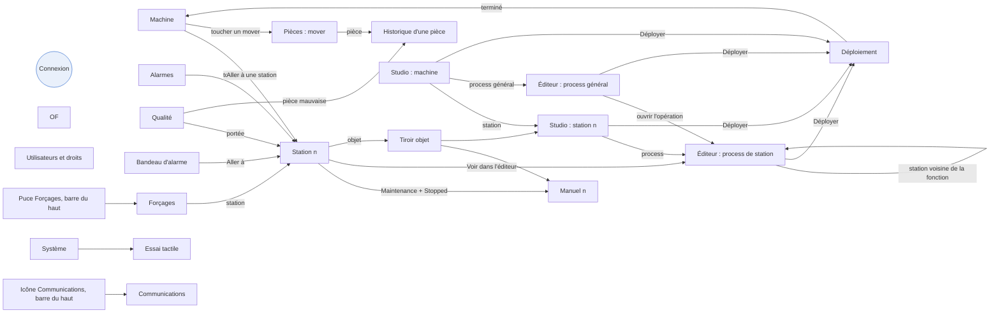

# Design de la HMI : système visuel, navigation, écrans et retours en fonctionnement

Ce document décrit l'interface à construire : principes, jetons de design, composants, coquille et navigation, chaque écran, et les **retours visuels en fonctionnement** (comment l'interface montre ce qui tourne, ce qui attend, ce qui est en erreur). La maquette `docs/ui-reference/Machine_Studio.dc.html` est la référence pour le langage visuel et pour l'usage de l'éditeur de process ; tout le reste est défini ici. Les termes suivent `00-glossaire.md`.

## 1. Principes

1. **L'état d'abord.** Sur chaque page, l'état de ce qu'on regarde (machine, station, objet, carte) se lit en moins d'une seconde, de loin : couleur, icône et mot, jamais la couleur seule.
2. **La couleur a un sens, toujours le même.** Bleu = activité en cours et sélection ; vert = bon, en production ; orange = attente, avertissement, pause ; rouge = erreur, défaut ; violet = simulation ; sarcelle = pas à pas. Le reste de l'interface est neutre (gris et blanc).
3. **Le mouvement signale l'activité, le clignotement exige une action.** Ce qui travaille pulse doucement ; seul ce qui attend une intervention humaine clignote (en phase avec la balise réelle).
4. **Une seule façon de faire chaque chose.** Mêmes cartes, mêmes panneaux, mêmes gestes dans le studio et en exploitation.
5. **Tactile sans compromis.** Cibles de 48 px au moins, 64 px pour les commandes de machine, pas de survol, pas de clic droit, pas de double toucher. Les actions dangereuses se confirment par un appui maintenu, pas par une boîte de dialogue en plus.
6. **On ne cache pas, on explique.** Un bouton indisponible reste visible, grisé ; le toucher dit pourquoi (état, mode, droit) et comment y arriver.
7. **Dense mais lisible.** On garde la densité d'outil d'ingénierie de la maquette, agrandie pour le doigt : beaucoup d'information, peu de décoration.

## 2. Jetons de design

Tous définis dans `Theme/Tokens.xaml` ; les vues n'utilisent que ces clés.

### 2.1 Couleurs neutres et accent

| Clé | Valeur | Usage |
| --- | --- | --- |
| `Bg.App` | `#F4F5F7` | Fond de l'application |
| `Bg.Surface` | `#FFFFFF` | Cartes, panneaux, barre du haut |
| `Bg.SurfaceAlt` | `#FAFBFC` | Rail de navigation, panneaux de gauche (arbre, palette) |
| `Bg.Sunken` | `#F0F2F4` | Sélecteurs à segments, fond d'icône, champs inactifs |
| `Border.Default` | `#E1E4E8` | Bordures de panneaux et cartes |
| `Border.Strong` | `#D9DDE2` | Bordures de boutons et champs |
| `Border.Divider` | `#EEF0F2` | Séparateurs de lignes |
| `Text.Primary` | `#1A1D21` | Texte principal |
| `Text.Secondary` | `#5F6873` | Libellés, descriptions |
| `Text.Tertiary` | `#8A929C` | Indications, unités |
| `Text.Disabled` | `#B0B6BD` | Désactivé |
| `Accent` | `#2563C9` | Sélection, action principale, activité en cours |
| `Accent.Pressed` | `#1A4B9C` | Bouton principal appuyé |
| `Accent.Bg` | `#E9F0FB` | Fond d'élément sélectionné |
| `Accent.BgSoft` | `#F5F8FD` | Survol de zone de dépôt |
| `Accent.Border` | `#9DB7E3` | Bordure de bloc En parallèle, bordure pointillée d'ajout |

### 2.2 Couleurs sémantiques

| Clé | Texte | Fond | Point / trait | Sens |
| --- | --- | --- | --- | --- |
| `Ok` | `#1E7A45` | `#E5F3EA` | `#1E8A4C` | Bon, prêt, complet, en production |
| `Warn` | `#8A5200` | `#FCF0DB` | `#D98A00` | Avertissement, attente, pause, incomplet |
| `Err` | `#A83232` | `#FBE8E8` | `#C63C3C` | Erreur, défaut, mauvais |
| `Busy` | `#1A4B9C` | `#E9F0FB` | `#2563C9` | Action en cours |
| `Sim` | `#5B3CB0` | `#EFEAFB` | `#6D4AC9` | Objet ou machine en simulation |
| `Step` | `#0F5F59` | `#E0F2F1` | `#0F766E` | Pas à pas, en attente du pas |
| `Maint` | `#1E4E8C` | `#E3EDFB` | `#3A6FD8` | Mode Maintenance (avec icône clé) |
| `Neutral` | `#3B424B` | `#E9ECEF` | `#8A929C` | Arrêté, inconnu |

### 2.3 États PackML

| État | Badge | Icône |
| --- | --- | --- |
| Stopped | `Neutral` | `stop_circle` |
| Resetting | `Warn` avec rayures animées | `restart_alt` (rotation lente) |
| Idle | `Ok` en contour | `pause_circle` |
| Execute | Fond plein `#1E8A4C`, texte blanc | `play_circle` |
| Held | `Warn` | `pause` |
| Stopping | `Warn` avec rayures animées | `stop` |
| Aborted | Fond plein `#C63C3C`, texte blanc, icône clignotante | `report` |
| Clearing | `Err` avec rayures animées | `cleaning_services` |

### 2.4 Balise (couleurs physiques)

Le composant Balise reproduit la colonne réelle : rouge `#E5484D`, orange `#F59E0B`, vert `#22A55B`, bleu `#2F6FED`, éteint `#D5D9DE`. Une couleur allumée a un halo (flou 6 px de la même couleur à 40 %). Le clignotement suit `BlinkClock` (période du paramètre de balise, 800 ms par défaut), donc il est en phase sur tout l'écran.

### 2.5 Typographie (IBM Plex Sans, chiffres tabulaires partout)

| Clé | Taille / graisse | Usage |
| --- | --- | --- |
| `Type.Caps` | 12 / 600, majuscules, espacement 0,04 em | En-têtes de groupe (PROJET, LOGIQUE) |
| `Type.Caption` | 13 / 400 | Unités, aides, horodatages |
| `Type.Body` | 15 / 400 | Texte courant, lignes de tableau |
| `Type.BodyStrong` | 15 / 600 | Titres de cartes, valeurs importantes |
| `Type.Title` | 20 / 600 | Titres de section, nom de station |
| `Type.PageTitle` | 26 / 600 | Titre de page |
| `Type.Value` | 34 / 500 | Grandes valeurs (position d'axe, compteurs) |
| `Type.Kpi` | 48 / 500 | Chiffres de la page Machine (OF) |

Formats : virgule décimale (« 268,40 »), signe moins typographique « − », espace fine avant les unités (« 850 N »), durées « 1,2 s » sous 60 s puis « 2 min 05 s », heures « 14:32:05 ».

### 2.6 Dimensions, espacements, formes

| Clé | Valeur |
| --- | --- |
| Grille | multiples de 4 px |
| `Size.Touch` | 48 px (minimum de toute cible) |
| `Size.Row` | 56 px (lignes de liste et de tableau) |
| `Size.Command` | 64 px (boutons de commande machine) |
| `Size.NavItem` | 72 × 72 px |
| `Size.TopBar` | 64 px |
| `Size.NavRail` | 88 px |
| `Size.SidePanel` | 380 px (panneau de droite), 300 px (panneau de gauche) |
| `Radius.S / M / L / XL` | 6 / 8 / 10 / 12 px ; pastilles 999 px |
| `Shadow.Card` | 0 1 2 rgba(20,30,45,0,06) |
| `Shadow.Raised` | 0 4 12 rgba(20,30,45,0,10) (carte sélectionnée, fantôme) |
| `Shadow.Overlay` | 0 12 32 rgba(20,30,45,0,16) (popovers, pavé numérique) |

### 2.7 Mouvement

| Clé | Valeur | Usage |
| --- | --- | --- |
| `Motion.Fast` | 120 ms | Pression de bouton, changement de couleur |
| `Motion.Base` | 200 ms | Apparition de panneau, retour du fantôme |
| `Motion.Slow` | 320 ms | Changement de page, tiroir |
| `Ease.Standard` | courbe (0,2 ; 0 ; 0 ; 1) | Tout mouvement |
| `Pulse.Period` | 1 600 ms | Pulsation d'activité |
| `Blink.Period` | 800 ms (paramètre de balise) | Clignotement « action requise » |
| `Flow.Speed` | 40 px/s | Tirets animés sur les connecteurs actifs |

Réglage « Réduire les animations » (page Système) : supprime pulsations, flux et secousses ; garde les couleurs, icônes et clignotements de la balise.

## 3. Composants

| Composant | Description | États |
| --- | --- | --- |
| `Button` | 48 px, rayon 8, icône + libellé. Variantes : principal (accent plein), secondaire (blanc, bordure), discret (sans bordure), danger (bordure rouge, texte rouge) | normal, appuyé (assombri, échelle 0,98), désactivé (gris + cadenas si droit), en cours (indicateur rotatif à la place de l'icône) |
| `CommandButton` | 64 px, pour Réarmer, Démarrer, Pause, Arrêter, Acquitter ; icône 28 px | comme `Button` ; « disponible » met un liseré de la couleur de l'état cible |
| `AbortButton` | 64 px, rouge plein, toujours actif (droit non modifiable), sans confirmation | appuyé : rouge foncé |
| `HoldButton` | Bouton à appui maintenu (1 s) pour Déployer, Annuler un OF, Supprimer, Confirmer un retrait | anneau qui se remplit pendant l'appui ; relâcher avant la fin annule |
| `StateBadge` | Badge d'état PackML (§ 2.3), tailles S (24 px), M (32 px), L (48 px avec description) | transition en fondu 200 ms + rebond d'échelle 1,06 |
| `StatusPill` | Pastille 24 px (Complet, Incomplet, Erreur, Simulé, Personnalisée…) | — |
| `StatusDot` | Point 8 px (arbre, listes) | pulse si `Busy` |
| `ObjectCard` | Carte d'objet : icône 40 px sur fond `Bg.Sunken`, nom, modèle, pastille d'état, valeurs E1..E4 compactes | sélectionnée (bordure accent + halo 3 px), en cours, en erreur, simulée (coin violet « SIM ») |
| `StepCard` | Carte d'étape de l'éditeur (§ 6.9) | voir § 7.2 |
| `BlockFrame` | Cadre de bloc avec étiquette ronde centrée en haut | voir § 7.2 |
| `Lane` | Colonne de l'éditeur avec en-tête collant (mode Couloirs seulement) | active (en-tête accentué si une carte du couloir tourne) |
| `ObjectChip` | Pastille d'objet (icône et nom) portée par une carte en mode Flux | active (accentuée si l'objet travaille, rouge s'il est en erreur) |
| `PaletteItem` | Élément de palette 48 px : poignée, nom, icône | glissé (fantôme), indisponible (opacité 40 % + raison) |
| `TreeRow` | Ligne d'arborescence 48 px avec indentation 20 px par niveau, chevron 40 px | sélectionnée, cible de dépôt |
| `DataRow` | Ligne de tableau 56 px | sélectionnée, en erreur (barre rouge à gauche), modifiée (point bleu) |
| `Tabs` | Onglets 48 px, soulignement accent 3 px | — |
| `Segmented` | Sélecteur à segments 48 px | — |
| `Toggle` | Interrupteur 52 × 32 px | — |
| `OverrideControl` | Valeur en grand + boutons −/+ (pas de 5 %) + toucher pour ouvrir un curseur 400 px avec valeurs rapides 0 / 25 / 50 / 75 / 100 % ; affiche la chaîne d'override effectif | 0 % : fond `Warn`, libellé « Mouvements arrêtés » |
| `NumericKeypad` | Pavé 4 × 4 de touches 72 px, affichage de la valeur, unité, bornes, −/+ du pas | valeur invalide : affichage rouge + message |
| `Keyboard` | Clavier AZERTY de touches 64 px | — |
| `Beacon` | Balise verticale (§ 2.4), tailles S (16 × 56 px), M (24 × 96 px) | suit l'état réel publié par le PLC |
| `ProgressBar` | 4 px sous les cartes, 8 px dans les panneaux | indéterminée (bande qui glisse) si l'avancement est inconnu |
| `ProgressRing` | Anneau 24 / 40 px | passe orange à 80 % du timeout effectif |
| `AlarmBanner` | Bandeau 56 px sous la barre du haut | voir § 7.6 |
| `Toast` | Notification 48 px en bas au centre, 3 s | succès, info, erreur |
| `Drawer` | Panneau qui glisse de la droite, 480 px | — |
| `EmptyState` | Icône 64 px, titre, phrase, action | — |
| `LockOverlay` | Cadenas + « Niveau Régleur requis » sur un élément protégé | toucher → connexion |

## 4. Coquille et navigation

### 4.1 Coquille (1920 × 1080)

```
┌──────┬───────────────────────────────────────────────────────────────────────────────────────┐
│      │ ▣ MX-4  Ligne d'assemblage   [● Execute] [Production] [OF 24-117 ███░ 412/600]          │
│ RAIL │                       [Override 80 % − +] [🔔 2] [PLC ●] [Régleur · A. Martin] 14:32 │ 64 px
│ 88px ├───────────────────────────────────────────────────────────────────────────────────────┤
│      │ ▲ Bandeau d'alarme (seulement si un défaut est actif et non acquitté)              56 px  │
│ ⌂    ├───────────────────────────────────────────────────────────────────────────────────────┤
│ Mach.│                                                                                       │
│ ▦    │                                CONTENU DE LA PAGE                                     │
│ Stat.│                                                                                       │
│ ✋   │                                                                                       │
│ Man. │                                                                                       │
│ 🔔   │                                                                                       │
│ Alar.│                                                                                       │
│ ◫    │                                                                                       │
│ Pièc.│                                                                                       │
│ ≡ OF │                                                                                       │
│ ──── │                                                                                       │
│ STUDIO                                                                                       │
│ ⚙ Mach.                                                                                      │
│ ⚙ Stat.                                                                                      │
│ ⑂ Proc.                                                                                      │
│ ──── │                                                                                       │
│ 👤 Util.                                                                                     │
│ 📊 Stat.                                                                                     │
│ 🖥 Syst.                                                                                     │
└──────┴───────────────────────────────────────────────────────────────────────────────────────┘
```

- **Barre du haut** (toujours visible) : nom de la machine ; badge d'état machine (M) ; mode ; OF en cours avec barre de progression (bonnes en vert, mauvaises en rouge, en cours en bleu) ; contrôle d'override machine ; cloche d'alarmes avec compteur ; état de la connexion PLC (vert connecté, orange simulateur, rouge déconnecté) ; état des communications (icône `lan` : verte si tous les canaux activés sont connectés, orange si un canal est dégradé, rouge si un canal est en erreur ; toucher → page Communications) ; puce « Forçages : n » (couleur `Maint`, icône `engineering`) tant qu'un forçage est actif ; utilisateur (toucher → connexion) ; heure.
- **Rail de navigation** (icônes Material Symbols 28 px, libellé 12 px) : groupe Exploitation (Machine, Stations, Manuel, Alarmes, Qualité, Forçages, Pièces, OF), groupe Studio (Machine, Station, Process), groupe Administration (Utilisateurs, Statistiques, Communications, Système). Badges sur les icônes : nombre d'alarmes actives, point rouge si le projet a des erreurs de validation, point bleu si le projet n'est pas déployé.
- **Pages du studio** : sous la barre du haut, une barre d'outils de page de 56 px (titre, annuler, refaire, résumé de validation, Déployer) et, en bas, la barre de validation de 44 px.

### 4.2 Carte de navigation



Règles :
- La **station courante** est partagée : changer de station dans une page (Station, Manuel, Studio station, Éditeur) la change pour les autres. Dans ces pages, une rangée de puces de stations (48 px, avec point d'état) en haut permet de passer d'une station à l'autre ; le glissement horizontal du contenu fait de même.
- **Retour** : un bouton « ‹ Retour » apparaît dans la barre d'outils quand on est arrivé par un lien (alarme, pièce, tiroir) ; il ramène à l'endroit exact d'origine.
- **Liens profonds** : toute alarme, trace, erreur de validation ouvre la page concernée avec l'élément sélectionné et mis en évidence (§ 7.7).
- **Gardes** : l'édition du projet est possible à tout moment (c'est une copie hors ligne) ; seuls Déployer, Apprendre et le mode manuel dépendent de l'état de la machine. Une page studio affichée pendant que la machine produit montre un bandeau discret « Le PLC exécute la version déployée le 14/10 à 16:05 ».
- **Droits** : une page entière inaccessible reste dans le rail, grisée avec cadenas ; la toucher ouvre la connexion.
- **Démarrage** : page Machine. Après 10 minutes sans toucher : déconnexion (retour niveau 0) et retour à la page Machine si on était dans le studio.

## 5. Vue d'ensemble des pages

| Page | Pour qui | Question à laquelle elle répond |
| --- | --- | --- |
| Machine | Tous | La machine produit-elle ? Où sont les movers ? Que dois-je faire ? |
| Station | Opérateur, régleur | Que fait cette station, où en est-elle, pourquoi est-elle arrêtée ? |
| Manuel | Régleur | Je veux faire bouger cet objet, apprendre cette position |
| Alarmes | Tous | Qu'est-ce qui ne va pas, depuis quand, où ? |
| Qualité | Opérateur, régleur, qualité | Les rebuts dérivent-ils ? Qui est arrêté pour qualité, pourquoi, et comment le libérer ? |
| Pièces | Opérateur, qualité | Où est cette pièce, qu'a-t-elle subi ? Quels movers vider ? |
| OF | Opérateur | Quel OF tourne, combien reste-t-il, lancer le suivant |
| Studio machine | Ingénieur process | Quelles stations, quelles fonctions, où sur le plan ? |
| Studio station | Ingénieur process | Que contient cette station, comment est-elle raccordée ? |
| Éditeur de process | Ingénieur process | Quelle suite d'étapes, avec quels paramètres ? |
| Déploiement | Ingénieur process | Qu'est-ce qui change, est-ce prêt, l'envoyer |
| Utilisateurs et droits | Administrateur | Qui peut faire quoi |
| Statistiques | — | À définir |
| Système | Administrateur | Connexion, simulateur, projet, affichage |

## 6. Écrans

### 6.1 Machine

```
┌────────────────────────────────────────────────────────────┬──────────────────────────────────┐
│ Plan planaire en direct                       [Légende ▾]  │ ● EXECUTE                [Balise]│
│  ┌────────┐   ┌──────────┐ ┌──────────┐   ┌────────┐       │ Production depuis 02 h 14        │
│  │Chargem.│   │Pressage01│ │Pressage02│   │Contrôle│       │ [Réarmer] [Démarrer] [Pause]     │
│  │● Exec ◔│   │● Exec ◕  │ │▲ ABORTED │   │● Exec  │       │ [Arrêter] [Acquitter]            │
│  └───▼────┘   └────▼─────┘ └────▼─────┘   └───▼────┘       │ [■■■■■■■■ ABORT ■■■■■■■■]        │
│ ┌─┬─┬─┬─┐ ……… tuiles ……… movers (carrés numérotés) ………    │ Mode  [Production|Maintenance]   │
│ │3│ │ │5│      ◻ ◻ tampons      ┄┄► destination             │ Override machine  80 %  [− +]    │
│ └─┴─┴─┴─┘                                                  ├──────────────────────────────────┤
│  ┌──────────┐             ┌────────┐                       │ OF 24-117 · Platine P12          │
│  │Décharg.  │             │ Rebut  │                       │   412 / 600   ███████░░░  69 %   │
│  └──────────┘             └────────┘                       │   ✓ 405  ✗ 7  ◌ 6 en cours       │
│                                                            │   Fin estimée 16:40              │
│                                                            ├──────────────────────────────────┤
│                                                            │ Stations                          │
│                                                            │ Chargement   ● Execute  ◔ 4,1 s  │
│                                                            │ Pressage 01  ● Execute  ◕ 6,3 s  │
│                                                            │ Pressage 02  ▲ Aborted  [Réint.] │
│                                                            │ …                                │
└────────────────────────────────────────────────────────────┴──────────────────────────────────┘
```

- **Plan planaire** (zone de gauche, zoom par pincement) : tuiles en gris très clair, stations en tuiles posées à leur emplacement (nom, puces de ses fonctions, badge d'état S, anneau d'avancement de l'opération en cours avec « fonction › opération » pendant qu'elle tourne, mini-balise), positions de travail, files (chevrons), tampons et parcage (contours pointillés), movers (§ 7.4). Toucher une station → page Station ; toucher un mover → tiroir mover (état, étape du process général, pièces, destination ; en Maintenance : « Envoyer vers… »).
- **Colonne de droite** (520 px) : état machine (badge L, durée dans l'état, cause si Aborted), balise machine (M), commandes (boutons de 64 px disposés en grille 3 × 2, Abort sur toute la largeur), mode, override machine, carte OF (chiffres `Type.Kpi`), liste des stations (badge, temps de l'opération en cours, bouton « Réintégrer » sur une station Aborted).
- **Finir les pièces** : bouton de commande « Finir les pièces » (icône `hourglass_bottom`) à côté d'Arrêter, disponible en Execute et Held. Touché, il demande une confirmation (appui maintenu). Tant que le mode est actif : le bouton devient « Annuler la fin », un bandeau bleu de la page Machine indique « Fin des pièces en cours — N pièces restantes » avec un anneau de progression, la puce d'état de la barre du haut porte « Execute · fin des pièces », et les stations d'entrée affichent « Chargement arrêté ». Quand la machine s'arrête d'elle-même : toast « Machine vidée : plus aucune pièce en cours » et balise bleu clignotant. Si un mover à vider retient la fin, le bandeau le dit avec un bouton « Voir la pièce ».
- Une commande indisponible, touchée, affiche une bulle : « Démarrer est possible depuis Idle ou Held. La machine est Stopped : Réarmez d'abord. » avec un bouton « Réarmer » si le droit est là.

### 6.2 Station (exploitation)

```
┌─ Puces stations : [Chargement ●] [Pressage 01 ●] [Pressage 02 ▲] [Contrôle ●] … ───────────────┐
│ Pressage 01 · [Pressage pignon] [Sertissage]  [● EXECUTE] [balise]  Override 100 % [− +]        │
│ Commandes de la station (Maintenance, ou réintégration) : [Acquitter] [Réarmer] [Démarrer] …    │
├─[Exécution] [Objets] [Variables] [Historique]──────────────────────────────┬──────────────────────┤
│                                                                            │ Opération en cours   │
│   Éditeur en lecture seule, mode « Suivre l'exécution » (§ 7.2)           │ Presser pignon       │
│   ┌──────────────┬──────────────┬──────────────┬──────────────┐            │ Mover 3 · P12-…0412  │
│   │ Vision       │ Robot XYZC   │ Presse       │ Logique      │            │ 4,1 s / ≈ 6,4 s      │
│   │  ✓ Chercher  │              │              │              │            │ ─────────────────── │
│   │  ✓ Obtenir   │  ✓ Prendre   │              │              │            │ En cours :           │
│   │              │  ◉ Poser ▓▓░ │              │              │            │  Poser pièce (nid)   │
│   │              │  ┆ Prendre   │              │              │            │  Z → −24,80 mm       │
│   │              │   (suivante) │              │              │            │  vitesse 10 % (lente)│
│   └──────────────┴──────────────┴──────────────┴──────────────┘            │ Suivante :           │
│                                                                            │  Prendre pièce Mover │
│                                                                            │ ─────────────────── │
│                                                                            │ Pas à pas (Maint.)   │
│                                                                            │ [Opération|Étape|Act]│
│                                                                            │ [   PAS SUIVANT   ]  │
└────────────────────────────────────────────────────────────────────────────┴──────────────────────┘
```

- **Exécution** : l'opération en cours (ou le cycle de fond, ou l'initialisation) affichée avec le canevas de l'éditeur, en lecture seule, avec les effets du § 7.2 et le suivi automatique. Panneau de droite : fonction et opération (« Sertissage › Sertir »), mover, pièce, durée réelle / estimée, carte en cours et carte suivante **avec leurs paramètres résolus** (position visée en chiffres, vitesse effective), contextes parallèles actifs (une ligne par branche).
- **Maintenance** (panneau de droite, partie basse) : « Lancer… » (choisir l'opération, l'initialisation ou le vidage, avec ou sans mover présent), pas à pas (interrupteur, granularité Opération / Étape / Action, grand bouton « Pas suivant » de 64 px, rappel « Abort pour abandonner »).
- **Objets** : grille de cartes d'objets en direct (§ 7.5) ; toucher → tiroir objet (état, dernière action, erreur avec texte et sous-alarme, bouton Acquitter, liens Manuel et Configuration).
- **Variables** : variables de station et données de la pièce en cours, valeurs en direct, valeur modifiée surlignée 1 s.
- **Historique** : 50 dernières opérations (pièce, durée, verdict, toucher → historique de la pièce).
- **Station Aborted** : en haut de page, carte rouge « Pressage 01 est en Aborted depuis 14:21 — Force maximale dépassée (Presse) » avec les étapes de réintégration numérotées (1 Acquitter, 2 Réarmer, 3 Démarrer), chacune devenant active à son tour.

### 6.3 Mode manuel

```
┌─ Puces stations ───────────────────────────────────────────────────────────────────────────────┐
│ ⓘ Manuel disponible : mode Maintenance ✓  Station Stopped ✓  Droit Régleur ✓                    │
├──────────────────┬─────────────────────────────────────────────────────┬──────────────────────┤
│ Objets           │ Robot XYZC · module            ● Prêt   Ov. manuel 50 %│ Positions nommées   │
│ ▾ Robot XYZC  ●  │ ┌ X 268,40 ┐ ┌ Y 92,15 ┐ ┌ Z −31,60 ┐ ┌ C 0,00 ┐       │ Repos       ✓ [Aller]│
│    Axe X     ●  │ │▕━━━━●━━▏│ │▕━━●━━━━▏│ │▕━━━━━●━▏│ │▕━━●━━━▏│       │ Zone alim.  ✓ [Aller]│
│    Axe Y     ●  │ └─────────┘ └─────────┘ └──────────┘ └────────┘       │ Dépose nid  ✓ [Aller]│
│    Axe Z     ●  │ Plan XY : points des positions, croix du robot         │ Pose presse ✗ [Appr.]│
│    Axe C     ●  │ Fonctions : [Aller à…] [Prendre pièce…] [Poser…]       │ Mover       ✓ [Aller]│
│    Aspiration ● │ [Dégager] [Référencer]                                 │ Bac rebut   ✓ [Aller]│
│ Vision Asyril ● │                                                        │ [Apprendre…]         │
│ Presse        ● │ Axe sélectionné : Z   Jog  [  −  ] [  +  ] vitesse [Lente▾]│ Journal manuel     │
│ Présence nid  ● │ Actions : [Power on] [Init] [Move absolu…] [Stop] …    │ 14:31 Z Move abs ✓  │
└──────────────────┴─────────────────────────────────────────────────────┴──────────────────────┘
```

- **Condition d'accès** : bandeau de pré-requis (mode, état de la station, droit), chaque point en vert ou rouge, avec le bouton qui y mène si l'utilisateur en a le droit (« Passer en Maintenance », « Arrêter la station »).
- **Panneau central généré** à partir du catalogue :
  - en-tête : nom, type, état, override manuel (curseur) pour les axes et modules ;
  - valeurs E1..E4 en `Type.Value` ; pour un axe, barre de course min-max avec le curseur de position actuelle et, pendant un mouvement, un repère fantôme sur la cible ;
  - un bouton de 64 px par action ; une action à paramètres ouvre une feuille avec les champs du catalogue (positions nommées en liste, vitesses de l'axe, pavé numérique) puis « Exécuter » ;
  - résultat de la dernière action (valeurs, jugement en couleur) ;
  - axes : pavé de jog (boutons maintenus de 96 × 96 px), vitesse de jog ;
  - module robot : vue XY (plan de travail à l'échelle, positions nommées en points, position actuelle en croix ; toucher un point → « Aller à <position> » avec confirmation), boutons de fonctions de module ;
  - vérin : deux grands boutons Travail / Repos et un schéma du vérin qui montre la position lue ;
  - entrée : grande LED ; si l'objet est simulé, interrupteur de forçage ;
  - sortie : interrupteur.
- **Positions nommées** : liste (nom, apprise ou non, X Y Z C), « Aller à » (fonction Aller à du robot) et « Apprendre… » (feuille : position cible, composantes à apprendre cochées, valeurs actuelles vs enregistrées, écart en mm ; confirmation par appui maintenu).
- **Journal manuel** : dernières actions avec résultat.

### 6.4 Alarmes

- Onglets **Actives** et **Historique**. Filtres en puces : gravité, station, objet ; recherche texte.
- Ligne d'alarme (64 px) : barre de gravité à gauche (4 px), icône, heure d'apparition, durée (en direct), station › objet, message (catalogue), texte de sous-alarme, état (active, disparue non acquittée, acquittée), boutons « Aller à » et « Acquitter » (avertissements).
- Toucher une ligne : tiroir avec le contexte (étape en cours au moment de l'alarme, mover, pièce, valeurs de l'objet), lien vers l'élément.
- Historique : plage de dates, export CSV.

### 6.5 Pièces et movers

- Colonne gauche : liste des movers (n°, état, station, pièces) et section « Movers à vider » mise en avant (bleu clignotant) avec bouton « Confirmer le retrait » (appui maintenu).
- Recherche d'une pièce par identifiant (clavier, ou collage depuis le presse-papiers).
- Centre : fiche mover ou pièce : mini-process général (cartes en ligne, étape courante en surbrillance), pièces portées, puis **historique d'une pièce** en frise chronologique (une ligne par opération : station, opération, début, durée, verdict, données de pièce clés, vignette de courbe de presse ; toucher → courbe complète force/course avec fenêtres de contrôle).

### 6.6 OF

- Carte de l'OF en cours (numéro, référence, compteurs, barre, fin estimée, Suspendre / Reprendre).
- Liste des OF (état en pastille, quantités, dates) ; « Nouvel OF » ouvre un tiroir (numéro, référence, quantité, paramètres d'opération proposés d'après les opérations du process général).
- Lancer : disponible machine Stopped ou Idle ; Annuler : appui maintenu.

### 6.7 Studio : machine

Onglets :
- **Plan et stations** : éditeur du plan planaire (grille de tuiles à l'échelle). Glisser « Nouvelle station » depuis une palette sur le pourtour ; glisser les marqueurs de position (travail, file, tampon, parcage) ; toucher un marqueur → coordonnées au pavé numérique. Liste des stations à droite (nom, n°, puces de ses fonctions, ordre).
- **Fonctions** : une carte par fonction (nom, rôle, priorité en sélecteur 1 à 9, puces des stations membres, opérations de la fonction : nom et paramètres). Glisser une station depuis la liste des stations vers une carte **ajoute** la station à la fonction (une station peut figurer dans plusieurs cartes) ; appui long sur une puce → « Retirer de la fonction ». Sous chaque puce, un point indique si la station implémente toutes les opérations de la fonction (vert) ou non (rouge, lien vers l'éditeur). Fonction de rebut désignée par une étoile. Une vue « matrice » (stations en lignes, fonctions en colonnes, cases à cocher de 48 px) permet de régler les appartenances d'un coup d'œil.
- **Objets machine** : système planaire, movers (nombre, emplacements), balise machine, sécurités (nom de chaque circuit).
- **Données de pièce** : tableau (nom, type, unité) ; Verdict et Identifiant verrouillés.
- **Image E/S** : import du CSV TwinCAT, tableau filtrable (type, index, nom, borne, utilisé par).
- **Réglages** : délai avant « mover à vider », vitesses des movers, etc.

### 6.8 Studio : station

```
┌─ Puces stations ─────────────────────────────── [Annuler][Refaire]  2 erreurs · 3 avert.  [Déployer]┐
├────────────────────┬─────────────────────────────────────────────────────┬──────────────────────┤
│ PROJET             │ Pressage 01 — vue de dessus                         │ [Propriétés][Biblio.]│
│ ▾ Pressage 01      │ ┌───────────────────────────────────────────────┐   │ ▣ Robot XYZC  ● Inc. │
│  ▾ Robot XYZC  ●   │ │ ┌ Robot XYZC ┐         (fond à points)         │   │ Identité             │
│   ⠿ Axe X      ●   │ │ └────┬───────┘ zone de travail 320 × 180 mm    │   │ Rôles d'enfant       │
│   ⠿ Axe Y      ●   │ │ ┌Vision┐ ┌Nid ┐ ┌Presse┐                        │   │ Axes (tableau)       │
│   ⠿ Axe Z      ●   │ │ └──────┘ └────┘ └──────┘                        │   │ Vitesses (% Vmax)    │
│   ⠿ Axe C      ●   │ └───────────────────────────────────────────────┘   │ Outil                │
│   ⠿ Aspiration ●   ├─[Positions][Variables][Vitesses][Verrouillages][Recettes][Capacités]───┤ Raccordement       │
│ ⠿ Vision Asyril ●  │ Nom         X       Y       Z       C   Approche État   [Apprendre][…]│ Override  100 % − +  │
│ ⠿ Presse        ●  │ Repos       0,00    0,00    0,00  0,00   —     ✓ Apprise              │ Simulation   [ ]     │
│ Variables (2)      │ Pose presse —       —       —      —   12,0   ✗ Non apprise          │ Timeouts             │
│ Process (4) →      │ [+ Ajouter une position]                                              │                      │
├────────────────────┴─────────────────────────────────────────────────────┴──────────────────────┤
│ ⛔ Axes Z et C raccordés au même servo · ⚠ Position « Pose presse » non apprise …   12 actions  │
└──────────────────────────────────────────────────────────────────────────────────────────────────┘
```

- **Arborescence** (300 px) : station › modules › objets ; poignées de glisser (⠿) pour réordonner ou changer de parent ; appui long → menu (renommer, dupliquer, supprimer, convertir en groupe) ; sections Variables et Process avec compteurs ; lien « Process → » vers l'éditeur.
- **Vue de dessus** : les objets de premier niveau sont des cartes (`ObjectCard`) posées librement (position enregistrée), les modules sont des cadres qui contiennent leurs enfants en petites cartes ; dépôt depuis la bibliothèque ; lignes de liaison du robot vers les objets qu'il sert (pointillées si incomplètes). Sert de repère spatial, pas de dessin technique.
- **Onglets du bas** : Positions nommées (tableau de la maquette, agrandi), Variables, Vitesses (tableau axe × V1..V8, en % de Vmax, avec la vitesse en mm/s calculée en gris), Verrouillages (liste : objet, actions, condition — éditeur de condition à termes ; les verrouillages générés par un module sont marqués « Généré » et non modifiables), Recettes de presse (si la station a une presse : tableau de segments par recette, courbe d'aperçu), Capacités (générées : actions et fonctions disponibles pour le process, par objet).
- **Panneau de droite** : Propriétés de l'élément sélectionné, en sections générées depuis le catalogue (Identité, Rôles d'enfant pour un module, Paramètres, Vitesses, Raccordement, Override, Simulation et Désactivé, Timeouts par action, Verrouillages de l'objet) ; Bibliothèque (types par catégorie, modules en tête, recherche ; chaque type glissable avec sa description).
- **Raccordement** : chaque signal est une ligne « nom → [sélecteur] » ; le sélecteur ouvre une liste filtrée de l'image E/S du bon type (index, nom de borne, utilisé par…), avec les conflits en rouge.

### 6.9 Studio : éditeur de process

Référence : écran « Process » de la maquette, agrandi pour le toucher.

```
┌─ Niveau [Machine | Station ▾ Pressage 01]   Process : [Presser pignon][Cycle de fond][Init][+]   [Suivre l'exécution ◉] ─┐
├──────────────────┬───────────────────────────────────────────────────────────────────────┬────────────────────┤
│ 🔍 Rechercher     │ ┌ Vision ────────┬ Robot XYZC ────┬ Presse ────────┬ Logique ──────┐ │ [Étape][Données]   │
│ VISION ASYRIL    │ │ (1) Chercher   │                │                │               │ │ ② Prendre pièce    │
│ ⠿ Chercher pièce │ │      │         │                │                │               │ │ Robot · fonction   │
│ ⠿ Obtenir pièce  │ │ (2) Obtenir ───┼─►(3) Prendre   │                │               │ │ Position [Var ▾]   │
│ ROBOT XYZC       │ │                │  (4) Poser nid │                │               │ │ Approche  10 mm    │
│ ⠿ Aller à        │ │        ╭───────── En parallèle ─────────╮        │               │ │ Vitesse  [Rapide▾] │
│ ⠿ Prendre pièce  │ │        │ (6) Chercher │ (7) Repos │ (5) Presser │               │ │ En cas d'échec     │
│ ⠿ Poser pièce ✎  │ │        ╰──────────────────────────────────╯        │               │ │ [Arrêter|Refaire|…]│
│ PRESSE           │ │                     ╭── Si / Sinon : pièce bonne ──╮               │ │ Résultats → …      │
│ ⠿ Exécuter rec.  │ │                     │ … │ Sinon (rebut) … │                         │ │ [Supprimer]        │
│ LOGIQUE          │ │                    (↺ Fin d'opération)                             │ │                    │
│ ⠿ Si / Sinon     │ └───────────────────────────────────────────────────────────────────┘ │                    │
│ ⠿ En parallèle … ├───────────────────────────────────────────────────────────────────────┤                    │
│                  │ Chronogramme estimé · temps de cycle 6,4 s · étape critique : Presser  │                    │
└──────────────────┴───────────────────────────────────────────────────────────────────────┴────────────────────┘
```

- **Mover requis** : étape de la palette (groupe Logique), carte en forme de trait horizontal fin (icône `person_pin_circle`, « Mover requis ») qui sépare le process en deux zones : au-dessus, un fond teinté « Préparation — avant l'arrivée du mover » ; au-dessous, le fond normal. Une seule peut être posée ; déposée ailleurs qu'au premier niveau, elle est refusée avec le message de V021. Dans les cartes de la préparation, les sélecteurs de valeur ne proposent pas les données de pièce (V022). En suivi d'exécution, la carte Mover requis s'allume en attente tant que le mover n'est pas arrivé. Le chronogramme estimé montre la préparation en parallèle du trajet du mover.
- **Mode d'affichage** : bascule « Vue : Flux | Couloirs » dans la barre de l'éditeur (option `--layout flow|lanes`). **Flux** (défaut, D72) : une seule colonne de cartes, centrée, sans en-têtes de couloirs ; chaque carte d'un objet porte sa pastille d'objet ; les colonnes n'existent que dans un bloc En parallèle ou Si / Sinon, qui épouse ses branches. **Couloirs** (option) : décrit ci-dessous. Le modèle de process, le compilateur et le simulateur sont identiques dans les deux modes ; au niveau machine du Flux, pas de pastille (la carte écrit déjà « Fonction : … »).
- **Niveaux** : sélecteur Machine | Station en haut à gauche, puis la station et le process. En mode Couloirs, au niveau machine, les couloirs sont les fonctions et la palette contient leurs opérations ; une carte d'opération a un bouton « Ouvrir l'opération » qui ouvre l'éditeur au niveau station (sur la première station de la fonction ; les puces de stations permettent de passer aux autres).
- **Opérations d'une station à plusieurs fonctions** : au niveau station, les onglets de process regroupent les opérations par fonction (« Pressage pignon › Presser pignon », « Sertissage › Sertir ») ; l'onglet Données du process d'une opération contient la liste « Implémente » : cases à cocher des opérations des fonctions de la station, pour qu'un même process serve plusieurs fonctions quand leurs paramètres sont identiques. Au niveau machine, l'en-tête d'un couloir de fonction montre les puces de ses stations ; une station partagée apparaît dans plusieurs couloirs.
- **Palette** (280 px) : recherche ; un groupe par couloir avec ses actions et ses fonctions (une fonction personnalisée porte un crayon ✎) ; groupe Logique ; éléments de 48 px avec poignée ; une action indisponible (manuel seulement, objet désactivé) est atténuée avec sa raison.
- **Canevas** : en-têtes de couloirs collants (mode Couloirs) ou colonne unique (mode Flux) ; cartes de 260 px de large au plus, hauteur selon le contenu (64 px minimum) : pastille de numéro, titre, icône, 1 à 3 paramètres clés, pied (durée estimée), messages d'erreur ou d'avertissement en bandeau dans la carte ; connecteurs en angle arrondi ; blocs encadrés avec étiquette ronde (toucher → réglages du bloc dans le panneau de droite ; poignée de l'étiquette → déplacer le bloc ; « + Branche ») ; repère de fin « ↺ Fin d'opération » ou « ↺ Retour à l'étape 1 ». Zoom par pincement, boutons « Ajuster » et « 100 % ».
- **Glisser-déposer** : depuis la palette vers une carte (trait bleu avant/après selon la moitié touchée), vers une branche vide (zone pointillée « Déposez une action ici »), vers la fin ; déplacer une carte ou un bloc par sa poignée ; refus expliqué sous le doigt (« Un objet ne peut pas être dans deux branches parallèles »).
- **Panneau de droite** (380 px) : onglet Étape (titre, objet, type, description, paramètres avec sélecteurs de valeur — constante, variable, donnée de pièce, paramètre d'opération, position nommée avec décalage —, timeout, En cas d'échec, **sorties** (une ligne par résultat du catalogue avec la variable qui le reçoit ; toucher une ligne propose « Ne pas ranger », les variables compatibles — de process puis de station —, les données de pièce, le verdict (jugements), l'identifiant (texte) et « Nouvelle variable de process / de station… » dont le nom, proposé d'après le résultat, se modifie tout de suite au clavier ; la carte affiche « Résultat → variable »), supprimer) ; onglet Données du process (paramètres d'opération, variables de process — renommer, rendre partagée, supprimer si inutilisée —, variables de station, données de pièce lues et écrites par ce process) ; onglet Table compilée (listing de `06-tables-et-interface-hmi-plc.md` § 5.6, l'instruction de la carte sélectionnée surlignée).
- **Chronogramme estimé** (repliable) : une ligne par couloir, barres par étape à l'échelle du temps estimé (catalogue + courses), chemin nominal, étape critique, temps de cycle, cadence ; « Rejouer » anime une tête de lecture et surligne les cartes au fil du temps.
- **Suivre l'exécution** : superpose l'exécution réelle (PLC ou simulateur) sur le canevas (§ 7.2). Si le process a été modifié depuis le déploiement, l'exécution affichée est celle de la version déployée : le canevas passe en lecture seule grisée avec le bandeau « Version déployée (modifiée depuis) — Revenir à l'édition ».

### 6.10 Déploiement

Feuille plein écran en 4 étapes, avec indicateur d'étapes en haut :
1. **Validation** : erreurs (bloquantes) et avertissements, chacun avec « Corriger » (lien profond).
2. **Différences** : arbre des changements par rapport à la version déployée (stations, objets, paramètres, positions, process ; ajouté en vert, modifié en bleu, supprimé en rouge barré) ; compteur par catégorie.
3. **Conditions** : machine Stopped, PLC connecté, droit Déployer, aucun mover en défaut — chaque ligne cochée en direct.
4. **Envoi** : bouton « Déployer » à appui maintenu ; progression par bloc (machine, stations, recettes) avec vérification de la somme de contrôle ; résultat (succès avec empreinte et heure, ou liste des refus du PLC avec liens).

### 6.11 Utilisateurs et droits

- **Utilisateurs** : liste (nom, identifiant, niveau, dernière connexion, actif) ; tiroir d'édition ; réinitialiser le mot de passe.
- **Niveaux** : liste éditable (n°, nom).
- **Droits** : tableau groupé (Machine, Stations, Manuel, Studio, OF, Administration) ; chaque droit a un sélecteur de niveau ; Abort verrouillé au niveau 0 ; chaque modification est journalisée.
- **Journal** : qui, quand, quoi, avant/après, filtres.

### 6.12 Statistiques

État vide : icône `monitoring`, titre « Statistiques de production », phrase « À définir. Les données d'OF et de traçabilité sont déjà enregistrées. »

### 6.13 Système

Connexion PLC (mode, AMS Net Id, état, empreinte du projet dans le PLC), Simulateur (échelle de temps, injection de défauts, taux d'échec, forçage), Projet (ouvrir, importer, exporter, historique des déploiements avec restauration), Exporter les constantes PLC, Essai tactile, Affichage (mode kiosque, réduire les animations, temps de déconnexion), À propos (versions, licences).

### 6.14 Connexion

Surimpression : tuiles des utilisateurs récents (64 px), champ identifiant, pavé PIN ou clavier mot de passe, « Rester en Opérateur ». Après connexion, l'action qui l'a demandée s'exécute.

### 6.15 Qualité

Page de la surveillance des rebuts : voir `10-surveillance-des-rebuts.md` § 11 (disposition, fenêtres en carrés, états des portées, libération, tiroir de détail, éléments affichés dans les autres pages).

### 6.16 Communications

Rail, groupe Administration, icône `lan`. Droit `system.settings` pour modifier ; lecture pour tous.

```
┌─ Communications ───────────────────────────────────────────── Identifiant machine [MX-4]  Racine [entreprise/site-1/…] ─┐
│ ┌ PLC ──────────────────────────┐ ┌ Journal de messages ─────────┐ ┌ Usine — événements (MQTT) ──┐                    │
│ │ ● Connecté · Simulation       │ │ ● Actif · 18 412 messages     │ │ ○ Prévu                      │                    │
│ │ Mode [Simulation|ADS]         │ │ Dossier, rétention 7 j        │ │ Broker, port, TLS, identif.  │                    │
│ │ AMS Net Id, port 851          │ │ [Ouvrir le dossier]           │ │ Sujets ☑ pièces ☑ alarmes…   │                    │
│ │ [Tester]          [Réglages]  │ │ [Tester]   [Réglages] [◉ On]  │ │ [Réglages]        [○ Prévu]  │                    │
│ └───────────────────────────────┘ └───────────────────────────────┘ └──────────────────────────────┘                    │
│ ┌ Usine — état (OPC UA TwinCAT) ┐ ┌ OF entrants ─────────────────┐ ┌ Appareils réseau ────────────┐                    │
│ │ ○ Prévu (phase PLC)           │ │ ● Source locale               │ │ 4 appareils · 4 joignables   │                    │
│ │ Adresse à donner à l'usine    │ │ Usine (MQTT) : ○ Prévu        │ │ Lecteur de code ● 2 ms       │                    │
│ └───────────────────────────────┘ └───────────────────────────────┘ └──────────────────────────────┘                    │
│ [Exporter les schémas JSON]   [Remettre à zéro les compteurs de production…]                                          │
└────────────────────────────────────────────────────────────────────────────────────────────────────────────────────────┘
```

- Une carte par canal : nom, interrupteur d'activation (désactivé et marqué « Prévu » pour un canal pas encore réalisé), état en direct (point de couleur + texte : Désactivé, Prévu, Démarrage, Connecté, Dégradé, Erreur), dernière erreur avec l'heure, compteurs (messages envoyés, en attente), boutons Tester et Réglages.
- Réglages dans un tiroir à droite, champs générés depuis la description du canal ; les secrets s'affichent masqués avec « Modifier » ; « Appliquer » relance le canal ; toute modification est journalisée.
- Désactiver un canal actif se confirme par appui maintenu ; la carte passe en gris.
- **Appareils réseau** : liste en lecture des connexions déclarées dans les objets des stations (vision, lecteur de code, robots…), avec leur état et le temps de réponse ; leurs réglages restent dans le studio station.

### 6.17 Forçages

Rail, groupe Exploitation, icône `engineering`. Disposition, comportements et droits : `12-forcages-et-etats-declares.md` § 8.

## 7. Retours visuels en fonctionnement

Cette partie décrit comment l'interface rend visible ce qui se passe dans la machine. Toutes les informations viennent de l'instantané PLC (10 Hz) ; les animations sont interpolées entre deux instantanés pour rester fluides.

### 7.1 Règles générales

| Situation | Couleur | Mouvement | Exemple |
| --- | --- | --- | --- |
| En cours | `Busy` (bleu) | Pulsation douce (halo qui respire, 1,6 s) + barre d'avancement | Carte d'étape en exécution, objet qui bouge |
| Prochain | Contour accent pointillé | Aucun | Carte suivante |
| En attente d'une condition | `Warn` (orange) | Contour en « tirets qui défilent » | Attendre « pièce présente » |
| En attente du pas à pas | `Step` (sarcelle) | Icône pause, aucun mouvement | Pas à pas arrêté avant une carte |
| Terminé | `Ok` (vert) | Coche qui apparaît (200 ms) puis s'estompe en 1,5 s | Carte qui vient de finir |
| Erreur | `Err` (rouge) | Secousse horizontale unique (3 × 4 px, 300 ms), puis fixe | Carte dont l'action a échoué |
| Action requise | Couleur de l'état | Clignotement en phase avec la balise (`BlinkClock`) | Station Aborted, mover à vider, alarme non acquittée |
| Suspendu par override 0 % | Rayures diagonales gris-bleu | Aucun | Axe arrêté par override |
| Simulé | Coin violet « SIM » | Aucun | Objet en simulation |

### 7.2 Éditeur de process en direct (« Suivre l'exécution »)

**Cartes** (état calculé depuis le PC de chaque contexte et la carte de compilation) :

| État de la carte | Rendu |
| --- | --- |
| Inactive | Normal |
| Suivante | Contour pointillé accent 2 px, pastille « Suivante » en haut à droite |
| En cours | Bordure accent 2 px, halo qui pulse, barre d'avancement de 4 px en bas (`fProgress` de l'objet, sinon bande indéterminée), chrono qui défile dans le pied (« 1,3 s / ≈ 2,0 s ») ; pour une fonction de module : liste de ses étapes internes, la sous-étape en cours en gras avec une puce bleue |
| En cours, attente de condition | Contour orange en tirets qui défilent, icône sablier qui tourne, termes de la condition listés avec leur valeur actuelle et une coche ou une croix par terme (« Pièce présente sur le nid ✗ ») |
| En cours, verrouillage | Icône cadenas orange, condition qui bloque en clair |
| En cours, override 0 % | Rayures diagonales, « Arrêté par override (machine 0 %) » avec le niveau responsable |
| En cours, timeout proche | Anneau d'avancement qui passe orange à 80 % du timeout effectif |
| Nouvel essai | Pastille orange « Essai 2/3 » avec flèche circulaire qui tourne |
| Terminée (ce cycle) | Coche verte en haut à droite, durée réelle affichée, s'estompe vers l'état normal en 1,5 s ; le chemin parcouru reste marqué jusqu'au prochain cycle (connecteur en accent pâle) |
| En erreur | Bordure et fond `Err`, secousse unique, bandeau dans la carte avec le message et deux boutons « Voir l'objet » et « Alarme » |
| Branche non prise (Si / Sinon) | La branche non prise passe à 40 % d'opacité pour le cycle en cours |
| Pas à pas, en attente | Bordure sarcelle, icône pause, mention « En attente du pas » ; la carte suivante n'est pas affichée « Suivante » mais « Après ce pas » |

**Blocs** :
- En parallèle actif : cadre en accent plein, chaque branche montre sa carte en cours ; une branche finie qui attend les autres affiche au bas un trait pointillé animé vers le point de jonction et « Attend les autres branches ».
- Si / Sinon : au moment de l'évaluation, l'étiquette du bloc affiche le résultat (« Pièce bonne : oui ») 2 s, la branche choisie s'éclaire.
- Répéter : l'étiquette affiche « Tour 2 / 3 ».

**Connecteurs** : le segment entre la dernière carte terminée et la carte en cours est animé (tirets qui avancent dans le sens d'exécution) ; les segments parcourus dans le cycle sont en accent pâle ; les autres en gris.

**Suivi** : le canevas défile en douceur (320 ms) pour garder la carte en cours visible ; un toucher de l'utilisateur sur le canevas suspend le suivi 10 s (pastille « Suivi suspendu — Reprendre »). Une mini-carte en bas à droite montre l'ensemble du process et un point bleu par contexte actif.

**En-têtes de couloir** (mode Couloirs ; en mode Flux, la pastille d'objet de la carte joue ce rôle : barre bleue quand l'objet travaille, rouge en erreur) : l'en-tête d'un couloir dont un objet travaille porte une barre bleue de 3 px en bas ; si un objet du couloir est en erreur, l'en-tête passe en rouge.

### 7.3 États machine et station

- **Changement d'état** : le badge fait un fondu enchaîné de 200 ms avec un léger rebond d'échelle ; la bordure supérieure de la page (2 px sous la barre du haut) prend la couleur de l'état pendant 1 s.
- **États transitoires** (Resetting, Stopping, Clearing) : badge à rayures qui défilent et liste des étapes de la transition en cours (Resetting : « Power on des axes ✓ · Référencement Z ◉ · Référencement X, Y ○ ») construite à partir de la table d'initialisation.
- **Aborted** : badge rouge plein, icône qui clignote en phase avec la balise ; sur la page Machine, la tuile de la station a une bordure rouge clignotante et des hachures rouges pâles ; un bandeau d'alarme apparaît (§ 7.6).
- **Arrêt qualité** : la tuile de la station porte un macaron rouge « Arrêt qualité » et ses files deviennent grises ; un mover hors service est gris avec une croix ; un nouveau rebut fait clignoter une fois en rouge la case la plus récente de la fenêtre de la portée.
- **Station hors fonction** (Aborted pendant que la machine produit) : sur le plan, les flèches de routage vers la station disparaissent et ses positions de file deviennent grises ; un macaron « Hors production » apparaît sur la tuile.
- **Balise à l'écran** : toujours identique à la balise réelle (couleurs et clignotement publiés par le PLC).

### 7.4 Plan planaire en direct

| Élément | Rendu |
| --- | --- |
| Mover | Carré à coins arrondis à l'échelle du mover réel (113 mm dans la machine d'exemple), numéro au centre, couleur de fond selon l'état (libre gris, en route bleu, en file bleu pâle, en station vert, en erreur rouge, à vider bleu clignotant avec halo), petites pastilles pour les pièces (verte bonne, rouge mauvaise, blanche en cours) |
| Déplacement | Position interpolée entre instantanés (animation linéaire de 100 ms) ; pas de saut ; une traînée de 3 positions fantômes à 20 % d'opacité donne la direction |
| Destination | Ligne pointillée fine du mover vers sa destination, de la couleur de son état ; la position réservée est un contour pointillé de la même couleur |
| Routage | Au moment où un mover est affecté à une station, la tuile de la station fait un éclair de contour bleu (300 ms) et la ligne de destination se dessine progressivement |
| Station | Tuile avec bande supérieure de la couleur de son état, nom, anneau d'avancement de l'opération en cours, temps de cycle de la dernière opération, mini-balise |
| File | Chevrons devant la station, pleins quand une place est occupée |
| Fin d'opération | La pièce du mover clignote une fois en vert (bonne) ou en rouge (mauvaise) |

### 7.5 Objets en direct (pages Station, Manuel, Studio station)

| Type | Rendu en direct |
| --- | --- |
| Axe | Valeur de position en `Type.Value`, barre de course avec curseur, repère fantôme de la cible pendant un mouvement, flèche de sens animée, vitesse en petit ; « Non référencé » en orange |
| Vérin | Pictogramme de vérin dont la tige glisse entre repos et travail (animation suivant les capteurs), capteurs en petites LED |
| Aspiration | Jauge de vide (kPa) avec les deux seuils marqués, icône d'air qui ondule quand l'aspiration est active, pièce présente en pastille |
| Entrée numérique | LED ronde (verte allumée, grise éteinte) |
| Sortie numérique | Interrupteur reflétant l'état |
| Entrée analogique | Valeur + mini-courbe des 30 dernières secondes |
| Vision | Dernier nombre de pièces trouvées, recette active, vignette du plateau avec les positions trouvées en points (simulateur : positions simulées) |
| Presse | Force et course en direct ; pendant une recette, courbe force/course qui se dessine en temps réel avec ses fenêtres de contrôle |
| Compteur | Valeur, et maximum s'il existe (barre) |
| Tous | Pastille d'état ; en action : barre d'avancement et nom de l'action ; en erreur : fond `Err`, code et texte |

### 7.6 Alarmes et commandes

- **Nouvelle alarme de défaut** : le bandeau rouge glisse depuis le haut (200 ms) sous la barre du haut : icône, heure, station › objet, message, boutons « Aller à » et « Acquitter » (si permis). Plusieurs défauts : le bandeau montre le plus récent et « + 2 autres ». La cloche fait un petit rebond et son compteur passe en rouge.
- **Avertissement** : pas de bandeau ; la cloche passe en orange ; un toast orange de 3 s.
- **Acquittement** : la ligne d'alarme passe en gris en 200 ms ; le bandeau se replie.
- **Commande envoyée** : le bouton affiche un indicateur rotatif jusqu'à la réponse du PLC ; acceptée → le badge d'état change ; refusée → secousse du bouton et toast avec la raison donnée par le PLC (« Refusée : la station n'est pas en Idle »).
- **Override modifié** : la valeur fait un fondu ; à 0 %, la barre du haut affiche une puce orange « Mouvements arrêtés (override 0 %) ».

### 7.7 Mise en évidence d'un élément ciblé (liens profonds)

Quand on arrive sur un élément par un lien (alarme, validation, trace) : la page défile pour le rendre visible, il reçoit un halo accent qui pulse 3 fois (1,2 s), et le champ fautif éventuel est encadré en rouge avec le message sous lui.

### 7.8 Studio : retours d'édition

- Dépôt réussi : la carte déposée apparaît avec un fondu et un léger agrandissement (200 ms) ; les cartes voisines glissent pour lui faire de la place (200 ms).
- Erreur de validation sur une carte : bandeau rouge dans la carte ; la pastille de numéro passe en rouge ; la barre de validation compte.
- Enregistrement automatique : « Enregistré il y a quelques secondes » dans la barre d'outils ; pendant l'écriture, un point qui pulse.
- Projet différent du PLC : point bleu sur Déployer et sur l'icône Studio du rail.

### 7.9 Accessibilité visuelle

- Jamais la couleur seule : chaque état a aussi une icône et un mot.
- Bleu et orange distinguent activité et attente (différenciables par les daltoniens) ; le rouge est toujours accompagné d'une icône.
- Contraste du texte : 4,5:1 au minimum sur son fond.
- Le clignotement ne dépasse jamais 3 fois par seconde.

## 8. Contenu et libellés

- Verbes à l'infinitif sur les boutons (« Réarmer », « Apprendre la position »), phrases courtes.
- Les noms d'états PackML restent en anglais (Stopped, Execute…) avec une description française dans le badge L et dans l'aide.
- Messages d'erreur : ce qui s'est passé, où, et quoi faire (« Vide non atteint sur Aspiration (Robot XYZC, Pressage 01). Vérifier la buse et la présence de la pièce, puis Acquitter. »).
- États vides : toujours une phrase et une action (« Aucune position nommée. Ajoutez-en une, puis apprenez-la en mode manuel. »).
