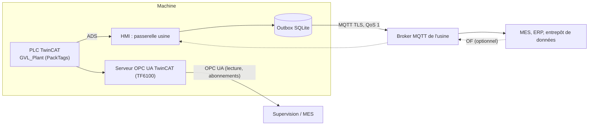

# Interface avec le système de l'usine

Ce document définit comment la machine remonte ses informations vers le système général de l'usine (MES, supervision, ERP, entrepôt de données) et reçoit ses OF : quelles données, par quels canaux, avec quelle fiabilité et quelle sécurité. Les termes suivent `00-glossaire.md`.

> **Première version : les interfaces et les réglages seulement.** Réalisé maintenant : les contrats C# (§ 7), le modèle des messages et leurs schémas JSON (§ 4.2, 4.3), un canal **Journal de messages** qui écrit chaque message dans des fichiers JSON (pour vérifier le contenu sans broker ni système usine), la source d'OF locale, et la page **Communications** (`08-hmi-design-ecrans.md` § 6.16) qui règle et active tous les canaux. Spécifiés ici mais réalisés plus tard : le canal MQTT et son outbox, les OF entrants, le serveur OPC UA (`GVL_Plant`). Dans la page Communications, leurs réglages s'enregistrent déjà ; leur activation porte la mention « Prévu » et reste désactivée.

## 1. Principes

1. **Standards du marché, pas de protocole maison** : l'état en direct suit le vocabulaire **PackML** (déjà notre modèle d'états) exposé en **OPC UA** ; les événements suivent un modèle JSON documenté publié en **MQTT** avec une arborescence de sujets de type ISA-95.
2. **Deux canaux complémentaires** :
   - **OPC UA, côté PLC** (serveur OPC UA TwinCAT, TF6100) pour l'état en direct et les compteurs : disponible même si la HMI est arrêtée, lu à la demande par la supervision.
   - **MQTT, côté HMI** (la « passerelle usine ») pour les événements et les données riches que seule la HMI connaît en clair : alarmes avec textes, traces de pièces, OF, qualité, journal, maintenance.
3. **Aucune perte** : les événements passent par une **file d'envoi persistante** (outbox) ; une coupure réseau retarde la remontée, elle ne perd rien.
4. **La machine produit sans l'usine** : une panne du réseau ou du système usine n'arrête jamais la production.
5. **Lecture seule par défaut** : l'usine lit. La seule donnée qu'elle peut envoyer est un OF (désactivé par défaut), validé par la HMI comme un OF saisi à la main. L'usine ne commande jamais la machine directement.
6. **Données brutes, pas d'indicateurs calculés** : la machine fournit les temps par état, les compteurs et les traces ; le TRS (OEE) et les statistiques se calculent dans le système usine (et plus tard dans la page Statistiques).
7. **Contrat versionné** : chaque message porte la version de son schéma ; les schémas JSON sont livrés avec la HMI et exportables.



## 2. Données remontées

| Famille | Contenu | Canal | Quand |
| --- | --- | --- | --- |
| Identité | N° et nom de machine, site, ligne, versions HMI et PLC, empreinte et date du projet déployé | OPC UA, MQTT | Au démarrage, à chaque déploiement |
| État machine | État PackML, mode, durée dans l'état, raison d'arrêt (première alarme cause), override machine, OF en cours, chargement verrouillé | OPC UA, MQTT | Continu (OPC UA) ; à chaque changement (MQTT) |
| État des stations et fonctions | État de chaque station, fonctions disponibles, arrêts qualité, opération en cours | OPC UA, MQTT | Idem |
| Compteurs de production | Pièces entrées, bonnes, mauvaises (constatées, sur défaut, retirées), en cours ; opérations par station ; cadence instantanée et théorique | OPC UA, MQTT | Continu ; toutes les 60 s (MQTT) |
| Temps par état et par mode | Temps cumulés dans chaque état PackML et chaque mode, depuis la remise à zéro et depuis le début de l'OF | OPC UA, MQTT | Continu ; toutes les 60 s (MQTT) |
| Temps de cycle | Dernier, moyenne glissante sur 50, par station et par opération | OPC UA, MQTT | Continu ; toutes les 60 s |
| Alarmes | Apparition, disparition, acquittement : objet, station, code, sous-code, gravité, texte (français) et texte de sous-alarme, contexte (étape, mover, pièce), utilisateur | MQTT | À chaque événement |
| Arrêts | Début, fin, durée, cause (alarme ou qualification par l'opérateur) | MQTT | À la fin de chaque arrêt |
| OF | Reçu, lancé, suspendu, repris, terminé, annulé, avec compteurs et durées | MQTT | À chaque événement, progression toutes les 60 s |
| Traçabilité des pièces | À la clôture de chaque pièce : identifiant, OF, entrée, sortie, état final, verdict, et pour chaque opération : station, fonction, début, fin, données de pièce, jugement, courbe de presse (référence) | MQTT | À chaque clôture de pièce |
| Qualité | Réactions et libérations (portée, indicateur, valeur, seuil, utilisateur, motif) ; taux et successifs par portée | MQTT | Événements ; état toutes les 5 min |
| Journal | Déploiements, modifications de configuration, overrides, actions manuelles, connexions, droits | MQTT | À chaque événement |
| Maintenance | Par objet : nombre d'actions, nombre d'erreurs, temps de mouvement cumulé, depuis la mise en service et depuis la dernière remise à zéro | MQTT | Toutes les heures |
| Santé | Battement, connexion PLC, remplissage de l'outbox, espace disque | MQTT | Toutes les 30 s |

Les courbes de presse ne sont pas envoyées dans le message de pièce (trop volumineuses) : le message porte leur référence ; un sujet dédié peut les publier si l'usine le demande (désactivé par défaut).

## 3. OPC UA côté PLC

### 3.1 Principe

- Le serveur OPC UA de TwinCAT (TF6100) publie **uniquement** la liste de variables globales `GVL_Plant`, marquée `{attribute 'OPC.UA.DA' := '1'}` ; aucune autre variable du PLC n'est exposée.
- `GVL_Plant` est en lecture seule pour OPC UA (`{attribute 'OPC.UA.DA.Access' := '1'}`) ; elle est remplie par `FB_PlantPublisher` à chaque cycle de la tâche (ou toutes les 100 ms).
- Sécurité : mode SignAndEncrypt, certificats, utilisateurs du serveur TwinCAT ; accès anonyme désactivé.

### 3.2 Modèle (vocabulaire PackTags)

```iecst
TYPE ST_PlantMachine :
STRUCT
    sMachineId          : STRING(40);
    sProjectHash        : STRING(64);
    tDeployed           : DT;
    // Status (PackTags)
    nStateCurrent       : DINT;   // codes PackML : 1 Clearing, 2 Stopped, 4 Idle, 6 Execute, 7 Stopping, 9 Aborted, 11 Held, 15 Resetting
    nUnitModeCurrent    : DINT;   // 1 Production, 2 Maintenance
    tStateCurrentTime   : TIME;   // durée dans l'état courant
    fMachSpeed          : REAL;   // cadence théorique (pièces/min)
    fCurMachSpeed       : REAL;   // cadence réelle glissante (pièces/min)
    fOverride           : REAL;   // %
    bLoadingLocked      : BOOL;   // chargement arrêté (fin d'OF ou qualité)
    // Admin (PackTags)
    nStopReasonId       : DINT;   // code de l'alarme première cause du dernier arrêt, 0 = aucun
    nStopReasonStation  : DINT;
    nProdProcessedCount : UDINT;  // pièces clôturées depuis la remise à zéro
    nProdGoodCount      : UDINT;
    nProdDefectiveCount : UDINT;  // toutes catégories
    nProdInProcess      : UDINT;
    aStateCumulativeTime: ARRAY[0..17] OF LTIME;  // indexé par code d'état PackML
    aModeCumulativeTime : ARRAY[1..2] OF LTIME;
    tAccTimeSinceReset  : LTIME;
    // OF
    sOrderNumber        : STRING(40);
    nOrderQuantity      : UDINT;
    nOrderGood, nOrderBad : UDINT;
    // Alarmes
    nActiveFaults, nActiveWarnings : UINT;
END_STRUCT END_TYPE

TYPE ST_PlantStation :
STRUCT
    sName               : STRING(40);
    nStateCurrent       : DINT;
    bQualityHold        : BOOL;
    sOperation          : STRING(40);  // « fonction › opération » en cours
    nOperationsCount    : UDINT;
    nRejectsDetected    : UDINT;
    fLastCycleTime      : REAL;        // s
    fAvgCycleTime       : REAL;        // s, moyenne sur 50
    aStateCumulativeTime: ARRAY[0..17] OF LTIME;
END_STRUCT END_TYPE

VAR_GLOBAL  // GVL_Plant
    stMachine  : ST_PlantMachine;
    aStation   : ARRAY[1..16] OF ST_PlantStation;
    aMover     : ARRAY[1..32] OF ST_PlantMover;    // état, station, pièces portées, hors service
END_VAR
```

- Les compteurs et temps cumulés sont persistants. Leur remise à zéro se fait depuis la HMI (droit `plant.reset`), est journalisée et publiée.
- Les noms des stations et la configuration viennent du déploiement ; la HMI n'écrit rien d'autre dans `GVL_Plant`.

## 4. MQTT côté HMI : la passerelle usine

### 4.1 Sujets

Racine configurable selon la hiérarchie ISA-95 de l'usine : `<entreprise>/<site>/<zone>/<ligne>/<machine>`, par exemple `entreprise/site-1/assemblage/ligne-3/mx-4`.

| Sujet (sous la racine) | Contenu | Conservé (retain) |
| --- | --- | --- |
| `status` | `online` / `offline` (dernière volonté MQTT) | oui |
| `identity` | Identité, versions, projet déployé | oui |
| `state` | État machine complet | oui |
| `stations/<n>/state` | État d'une station | oui |
| `counters` | Compteurs et temps cumulés | oui |
| `events/alarm` | Événements d'alarme | non |
| `events/stop` | Arrêts terminés avec durée et cause | non |
| `events/order` | Événements d'OF | non |
| `events/part` | Traçabilité d'une pièce clôturée | non |
| `events/quality` | Réactions, libérations, remises à zéro | non |
| `events/audit` | Journal | non |
| `events/force` | Pose et levée des forçages et des états déclarés (`12-forcages-et-etats-declares.md`) | non |
| `maintenance` | Compteurs de maintenance des objets | oui |
| `health` | Santé de la passerelle | oui |
| `cmd/order` *(entrant, désactivé par défaut)* | OF envoyé par l'usine | — |
| `cmd/order/ack` | Réponse de la machine à un OF reçu (accepté, refusé et raison) | non |

### 4.2 Enveloppe commune

```json
{
  "schema": "stdmachine.event.part/1",
  "machineId": "MX-4",
  "seq": 184223,
  "ts": "2026-10-16T12:04:31.512Z",
  "data": { }
}
```

- `seq` : numéro croissant par machine, jamais réutilisé, persistant ; le récepteur l'utilise pour dédoublonner (livraison « au moins une fois ») et détecter un trou.
- `ts` : horodatage UTC ISO 8601 de l'événement (horloge du PLC pour les événements machine ; les postes sont synchronisés par NTP).
- Noms de champs en anglais (camelCase), textes destinés aux humains en français dans des champs `text`.

### 4.3 Exemples

**Pièce clôturée** (`events/part`) :

```json
{
  "schema": "stdmachine.event.part/1", "machineId": "MX-4", "seq": 184223, "ts": "2026-10-16T12:04:31.512Z",
  "data": {
    "partId": "MX4-20261016-000412", "order": "24-117", "reference": "Platine P12",
    "createdAt": "2026-10-16T12:03:02.110Z", "closedAt": "2026-10-16T12:04:31.512Z",
    "finalState": "exited", "verdict": "good", "mover": 3, "slot": 1,
    "operations": [
      { "function": "Chargement", "operation": "Charger", "station": "Chargement",
        "start": "2026-10-16T12:03:00.004Z", "end": "2026-10-16T12:03:02.110Z", "verdictAfter": "undefined", "data": {} },
      { "function": "Pressage pignon", "operation": "Presser pignon", "station": "Pressage 02",
        "start": "2026-10-16T12:03:09.870Z", "end": "2026-10-16T12:03:16.210Z", "verdictAfter": "good",
        "data": { "forceFinale": { "value": 851.2, "unit": "N" } }, "curveRef": "curve/20261016/000412-1" }
    ]
  }
}
```

**Alarme** (`events/alarm`) :

```json
{
  "schema": "stdmachine.event.alarm/1", "machineId": "MX-4", "seq": 184224, "ts": "2026-10-16T12:05:10.020Z",
  "data": {
    "event": "raised", "severity": "stationFault", "station": "Pressage 01", "object": "Presse",
    "objectType": "Press", "code": 100, "subCode": 0, "text": "Force maximale dépassée",
    "context": { "operation": "Presser pignon", "step": "Exécuter recette", "mover": 5, "partId": "MX4-20261016-000415" }
  }
}
```

**Arrêt terminé** (`events/stop`) : début, fin, durée en secondes, état (Stopped, Held, Aborted), cause (`alarm` avec son code et sa station, `quality`, `orderComplete`, `operator` avec la raison qualifiée), utilisateur.

**État** (`state`) : état PackML (code et nom), mode, depuis, override, OF en cours avec compteurs, chargement verrouillé et motif, fonctions indisponibles, alarmes actives (nombres).

### 4.4 Fiabilité

- Chaque message est d'abord écrit dans l'**outbox** (table SQLite `outbox` : seq, sujet, contenu, créé, envoyé) dans la même transaction que l'enregistrement local correspondant (trace, alarme, journal).
- Un envoyeur publie les messages dans l'ordre, en QoS 1, et marque chaque message envoyé à réception de l'accusé du broker. Après une coupure, il reprend au premier message non accusé.
- Les sujets conservés (`state`, `counters`…) ne passent pas par l'outbox : seul le dernier état compte, il est republié à la reconnexion.
- Rétention de l'outbox : 30 jours ou 1 Go. Si la limite est atteinte, les messages les plus anciens de `maintenance` puis `events/audit` sont abandonnés en premier, jamais `events/part` ni `events/alarm` ; une alarme d'avertissement « Remontée usine en retard » apparaît dès que le plus ancien message en attente a plus d'une heure.
- La passerelle tourne dans la HMI ; si la HMI est arrêtée, les traces et alarmes restent dans les tampons du PLC (256 traces, 128 événements d'alarme) puis dans l'outbox au redémarrage ; au-delà, le trou est visible par `seq` et signalé.

### 4.5 OF reçus de l'usine

- `IOrderSource` reçoit une implémentation `PlantOrderSource` (MQTT, sujet `cmd/order`), désactivée par défaut, à côté de la source locale.
- Un OF reçu est validé (numéro unique, référence connue, quantité, paramètres compatibles avec les opérations du process général) puis apparaît dans la page OF à l'état Créé, avec le badge « Usine ». La réponse `cmd/order/ack` dit accepté ou refusé avec la raison.
- Option « Lancement automatique » (désactivée par défaut) : l'OF reçu est lancé dès que la machine est Stopped ou Idle et que l'OF précédent est terminé.
- L'usine ne peut ni modifier ni annuler un OF en cours ; elle peut demander l'annulation d'un OF à l'état Créé.

### 4.6 Qualification des arrêts (optionnelle)

La qualification des arrêts utilise les **états déclarés** de la machine (`12-forcages-et-etats-declares.md` § 2) : arrêt planifié, changement de série, attente amont ou aval, maintenance planifiée ou corrective, essais, nettoyage. L'état déclaré en cours accompagne l'événement `events/stop` et est publié dans `GVL_Plant`. Cela permet au système usine de calculer un TRS fiable.

## 5. Sécurité

- MQTT sur TLS (port 8883) ; authentification par certificat client ou identifiant et mot de passe ; secrets stockés chiffrés (Windows DPAPI, portée machine).
- OPC UA en SignAndEncrypt avec certificats ; lecture seule.
- Aucune commande de la machine depuis l'usine ; les OF entrants passent par la même validation que la saisie manuelle et peuvent être désactivés.
- Recommandation d'installation : la machine dans un réseau dédié, le broker et le serveur de supervision dans une zone intermédiaire ; seuls les ports 8883 (sortant) et 4840 (entrant, OPC UA) ouverts.

## 6. Réglages et écrans

Tous les réglages sont dans la page **Communications** (`08-hmi-design-ecrans.md` § 6.16, droit `system.settings`) : une carte par canal (PLC, Journal de messages, Usine MQTT, Usine OPC UA, OF entrants, appareils réseau) avec activation, réglages, test, état en direct et dernière erreur ; identifiant machine et racine des sujets ; sujets activés un par un et périodes ; export des schémas JSON (dictionnaire de données pour l'équipe informatique de l'usine) ; remise à zéro des compteurs de production et de temps (droit `plant.reset`, avec motif).

**Barre du haut** : l'icône Communications (`08-hmi-design-ecrans.md` § 4.1) résume l'état de tous les canaux activés, dont ceux de l'usine.

**Droits ajoutés** : `plant.reset` (niveau 2) ; le reste est couvert par `system.settings`.

## 7. Architecture logicielle

### 7.1 Contrats (première version)

```csharp
public enum PlantChannelState { Disabled, Planned, Starting, Connected, Degraded, Error }

public interface IPlantChannel : IAsyncDisposable
{
    string Id { get; }                              // "log", "mqtt", "opcua"
    string DisplayName { get; }
    bool IsImplemented { get; }                     // false : réglages seulement, activation « Prévu »
    PlantChannelStatus Status { get; }              // état, détail, dernière erreur, messages envoyés
    event EventHandler<PlantChannelStatus>? StatusChanged;
    Task StartAsync(ChannelSettings settings, CancellationToken ct);
    Task StopAsync(CancellationToken ct);
    Task<ChannelTestResult> TestAsync(ChannelSettings settings, CancellationToken ct);
}

public interface IPlantEventChannel : IPlantChannel  // canaux qui reçoivent les messages de la passerelle
{
    Task PublishEventAsync(PlantMessage message, CancellationToken ct);   // événements (seq, sujet, contenu)
    Task PublishStateAsync(PlantMessage message, CancellationToken ct);   // états conservés (dernier seul)
}

public interface IPlantGateway
{
    IReadOnlyList<IPlantChannel> Channels { get; }
    CommunicationSettings Settings { get; }
    Task ApplySettingsAsync(CommunicationSettings settings, CancellationToken ct);  // active, désactive, relance
    // Construit les messages (identité, état, stations, compteurs, alarmes, arrêts, OF, pièces, qualité,
    // forçages, journal, maintenance, santé) à partir des services de la HMI et les distribue
    // aux canaux d'événements activés, avec le numéro seq persistant.
}

public sealed record PlantMessage(string Schema, string MachineId, long Seq, DateTimeOffset Ts,
                                  string Topic, JsonObject Data);
// IOrderSource existe déjà : LocalOrderSource maintenant, PlantOrderSource plus tard.
```

- Première version : `PlantGateway`, `LogFileChannel` (un fichier JSON Lines par jour et par famille de sujets dans `%ProgramData%\StdMachine\plant-log\`, rétention 7 jours), `MqttChannel` et `OpcUaChannel` déclarés avec `IsImplemented = false`.
- Les réglages (`CommunicationSettings`) sont enregistrés dans `%ProgramData%\StdMachine\config\communications.json` ; les secrets (mot de passe, clé de certificat) sont chiffrés par DPAPI et jamais affichés en clair.

### 7.2 Réalisation complète (plus tard)

- Projet `StdMachine.Plant` (net10.0) : modèle des messages (records C#), sérialiseur JSON (schémas versionnés), `PlantGateway` (abonnements aux services de la HMI : instantané, alarmes, traces, OF, qualité, journal), outbox, envoyeur MQTT, `PlantOrderSource`.
- Bibliothèque MQTT : **MQTTnet** (licence MIT), qui fournit aussi un broker embarquable pour les tests.
- Le serveur OPC UA n'est pas dans la HMI : il est fourni par TwinCAT (TF6100) côté PLC, ce qui évite d'embarquer une pile OPC UA .NET (licence de la pile OPC Foundation contraignante) et garde l'état en direct disponible sans HMI.
- PLC : `FB_PlantPublisher` remplit `GVL_Plant` (temps par état, compteurs, raison d'arrêt) ; `FB_ObjectBase` compte les actions, les erreurs et le temps de mouvement de chaque objet (persistants) pour les messages de maintenance.
- Simulateur : il remplit la même structure `GVL_Plant` dans son instantané ; la passerelle fonctionne donc aussi en simulation.

## 8. Tests

Première version :
- Chaque message produit en simulation MX-4 (100 pièces, une alarme provoquée, un forçage posé et levé) est écrit par le canal Journal de messages et valide son schéma JSON ; `seq` croissant sans trou, persistant après redémarrage.
- Page Communications : activer, désactiver, tester le canal Journal ; les canaux prévus enregistrent leurs réglages et restent inactifs ; secrets chiffrés.

Plus tard (canaux réels) :
- Sérialisation : chaque message de l'exemple valide son schéma JSON ; noms de champs et versions stables.
- Outbox : ordre conservé, reprise après coupure du broker (broker MQTTnet embarqué arrêté puis relancé), aucun doublon de `seq`, priorités d'abandon quand la limite est atteinte.
- Simulation MX-4 : 100 pièces produites → 100 messages `events/part` reçus par un client de test, compteurs cohérents avec la page OF, une alarme provoquée → `raised`, `cleared`, `acknowledged` reçus.
- OF entrant : accepté, refusé (numéro en double, référence inconnue), lancement automatique.
