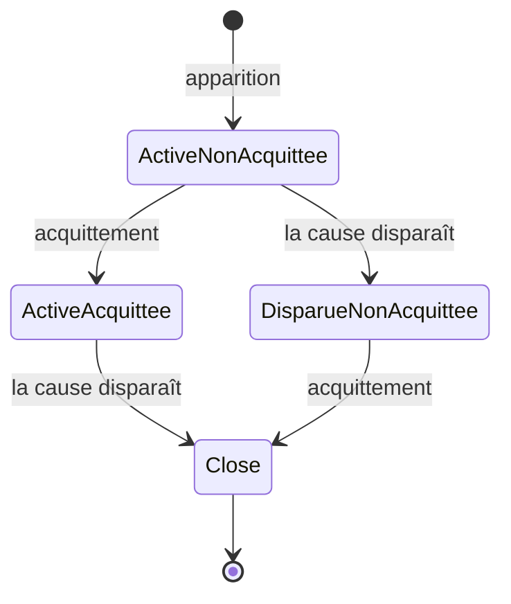

# Alarmes : gestion et numérotation

Ce document rassemble en un seul endroit la gestion des alarmes : d'où elles viennent, comment elles sont numérotées et identifiées, leur gravité, leur cycle de vie, leurs textes, leur affichage, leur historique et leur remontée à l'usine. Il reprend ce qui était dispersé dans `02` § 14, `03` § 1.3, `04` § 10, `05`, `08` § 6.4 et § 7.6, `10` § 8 et `11`, et corrige une collision de numéros (§ 3.4). Écrit le 2026-10-18 (D91). En cas de contradiction avec un autre document sur la numérotation, celui-ci l'emporte. Les termes suivent `00-glossaire.md`.

## 1. Principes

1. **Une alarme a une source et un code.** La source est un objet, une station ou la machine ; le code dit ce qui se passe. Un sous-code précise (code d'erreur de l'appareil, n° d'action, valeur atteinte…).
2. **Le PLC lève, la HMI explique.** Le PLC ne connaît que des numéros ; tous les textes sont dans la HMI (catalogue, fichiers de sous-alarmes, textes du projet).
3. **Aucune numérotation propre à une machine dans le code** : les codes d'objets viennent du catalogue, les codes des séquenceurs sont fixés ici, les alarmes de process viennent du projet.
4. **Une alarme ne se cache pas** : pas de masquage. Une alarme levée deux fois tant qu'elle est active n'est pas dupliquée ; son compteur de répétitions augmente.
5. **Toute alarme mène à sa cause** en un toucher (page Station, objet sélectionné, carte en cours surlignée).

## 2. Sources

| Source | Qui la lève | Exemples |
| --- | --- | --- |
| Objet | Le FB de l'objet (`04` § 7), par `_Fail(code, sous-code)` | Timeout de l'action, force hors fenêtre de la presse, erreur Asyril |
| Séquenceur de station | L'interpréteur et le séquenceur de station (`05` § 3 et 4) | Boucle sans attente, condition non atteinte, plus de contexte libre |
| Séquenceur général | Le séquenceur général et le gestionnaire de movers (`05` § 5 et 6) | Mover à vider, pièce présente en fin de process, déplacement trop long |
| Surveillance des rebuts | `FB_QualityMonitor` (`10` § 9) | Rebuts successifs, taux de rebut, budget d'OF |
| Process | Une carte « Signaler défaut » dessinée par l'ingénieur process (instruction `Alarm`) | « Bac rebut plein », « Pression d'air basse » |
| HMI | La HMI elle-même, pour ce que le PLC ne voit pas | PLC déconnecté, PLC incompatible, espace disque faible |

## 3. Numérotation

### 3.1 Plages de codes

Le code est un entier (`UINT`). Les plages ne se recouvrent pas :

| Plage | Origine | Où sont définis le numéro et le texte |
| --- | --- | --- |
| 1 à 99 | Erreurs communes à tous les objets | Catalogue (`commonErrors`), `03` § 1.3 |
| 100 à 899 | Erreurs propres à un type d'objet | Catalogue, fiche du type dans `03` |
| 900 à 949 | Séquenceurs (station, général, movers, chargeur, calibrations) | § 3.3 ci-dessous |
| 950 à 999 | Surveillance des rebuts | `10` § 8 (950 à 958 utilisés) |
| 1001 à 1099 | Alarmes de process (cartes « Signaler défaut »), n° 1 à 99 | Projet : n° et texte sur la carte |
| 9000 à 9099 | Alarmes de la HMI | § 3.5 ci-dessous |

Un code d'objet n'a de sens qu'avec le type de l'objet : le code 101 d'une presse et le code 101 d'un axe sont deux alarmes différentes. Les codes 900 et suivants ont le même sens partout.

### 3.2 Identité d'une alarme

- **Dans le PLC** : (n° global de la source, code). Le n° global vaut `station × 1000 + n° local de l'objet` ; n° local 0 = la station elle-même ; station 0 = la machine (`04` § 5). C'est la clé du gestionnaire d'alarmes : lever deux fois la même clé ne crée pas de seconde alarme (`04` § 10).
- **Dans la HMI et l'historique** : le n° local d'un objet est attribué par le compilateur et peut changer d'un déploiement à l'autre (ajout d'un objet). L'historique enregistre donc l'**identifiant stable** de l'objet dans le projet (son `Id`), son chemin lisible au moment de l'alarme (« Pressage 01 › Robot XYZC › Axe Z ») et le n° de station, retrouvés par la carte de compilation du projet déployé. Les statistiques d'alarmes par objet survivent ainsi aux redéploiements.
- **Affichage** : source et code lisibles, par exemple « Pressage 01 › Presse · 101 Force hors fenêtre · segment 3 ». Le code est toujours affiché à côté du texte (il sert au dépannage par téléphone et dans la documentation).

### 3.3 Codes des séquenceurs (900 à 949)

| Code | Alarme | Source | Gravité | Sous-code |
| --- | --- | --- | --- | --- |
| 901 | Boucle sans attente | Station ou machine | Défaut de station (machine : défaut machine) | Table |
| 902 | Condition non atteinte (attente plus longue que son timeout) | Station | Selon la politique d'échec de la carte | N° de carte |
| 903 | Plus de contexte libre (bloc En parallèle) | Station | Défaut de station | N° de carte |
| 904 | Profondeur d'appel dépassée | Station ou machine | Défaut de station (machine : défaut machine) | Table |
| 905 | Instruction invalide (PC hors de la table, instruction inconnue) | Station ou machine | Défaut de station (machine : défaut machine) | Index d'instruction |
| 906 | Nombre maximal de répétitions atteint (« Répéter tant que ») | Station | Défaut de station | N° de carte |
| 907 | Préparation annulée par l'arrêt (`05` § 4.2 bis) | Station | Information | N° de mover |
| 908 | Demande à l'opérateur annulée (calibration, `05` § 10.1) | Station ou machine | Selon la politique d'échec de la carte | N° de carte |
| 910 | Pièce présente en fin de process | Machine | Avertissement | N° de mover |
| 911 | Mover à vider | Machine | Avertissement (opérateur attendu) | N° de mover |
| 912 | Calibration à refaire | Station ou machine | Avertissement | N° de calibration |
| 913 | Fonction sans station disponible (défaut des stations) | Machine | Défaut machine | N° de fonction |
| 914 | Déplacement de mover trop long | Machine | Défaut machine | N° de mover |
| 915 | Mover absent du plan (hors service, D85) | Machine | Information | N° de mover |
| 916 | Movers remis à l'étape 1 par un déploiement | Machine | Information | Nombre de movers |
| 917 | HMI déconnectée (battement perdu plus de 5 s) | Machine | Information | — |
| 918 | Machine bloquée : aucun mover n'avance (réservé, `REVUE-DU-PROJET.md` § 3.5) | Machine | — | — |

Les codes non listés de la plage sont réservés. Un nouveau code de séquenceur s'ajoute ici, avec son texte dans `Resources/Strings.resx` de la HMI.

### 3.4 Alarmes de process (1001 à 1099) et correction de la collision

- Jusqu'ici, l'instruction `Alarm` levait le code `900 + n` (n de 0 à 99) : « Signaler défaut n° 1 » donnait 901, le même code que « Boucle sans attente », et n de 50 à 58 tombait sur la qualité. **Correction (D91)** : `Alarm` porte le **code complet** dans `aArg[3]`. Une carte « Signaler défaut » lève `1000 + n`, n de 1 à 99. Le compilateur, lui, peut lever les codes réservés aux séquenceurs (par exemple 906 pour « Répéter tant que »).
- **Attribution du n°** : à la création d'une carte « Signaler défaut », l'éditeur propose le premier n° libre de la station (ou du process général) ; il reste modifiable. Deux cartes d'une même station peuvent partager un n° seulement si elles ont le même texte et la même gravité (même alarme signalée à deux endroits) ; sinon, erreur de validation V033.
- **Portée** : une alarme de process est propre à sa station. « Bac rebut plein » n° 3 de Pressage 01 et n° 3 de Pressage 02 sont deux alarmes distinctes.
- **Texte et gravité** : sur la carte (texte de 80 caractères, gravité Avertissement, Défaut de station ou Défaut machine). Le texte peut citer des valeurs : `{mover}`, `{pièce}`, `{station}`.

### 3.5 Alarmes de la HMI (9000 à 9099)

| Code | Alarme | Gravité |
| --- | --- | --- |
| 9001 | PLC déconnecté | Défaut (affiché comme un défaut machine ; la HMI ne commande plus rien) |
| 9002 | PLC incompatible avec la HMI (`02` § 7.3) | Défaut |
| 9003 | PLC neuf détecté : valeurs sauvegardées à restaurer (`02` § 7.4) | Avertissement |
| 9004 | Canal usine en erreur ou outbox remplie à plus de 80 % | Avertissement |
| 9005 | Espace disque faible (moins de 10 %) | Avertissement |
| 9006 | Forçage arrivé à échéance dans 5 minutes (`12` § 1) | Information |

Elles vivent dans la HMI (source « HMI ») et s'affichent avec les alarmes du PLC. Elles disparaissent quand leur cause disparaît ; les défauts de la HMI ne se gèrent pas par Acquitter (ils ne touchent pas le PLC).

### 3.6 Sous-codes

Le sous-code (`UDINT`) précise l'alarme. Sa signification est donnée par l'alarme : n° d'action pour un timeout, n° de verrouillage, code d'erreur de l'appareil (NC, Asyril, Keyence…), valeur atteinte pour la qualité (successifs, ou taux en dixièmes de %), n° de carte ou de mover pour les séquenceurs.

## 4. Gravité et effet

| Gravité | Effet | Acquittement | Balise |
| --- | --- | --- | --- |
| Information | Aucun ; historique seulement | Aucun | — |
| Avertissement | Aucun arrêt | Par l'opérateur, une par une ou toutes (`alarm.ack`) | Bleu clignotant si opérateur attendu |
| Défaut de station | La station passe Aborted | Acquitter la station (ou la machine) : Clearing | Rouge clignotant et buzzer |
| Défaut machine | La machine passe Aborted | Acquitter la machine | Rouge clignotant et buzzer |
| Qualité | Réaction de la surveillance des rebuts, jamais Aborted | Libération qualité (`10` § 6) | Bleu clignotant |

- **Gravité d'une erreur d'objet** : défaut de station pour un objet de station, défaut machine pour un objet de niveau machine (`04` § 10). Une erreur du catalogue peut porter une **gravité par défaut** plus basse (champ `severity` facultatif dans `catalog.json`, par exemple Avertissement pour « Valeur maximale dépassée » d'un compteur).
- **La politique d'échec de la carte l'emporte** (`05` § 3.6) : avec Refaire, Pièce mauvaise, Aller à l'étape ou Ignorer, l'objet est acquitté et l'alarme passe en Information (« Aucune pièce trouvée, essai 2 sur 3 ») ; seule la politique Arrêter la station la laisse en défaut.
- **Mode manuel** : une erreur d'objet pendant une action manuelle lève une alarme de gravité Avertissement (la station est déjà Stopped) ; elle apparaît aussi dans le journal du mode manuel.
- **Cause première** : à chaque passage de la machine ou d'une station en Aborted, Held ou Stopping, la première alarme qui l'a provoqué est marquée « cause » (`05` § 5.2) ; elle est mise en tête de liste et sert de raison d'arrêt pour l'usine.

## 5. Cycle de vie

- **Information** : close dès son apparition (elle n'a ni cause durable ni acquittement).
- **Avertissement** : suit le schéma ; reste affiché tant qu'il n'est pas à la fois acquitté et disparu.
- **Défaut** : l'acquittement est la commande Acquitter (Clearing) de la station ou de la machine, qui appelle `Ack()` des objets ; un défaut dont la cause est encore présente (circuit de sécurité ouvert) réapparaît aussitôt.
- **Qualité** : l'acquittement est la libération qualité.
- **Événements** : apparition, disparition, acquittement (avec l'utilisateur), répétition. Le PLC les range dans un tampon circulaire de 128 événements avec un n° croissant (`nSeq`) ; la HMI les lit sans perte ni doublon et enregistre un trou de numérotation comme événement (`04` § 10, `06` § 6.3). Le PLC garde 256 alarmes actives au plus.
- **Contexte** relevé à l'apparition : carte en cours (`nStepId`), table, mover, emplacement, identifiant de la pièce, action et paramètres résolus, valeurs `E1` à `E4` de l'objet.

## 6. Textes

| Alarme | Texte principal | Texte du sous-code |
| --- | --- | --- |
| Objet | Catalogue : texte du code pour ce type (`commonErrors` ou erreurs du type) | Fichier de sous-alarmes du type, si le sous-code est un code d'appareil |
| Séquenceur, qualité, HMI | `Resources/Strings.resx` de la HMI (§ 3.3, 3.5, `10` § 8) | Selon le § 3.6 (n° de carte → titre de la carte, n° de mover…) |
| Process | Texte de la carte « Signaler défaut » (projet) | — |

- **Fichiers de sous-alarmes** : `catalog/subalarms/<code du type>.xml` (par exemple `AsyrilEyePlus.xml`, `LinearAxis.xml` pour les codes NC), au format XML SubAlarms déjà utilisé dans les machines existantes (code → texte, hiérarchique). Ils sont chargés au démarrage de la HMI ; un sous-code absent affiche « Sous-code <n> (texte inconnu) ».
- **Aide** : chaque erreur du catalogue et chaque entrée de sous-alarme peut porter une **cause probable** et un **remède** (champs facultatifs `cause` et `remedy`). Le tiroir de l'alarme les affiche sous le texte. Les alarmes de process peuvent avoir un remède saisi sur la carte.
- **Valeurs dans le texte** : `{objet}`, `{station}`, `{action}`, `{sous-code}`, `{valeur}` sont remplacés à l'affichage.
- Tous les textes sont en français ; aucun texte n'est dans le PLC.

## 7. Affichage

Repris de `08` § 6.4 et § 7.6, sans changement :
- **Bandeau** rouge pour un nouveau défaut (le plus récent, « + n autres »), toast orange pour un avertissement, cloche avec compteur.
- **Page Alarmes** : onglets Actives et Historique ; tri par gravité puis par heure, la cause première en tête ; filtres par gravité, station, objet ; ligne de 64 px avec barre de gravité, heure, durée, source, code et texte, texte de sous-alarme, état, « Aller à » et « Acquitter » ; tiroir avec contexte, aide et lien.
- Ajouts : le **code** est affiché à côté du texte ; le compteur de répétitions (« × 4 ») apparaît quand une alarme a été relevée plusieurs fois ; l'aide (cause, remède) apparaît dans le tiroir.

## 8. Historique et usine

- **Base de la HMI** (`07` § 5.2, table `alarms`, rétention 1 an) : identifiant stable de la source, chemin lisible, station, code, sous-code, gravité, textes au moment de l'alarme, apparition, disparition, acquittement et utilisateur, répétitions, cause première, contexte.
- **Export CSV** depuis l'historique (plage de dates, filtres).
- **Usine** : chaque événement est publié sur `events/alarm` (`11` § 4) avec le code, le sous-code, les textes, la source (identifiant stable et chemin) et le contexte ; les alarmes de la HMI y sont aussi.
- **Statistiques** (plus tard, page Statistiques) : nombre et durée par alarme et par source, à partir de cet historique.

## 9. Validation et tests

- **V033** (erreur) : deux cartes « Signaler défaut » d'une même station (ou du process général) ont le même n° avec un texte ou une gravité différents ; ou n° hors de 1 à 99.
- **V123** (avertissement) : un fichier de sous-alarmes attendu pour un type utilisé est absent, ou un code d'erreur du catalogue n'a pas de texte.
- **Tests** : une carte « Signaler défaut » n° 1 lève 1001 et non 901 ; la même alarme levée deux fois n'est pas dupliquée et compte une répétition ; avertissement acquitté puis disparu : clos ; défaut acquitté par Clearing ; Refaire : l'alarme passe en information ; trou dans les `nSeq` enregistré ; historique d'un objet conservé après un redéploiement qui change son n° local ; sous-code d'appareil traduit par le fichier XML, sous-code inconnu affiché proprement ; alarmes de la HMI (PLC déconnecté) affichées et closes au retour du PLC.
