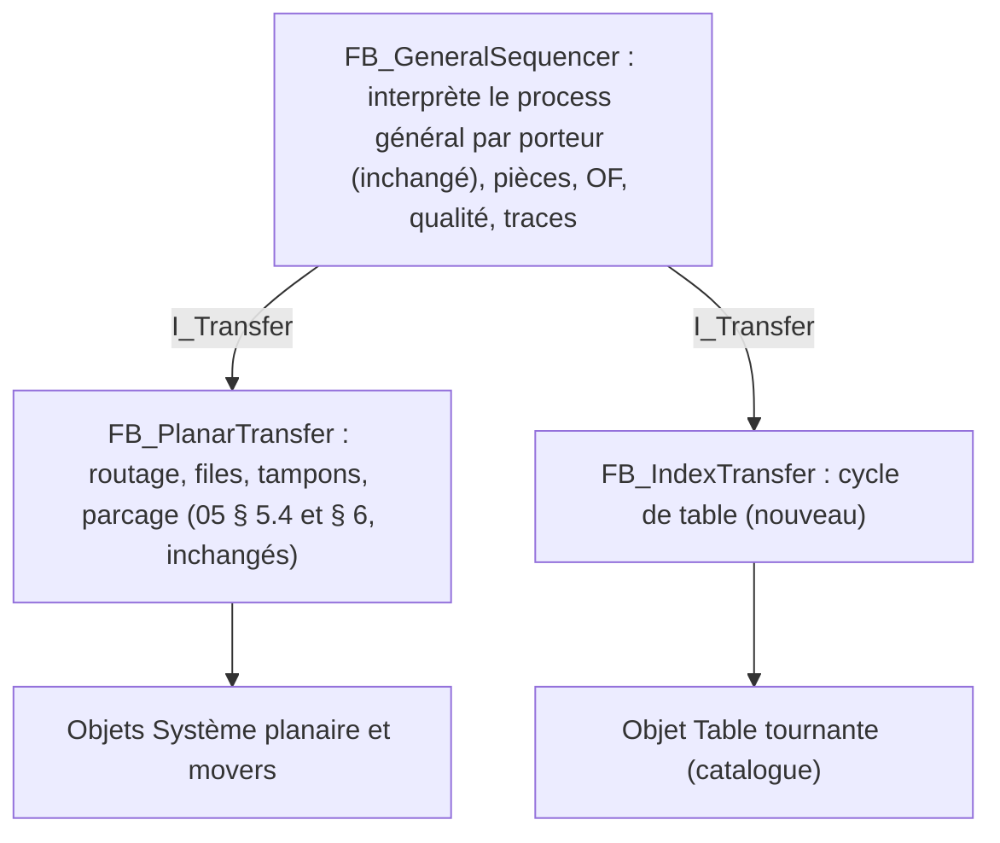

# Étude : table tournante Weiss à la place du système planaire

Statut : **étude, rien n'est décidé**. Ce document analyse comment adapter le standard (documents 00 à 12) à une machine dont le transfert est une table tournante à indexage (Weiss) au lieu d'un système planaire. Il ne modifie aucun document de référence. Les réponses du 19 octobre 2026 sont intégrées (§ 13) : table **à came pilotée par signaux en Profinet**, terme **posage**, **une pièce par posage**, aucune opération pendant la rotation, ni machine mixte ni poste opérateur. Les décisions proposées (§ 12) ne seront inscrites dans `09-journal-des-decisions.md` et reportées dans les documents qu'après accord.

Contraintes données :
- on accepte de perdre la liberté d'ordre des stations : l'ordre de passage est celui de la table ;
- on **garde la création des process dans la HMI** (process de station et process général, par glisser-déposer, compilés en tables, PLC générique) ;
- les stations sont autour de la table, mais une pièce peut aussi **sortir de la table** pour d'autres actions (nid de presse, banc, station déportée) puis revenir.

## 1. Conclusion en bref

1. **Le standard tient presque entier.** Les niveaux 1 à 4 (objets, actions, fonctions de module, opérations) et tout ce qui se passe dans une station ne dépendent pas du transfert : catalogue, process de station, interpréteur, PackML, manuel, pas à pas, verrouillages, overrides, alarmes, OF, droits, qualité et interface usine restent les mêmes.
2. **Le process général reste dessiné dans la HMI et compilé de la même façon.** Il continue de ne nommer que des fonctions. La seule différence est la signification de l'instruction `Route` : sur le planaire, elle **envoie** le mover vers une station ; sur la table, elle **attend** que la table présente le posage devant une station de la fonction. Le jeu d'instructions et le compilateur du process général ne changent pas.
3. **Ce qui change vraiment, c'est le séquenceur général** : le routage et la gestion des movers (`05` § 5.4 et § 6) sont remplacés par un **cycle de table** : à l'arrêt, chaque station sert le posage qui est devant elle ; quand toutes ont fini et sont dégagées, la table avance d'un pas. Les stations ne sont plus indépendantes : la plus lente fixe la cadence.
4. **Sortir une pièce de la table** demande une notion nouvelle, utile aussi au planaire : les **places de station**, c'est-à-dire des endroits suivis où une pièce peut se trouver hors d'un posage, et des étapes qui **transfèrent** une pièce entre un emplacement et une place. Une station peut alors déposer une pièce sur un banc, la laisser travailler pendant plusieurs tours de table et la reprendre plus tard sur un autre posage.
5. Je recommande **un seul standard avec deux types de transfert** (planaire, table tournante), choisis dans la configuration machine, plutôt qu'une copie du projet. Le PLC reste générique : les deux transferts sont dans la bibliothèque et le déploiement choisit le bon.

## 2. La table retenue : Weiss à came, signaux en Profinet

La table est un plateau Weiss **à came** (indexage mécanique, moteur et commande Weiss). Elle avance d'un pas à la fois, toujours dans le même sens, et le nombre de positions est fixé par la came. Le PLC la pilote **par des signaux** échangés en **Profinet** avec la commande de la table.

Pour le standard, cela donne :
- **Raccordement par l'image E/S.** Le PLC Beckhoff est contrôleur Profinet (borne ou fonction TwinCAT, choix matériel), et la commande Weiss est un appareil Profinet. Ses octets d'entrées et de sorties sont reliés une fois pour toutes à l'image E/S générique (`04`), comme des bornes. L'objet Table tournante lit et écrit ses signaux par références de signal : aucun code Profinet dans l'objet, et la même table câblée en E/S tout-ou-rien marcherait sans changement.
- **Signaux supposés** (à confirmer avec la documentation du modèle exact, § 13) :

| Sens | Signal | Rôle |
| --- | --- | --- |
| PLC → table | Marche (autorisation) | Commande prête à tourner |
| PLC → table | Démarrer le pas | Front ou maintien selon la commande Weiss : lance un pas |
| PLC → table | Acquitter défaut | Remet la commande en état après un défaut |
| Table → PLC | Prête | Commande sous tension, sans défaut |
| Table → PLC | En position | Came au repos, plateau verrouillé : les stations peuvent travailler |
| Table → PLC | En mouvement | Un pas est en cours |
| Table → PLC | Défaut | Défaut de la commande (et code s'il est transmis) |
| Capteur machine → PLC | Référence | Le posage n° 1 est devant la position d'index 1 (capteur ajouté sur la table, recommandé) |
| Profinet → PLC | État de l'appareil | Communication établie ; sa perte est un défaut machine |

- **Pas de position absolue.** La came ne dit pas où est le plateau : le PLC compte les pas (`nTableIndex`, persistant) et le vérifie à chaque passage sur le capteur de référence.
- **Arrêt hors position.** Si un arrêt d'urgence coupe la table au milieu d'un pas, le plateau n'est plus en position : ni production ni manuel des stations tant que l'opérateur n'a pas fait « Terminer le pas » (§ 8). Le comportement exact de la commande Weiss à l'arrêt d'urgence (arrêt immédiat ou fin de pas) est à confirmer.
- **Aucune opération pendant la rotation.** Toutes les opérations se font table en position ; la condition « En position » fait partie du verrouillage de chaque station de table (§ 4).

## 3. Vocabulaire proposé (à ajouter au glossaire après accord)

« Poste » est un mot à éviter (`00` : on dit « station ») et « nid » est déjà employé pour le nid de la presse. Le support de pièce fixé sur la table s'appelle **posage** (choix du 19 octobre 2026). Je propose :

| Terme | Code | Définition |
| --- | --- | --- |
| Transfert | `Transfer` | Ce qui porte les pièces d'une station à l'autre : système planaire **ou** table tournante. Paramètre de la machine. |
| Table tournante | `RotaryTable` | Plateau à indexage (Weiss) au centre de la machine. Objet de niveau machine. Il porte des posages et avance d'un pas à la fois. |
| Position d'index | `IndexPosition` | Une des N positions angulaires où la table s'arrête (1 à N, numérotées dans le sens de rotation). Une station de table est attachée à une position d'index. |
| Posage | `Fixture` | Support de pièce fixé sur la table. Il porte **une seule pièce** (un emplacement). Il ne quitte jamais la table. |
| Porteur | `Carrier` | Terme commun pour mover et posage : ce qui porte des pièces (1 à 4 emplacements pour un mover, 1 pour un posage) et exécute sa propre instance du process général. |
| Pas de table | `Index` | Rotation de la table d'une position d'index à la suivante. |
| Cycle de table | `IndexCycle` | Temps d'arrêt de la table (les stations travaillent) suivi d'un pas de table. |
| Station de table | `TableStation` | Station attachée à une position d'index : elle travaille sur le posage présenté. |
| Station déportée | `SatelliteStation` | Station sans position d'index, hors de la table. Aucun porteur ne vient à elle : elle ne travaille que sur des pièces posées dans ses places. |
| Place de station | `StationPlace` | Endroit suivi d'une station où une pièce peut se trouver hors porteur : nid de presse, banc de test, magasin, tapis de sortie… État : vide, occupée, prête. |
| Table dégagée | `TableClear` | Condition d'une station de table qui doit être vraie pour que la table puisse tourner (par exemple : axe Z au-dessus de la cote de sécurité, vérin de bridage rentré). |

Dans l'interface d'une machine à table, on dit « posage » là où une machine planaire dit « mover ». Dans le code commun (séquenceur général, pièces, traces, qualité, forçages), on emploie `Carrier`.

## 4. Configuration de la machine (remplace « Système planaire » et « Positions planaires » de `02` § 3)

| Élément | Planaire (aujourd'hui) | Table tournante |
| --- | --- | --- |
| Transfert | — | Type : Planaire ou Table tournante |
| Géométrie | Tuiles, movers, emplacements, vitesses | Nombre de positions d'index N (fixé par la came, par exemple 6, 8, 12), un posage par position d'index (N posages), une pièce par posage (pas de réglage d'emplacements), sens et diamètre (affichage seulement) |
| Positions du transfert | Travail, file, tampon, parcage | Aucune : la position d'index **est** la position de travail. Pas de file, pas de tampon, pas de parcage |
| Stations | Emplacement sur le plan | Position d'index (une station au plus par position) **ou** déportée (aucune position) |
| Fonctions, rôles, priorités | Inchangés | Inchangés ; la priorité ne sert plus (pas de file), elle est ignorée |
| Objets machine | Système planaire, movers | Table tournante, balise, sécurités |

Règles :
- Une position d'index peut rester libre (pas de station) : la table la traverse sans arrêt de travail.
- Deux stations sur une même position (une au-dessus, une en dessous) : non, en première version. On fait une seule station avec deux modules. C'est la solution la plus simple, à revoir si un cas réel l'exige.
- Toute station de table a, en plus de ses verrouillages, la condition générée « table en position » sur ses actions de mouvement : aucune action ne démarre pendant un pas.
- Une station de table a une condition **Table dégagée** (éditée comme un verrouillage, `02` § 4.5). Sans condition, la station est considérée dégagée dès qu'elle n'a pas d'opération en cours. Le validateur avertit si une station qui a des axes ou des vérins n'a pas de condition.

## 5. Le process général sur une table

### 5.1 Ce qui ne change pas

- Chaque **posage** exécute sa propre instance du process général, avec son PC, ses emplacements et ses pièces, comme un mover.
- Les étapes de la palette machine sont les mêmes : opérations par fonction, Si / Sinon, Répéter, Attendre condition, sous-process, Définir donnée de pièce, Signaler défaut, Fin.
- Le compilateur produit la même table (`Route`, `JumpIfFalse`, …), avec les mêmes structures.
- Pièce mauvaise : redirection automatique vers la fonction de rebut, sauf si le process traite le verdict lui-même (`05` § 5.4, étape 1).

### 5.2 Ce que veut dire une étape d'opération sur une table

Sur le planaire, `Route(F, op)` choisit une station de F et y envoie le mover. Sur la table, le posage ne choisit pas où il va : la table l'amène devant chaque position d'index à son tour. `Route(F, op)` devient donc :

> « Attendre d'être présenté devant une station de la fonction F qui est en production ; elle exécute alors l'opération. »

Conséquences, toutes naturelles :
- **L'ordre des stations sur la table ne limite pas les process possibles ; il limite la cadence.** Un process qui demande les fonctions dans l'ordre des positions d'index fait un tour par pièce. Un process qui revient en arrière (Sertissage sur la même station que Pressage, retouche) fait un tour de plus : le posage garde son étape et passe devant les autres stations sans être servi, puis il est servi au tour suivant.
- **Plusieurs stations pour une fonction** (redondance) : la première station de la fonction rencontrée qui est en production sert le posage. Les suivantes ne travaillent que si la première est indisponible (Aborted, hors production, arrêt qualité). La redondance garantit donc la disponibilité. Elle ne double pas la cadence : sur une table, une opération plus longue que le cycle de table se traite par une sortie de table (§ 7), pas par deux stations.
- **Plusieurs opérations de suite à la même station** : après la fin d'une opération, la station réévalue le posage. Si l'étape suivante vise encore une de ses fonctions, elle l'exécute dans le même arrêt de table.
- **Retouche** (Répéter) : un tour supplémentaire, sans rien de spécial.
- **Porteur vide** : une étape d'opération d'une fonction qui n'est pas d'Entrée est **sautée** si tous les emplacements visés sont vides (le posage n'a rien à faire faire). Une opération peut être marquée « accepte un porteur vide » (par exemple Reprendre du banc, § 7.3). Cette règle sert aussi au planaire.

### 5.3 Validation propre à la table

| Règle proposée | Gravité |
| --- | --- |
| Une station déportée est visée par une étape d'opération du process général (aucun porteur ne peut l'atteindre) | Erreur |
| Une fonction utilisée n'a aucune station de table | Erreur |
| Le process demande plus de 2 tours de table par pièce sur le chemin nominal (verdict bon) : nombre de tours affiché | Avertissement |
| Une station de table sans condition Table dégagée alors qu'elle a des objets de mouvement | Avertissement |
| Une place de station n'est jamais vidée par aucun process (la pièce y resterait) | Avertissement |
| Les règles V013 (position de travail planaire) et V107 (capacité de movers) ne s'appliquent pas ; V013 devient « une station de table n'a pas de position d'index, ou deux stations ont la même » | — |

Le studio affiche pour le process général un **déroulé sur la table** : pour une pièce bonne, la suite des positions d'index traversées avec, à chaque arrêt, l'opération faite ou « passe ». On voit tout de suite qu'un ordre de process coûte un tour de plus.

## 6. Le séquenceur général sur une table (remplace `05` § 5.3, § 5.4 et § 6 pour ce transfert)

### 6.1 Architecture PLC

Je propose de séparer, dans `FB_GeneralSequencer`, ce qui est commun de ce qui dépend du transfert :



- `ST_MoverCtx` devient `ST_CarrierCtx`, avec les mêmes champs. Les champs de position (destination, file) n'ont de sens qu'au planaire.
- L'interprétation par porteur (`Ready` : instructions instantanées jusqu'à `Route`, `WaitCond` ou `End`), la fin d'opération (`05` § 5.5), l'OF, la qualité et les traces sont **communes**.
- Le transfert est choisi au déploiement (`ST_MachineData.eTransfer`). Les deux FB sont dans `StdMachineLib`. Le PLC reste sans code propre à une machine.

### 6.2 États du posage

| État | Sens |
| --- | --- |
| `Ready` | Le PC est sur une instruction instantanée : le porteur s'exécute jusqu'à `Route`, `WaitCond` ou `End` |
| `Waiting` | Le PC est sur un `Route` dont la fonction n'est pas à la position où il se trouve : il attend que la table tourne (remplace `Routing`, `Queued` et `Buffered`) |
| `AtStation` | Une opération est en cours sur lui |
| `ToEmpty`, `OutOfService`, `Error` | Comme les movers, mais le posage reste sur la table (§ 6.5) |

### 6.3 Cycle de table — `FB_IndexTransfer`

```iecst
// Table à l'arrêt : chaque station de table sert le posage présenté.
CASE eCycle OF
Dwell:
    bAllServed := TRUE;
    FOR p := 1 TO nIndexPositions DO
        s := aStationAt[p];                              // 0 = position libre
        IF s = 0 THEN CONTINUE; END_IF
        c := CarrierAt(p);                               // (p - nTableIndex) modulo N
        IF aBusy[p] THEN                                 // opération en cours sur ce posage
            IF Station(s).Response IN [Done, Failed] THEN EndOperation(c, s); aBusy[p] := FALSE; (* réévalué au cycle suivant *)
            ELSIF Station(s).Response = Aborted THEN StationAborted(c, s); END_IF   // § 6.4
            bAllServed := FALSE;
        ELSIF NOT aServed[p] THEN
            RunInstant(c);                               // instructions instantanées du posage
            IF c.Pc IS Route(F, op) AND StationServes(s, F, c) AND Startable(c, F, op) THEN
                RequestOperation(s, c, F, op); aBusy[p] := TRUE; bAllServed := FALSE;
            ELSE
                aServed[p] := TRUE;                      // rien à faire ici pour ce posage
            END_IF
        END_IF
        bAllServed := bAllServed AND StationTableClear(s);
    END_FOR
    IF bAllServed AND MachineState = Execute AND NOT bHoldOrStop AND NOT bIdleTurn THEN
        Table.Start(Index);  eCycle := Indexing;
    END_IF
Indexing:
    IF Table.Done THEN
        nTableIndex := (nTableIndex MOD N) + 1; Clear(aServed); nIdleIndexes := ...; eCycle := Dwell;
    ELSIF Table.Error THEN MachineFault(); END_IF
END_CASE
```

- `StationServes(s, F, c)` : s est membre de F, en Execute, pas hors production, pas en arrêt qualité, posage pas hors service ni « à vider ». Puisque le posage arrive d'abord devant la première station de F, c'est elle qui le sert si elle est disponible ; sinon une station suivante de F le servira.
- `Startable` : règle du porteur vide (§ 5.2), fin d'OF (pas de nouvelle opération d'Entrée quand l'OF est complet), chargement verrouillé par la qualité.
- **Tour à vide** : si la table a fait N pas sans qu'aucune opération ne démarre, elle s'arrête (`bIdleTurn`). La machine reste en Execute et la balise passe en bleu clignotant (« Aucune station n'a de travail »). Elle repart dès qu'un élément change : station réintégrée, OF lancé, forçage levé. Ce cas remplace « mover en tampon faute de station ».
- **Fin d'OF** : plus de chargement ; quand tous les posages sont vides, Stop automatique (`05` § 5.6 inchangé).
- **Hold, Stop** : les opérations en cours se terminent, la table ne tourne plus (un pas commencé se termine toujours).
- La **sécurité de rotation** est double : la condition Table dégagée de chaque station (logique) et un verrouillage généré sur l'action « Indexer » de la table qui la reprend (actif aussi en manuel).

### 6.4 Station Aborted sur une table

Sur le planaire, une station Aborted sort du routage et les autres continuent. Sur une table, elle **bloque la rotation**, puisque son posage ne peut pas partir tant que le robot peut être au-dessus.

1. La station passe Aborted, réponse `Aborted` : les pièces du posage reçoivent le verdict mauvais (comme `05` § 6.4).
2. Les autres stations terminent leur opération en cours, puis la table attend. La machine reste en Execute ; la balise est verte et rouge clignotante, comme aujourd'hui pour une station Aborted.
3. Après Acquitter (vidage) la station est Stopped et dégagée : la table peut tourner à nouveau. La station ne sert plus personne tant qu'elle n'est pas réintégrée. Les posages qui ont besoin de sa fonction sont servis par une autre station de la fonction s'il y en a une ; sinon ils tournent, puis le tour à vide arrête la table, sans Aborted.
4. Réintégration (Réarmer, Démarrer) : inchangée.

La règle « la machine passe Aborted si une fonction n'a plus de station disponible » (`02` § 9) est remplacée par le tour à vide. Une station en défaut ne doit pas faire tomber la machine entière. L'opérateur voit pourquoi elle attend.

### 6.5 Posage à vider, hors service

- Pas de parcage : un posage « à vider » ou « hors service » **reste sur la table** et toutes les stations le laissent passer.
- « À vider » : l'opérateur retire les pièces machine arrêtée (on ne met pas les mains sur une table en production) et confirme dans la page Pièces, comme aujourd'hui.
- Mover hors service (`10` § 5, `12` § 4) devient posage hors service : même mécanisme ; un posage abîmé fait un trou dans la cadence mais n'arrête rien.

### 6.6 Démarrage et reprise

- Au Reset machine : action « Vérifier position » de la table (commande prête, communication Profinet établie, table en position). La position courante `nTableIndex` est persistante. Si la table est sur le capteur de référence, elle est recalée à 1 ; sinon elle est reprise de la mémoire persistante et vérifiée au prochain passage sur la référence (un écart est le défaut « Position perdue »).
- Table hors position au Reset (arrêt pendant un pas) : le Reset est refusé avec le motif ; l'opérateur fait « Terminer le pas » en manuel, puis réarme.
- Contextes des posages et pièces persistants : reprise au même PC, comme les movers.

## 7. Sortir une pièce de la table

C'est le point le plus important de la demande, et il sert aussi au planaire. Aujourd'hui, une pièce est **toujours** sur un emplacement de mover. Seule la marque « retirée » existe pour une pièce qui quitte la machine dans une station. Pour sortir une pièce de la table et l'y remettre, il faut savoir où elle est quand elle n'est pas sur un porteur.

### 7.1 Places de station

- Une station déclare des **places** (8 au plus) : nom, et pour le studio un repère sur sa vue de dessus. Exemples : « Nid presse », « Banc 1 » … « Banc 6 », « Tapis sortie ».
- Une place est vide, **occupée** (une pièce, en cours de travail) ou **prête** (son travail est fini, elle peut être reprise).
- La pièce garde son identifiant, ses données et son historique dans une place. La page Pièces la montre « dans Rodage › Banc 3 ».

### 7.2 Transférer une pièce : étapes de la palette station

| Étape (couloir Logique) | Effet sur le suivi | Paramètres |
| --- | --- | --- |
| Déposer la pièce dans une place | Emplacement du porteur → place (occupée) | Emplacement, place |
| Reprendre une pièce d'une place | Place → emplacement du porteur | Place précise, ou « la plus ancienne prête » parmi une liste ; emplacement |
| Transférer entre places | Place → place, y compris vers une place d'une **autre station** (station déportée) | Place source, place destination |
| Marquer la place prête | Occupée → prête | Place |
| Travailler sur la pièce d'une place | Les liaisons de résultats et les données de pièce de la suite visent la pièce de cette place (au lieu de l'emplacement courant) | Place |

- Ces étapes ne bougent rien : elles mettent à jour le suivi. L'ingénieur process les place juste après le mouvement réel (Poser pièce). Pour éviter les oublis, les fonctions de module **Prendre pièce / Poser pièce** reçoivent un paramètre facultatif « Suivi de pièce : depuis… / vers… ». Le compilateur ajoute l'instruction de transfert au bon moment (après la confirmation du vide à la pose).
- Nouvelles conditions disponibles : place vide, occupée, prête ; nombre de places prêtes d'une liste.
- Côté tables : une instruction `PartMove` (source, destination : emplacement ou place, de cette station ou d'une autre) et une instruction `PartSelect` (pièce courante du contexte). Les deux sont instantanées. `PartMove` vers une place occupée ou depuis une place vide est un échec, avec la politique d'échec de l'étape.

### 7.3 Trois façons de sortir une pièce

**a) Aller-retour dans la même opération** (le cas de la presse de MX-4) : la station prend la pièce sur le posage, la pose dans le nid de sa presse, presse, puis la remet sur le **même** posage. La table attend la fin de l'opération. Seul le suivi change : la page Pièces montre la pièce « dans le nid presse » pendant le pressage.

**b) Dépôt puis reprise par la même station** (opération plus longue qu'un cycle de table) : la station « Rodage » dépose la pièce sur un de ses 6 bancs et reprend sur le posage **la plus ancienne pièce prête**. C'est une opération « Échanger », qui accepte un porteur vide. Son cycle de fond pilote les bancs, sans lien avec la table : il démarre le rodage des places occupées et les marque prêtes à la fin. La pièce reprise continue le process général **du posage sur lequel elle arrive** : le process est porté par le posage, la pièce n'apporte que ses données et son historique. Avec 6 bancs, un rodage de 6 cycles de table ne ralentit pas la machine. Au démarrage, les premiers posages repartent vides, et la règle du porteur vide (§ 5.2) leur fait sauter les étapes suivantes jusqu'au chargement.

**c) Station déportée** : une station sans position d'index (cellule de test, marquage laser, autre machine) reçoit les pièces par une place d'échange. Exemple : la station de table « Transfert » pose la pièce sur un tapis, puis fait « Transférer entre places » vers la place d'entrée de la station déportée « Marquage ». Le cycle de fond du marquage traite la pièce et la renvoie dans une place de sortie. Une opération d'une station de table la reprend plus tard, ou une opération de sortie la clôture. Les deux stations ne s'attendent pas : elles ne se coordonnent que par l'état des places. Ce principe est le même que « deux stations ne s'attendent jamais » (`01`) : les places jouent le rôle des movers.

### 7.4 Ce que l'ajout des places change ailleurs

- **Traces** : une opération sur la pièce d'une place émet une trace avec la station et sans porteur. L'historique de la pièce est complet.
- **Rôle Sortie / Rebut hors porteur** : une station (même déportée) peut clôturer une pièce d'une place (étape « Clôturer la pièce : sortie / rebutée »). On sort ainsi des pièces par une station déportée.
- **Qualité** : l'imputation à la station (`10`) ne change pas. La portée « mover » devient « porteur ». Une pièce qui a changé de porteur est imputée au porteur sur lequel elle a été **jugée**.
- **Vidage** : le process de vidage d'une station traite aussi ses places (évacuer ou garder). Les pièces des places restent suivies après un Abort.
- **Persistance** : les places et leurs pièces sont persistantes, comme les emplacements.
- **Limites** : 8 places par station, 128 places en tout (à confirmer selon la mémoire).

## 8. Catalogue (`03`)

Nouveau type de niveau machine **Table tournante à came** (n° à attribuer dans `catalog.json`). Raccordement : les signaux du § 2 par références de signal (image E/S reliée à l'appareil Profinet).

| Paramètre | Type | Défaut |
| --- | --- | --- |
| Nombre de positions d'index | Int | 8 |
| Sens (affichage) | Énum : horaire, antihoraire | horaire |
| Durée nominale d'un pas (simulation, timeout) | Real (ms) | 800 |
| Mode du signal Démarrer | Énum : impulsion, maintien jusqu'à En mouvement | impulsion |
| Capteur de référence | Bool | oui |

| N° | Action | Paramètres | Résultats | Mouvement | Timeout défaut |
| --- | --- | --- | --- | --- | --- |
| 1 | Activer (Marche, attend Prête) | — | — | non | 5 000 ms |
| 2 | Vérifier position | — | r1 Position d'index | non | 2 000 ms |
| 3 | Indexer d'un pas | — | r1 Position d'index | oui | 3 × durée nominale |
| 4 | Terminer le pas (table hors position, manuel seulement) | — | r1 Position d'index | oui | 3 × durée nominale |
| 5 | Acquitter défaut | — | — | non | 3 000 ms |
| 6 | Désactiver | — | — | non | 3 000 ms |

État affiché : `E1` position d'index, `E2` en position (0/1), `E3` en mouvement (0/1), `E4` pas effectués (compteur de maintenance). Erreurs : Table non en position, Timeout de pas, Défaut de la commande table (sous-code si la commande le transmet), Position perdue (écart au capteur de référence), Communication Profinet perdue. Ce sont des défauts machine. État sûr sur Abort : Démarrer et Marche retirés ; la came finit ou non son pas selon la commande Weiss (à confirmer). Override : la came n'a pas de vitesse pilotée ; comme pour un vérin (`02` § 13), l'override rallonge seulement le timeout, et à 0 % aucun nouveau pas ne démarre.

Simulation : un pas dure la durée nominale ; En mouvement pendant le pas, En position à la fin ; le capteur de référence suit `nTableIndex` ; forçages d'essai possibles : défaut commande, perte Profinet, arrêt au milieu d'un pas.

Les types `PlanarSystem` et `PlanarMover` restent ; une machine a soit les uns, soit l'autre.

## 9. HMI

| Page | Changement |
| --- | --- |
| Machine (`08` § 6.1, § 7.4) | Le plan planaire est remplacé par une **vue de table** : disque avec ses N posages (n° et pièces), stations en tuiles autour de leur position d'index, stations déportées à l'extérieur avec leurs places. Animation du pas (rotation par `Storyboard`, durée du pas réel). Sous la vue : **barre de cycle** avec le temps d'arrêt de chaque station sur le dernier cycle ; la station qui a fait attendre la table est mise en avant (station limitante). |
| Studio machine (`08` § 6.7) | « Plan et stations » devient, pour une table, un disque : glisser « Nouvelle station » sur une position d'index ou à l'extérieur (déportée), régler N, les posages et les emplacements. Choix du transfert dans « Objets machine ». |
| Studio station | Section Places (liste, repère sur la vue de dessus) ; condition Table dégagée (éditeur de condition existant). |
| Éditeur de process (machine) | Inchangé ; panneau « Déroulé sur la table » (§ 5.3). |
| Éditeur de process (station) | Nouvelles étapes de suivi (§ 7.2), paramètre « Suivi de pièce » sur Prendre / Poser. |
| Pièces | « Posages » à la place de « Movers » ; pièces dans les places des stations ; posages à vider. |
| Forçages, Qualité | « Posage hors service » à la place de « Mover hors service ». |
| Manuel | Commande de la table (Indexer d'un pas, Terminer le pas, Acquitter défaut) dans le canal machine, seulement si toutes les stations sont dégagées ; la condition qui bloque est affichée comme pour un verrouillage. |

Les libellés « mover » / « posage » viennent du transfert configuré : une ressource par transfert, aucune condition dans les vues.

## 10. Simulateur

- `FB_IndexTransfer` simulé à la lettre (§ 6.3), table à came simulée (pas de durée fixe × override, signal en position).
- Machine d'exemple **MX-4T** (même catalogue, mêmes stations de MX-4 autant que possible) pour les essais, les captures et les démonstrations :

| Position d'index | Station | Fonctions |
| --- | --- | --- |
| 1 | Chargement | Chargement (Entrée) |
| 2 | Pressage 01 | Pressage pignon, Sertissage |
| 3 | Pressage 02 | Pressage pignon, Sertissage (redondance) |
| 4 | Contrôle | Contrôle |
| 5 | Rodage (6 bancs en places) | Rodage : opération « Échanger » (§ 7.3 b) |
| 6 | — | — |
| 7 | Déchargement | Déchargement (Sortie) |
| 8 | Rebut | Rebut |
| déportée | Marquage | (aucune fonction : travaille sur ses places, pièce donnée par Déchargement) |

Process général : Charger → Presser pignon → Si bon Contrôler → Si bon Échanger (rodage) → Sertir → Si bon Décharger sinon Évacuer. Sertir est fait par Pressage 01 ou 02 **au tour suivant**. Le déroulé affiche donc 2 tours par pièce : c'est voulu, cela montre la règle. Le pressage montre l'aller-retour (§ 7.3 a), le rodage le dépôt et la reprise (b), le marquage la station déportée (c).

- Tests à ajouter : cycle de table (pas seulement quand tout est servi et dégagé), opérations consécutives à la même station, redondance (première station disponible), tour supplémentaire, porteur vide, tour à vide, station Aborted qui bloque puis débloque, Hold et Stop pendant un pas, fin d'OF, transferts de places (succès et échecs), échange au rodage, persistance de la position de table, 100 pièces sur MX-4T.

## 11. Impact sur les documents et le code actuel

| Document | Nature du changement | Ampleur |
| --- | --- | --- |
| 00 Glossaire | Termes du § 3 ; « mover » devient un cas de « porteur » | Moyenne |
| 01 Définition | Description de la machine : deux transferts ; machine d'exemple MX-4T | Moyenne |
| 02 Spécifications | § 3 configuration, § 6.2 exécution, § 9 Aborted, § 10 routage (une section par transfert) ; places de station dans § 5.3 | Forte |
| 03 Catalogue | Type Table tournante ; paramètre « suivi de pièce » des fonctions Prendre / Poser | Faible |
| 04 Architecture objets | Rien de nouveau côté matériel : la table passe par l'image E/S (appareil Profinet relié dans TwinCAT) | Faible |
| 05 Séquenceurs | § 5 scindé : commun + `I_Transfer` ; nouveau § « Cycle de table » ; `PartMove` et `PartSelect` dans l'interpréteur ; § 6 réservé au planaire | Forte |
| 06 Tables | `eTransfer`, positions d'index, places, condition Table dégagée, nouvelles instructions, statut des porteurs et des places | Moyenne |
| 07 Architecture HMI | Modèle (`Transfer`, `StationPlace`), règles de validation du § 5.3, simulateur | Moyenne |
| 08 Écrans | Vue de table, barre de cycle, studio en disque, places | Moyenne |
| 10 Qualité | Portée mover → porteur | Faible |
| 11 Usine | Données des porteurs, cadence de table (temps de cycle, station limitante) | Faible |
| 12 Forçages | Mover hors service → porteur hors service ; tour à vide | Faible |

Code du PoC actuel (`src/`) : les endroits liés au planaire sont peu nombreux. On trouve `MachineViewModel` (plan, tuiles, movers), `StudioViewModels` (éditeur du plan), `OperationsViewModels` (pièces, forçages des movers), `DemoSchedule` (segments de trajet de mover) et les vues associées. L'éditeur de process, les composants, le thème et le glisser-déposer ne sont pas touchés. La vue de table serait un deuxième modèle de vue, choisi selon le transfert.

## 12. Décisions proposées (à valider)

| N° | Décision proposée | Raison |
| --- | --- | --- |
| P1 | Un seul standard, deux types de transfert (planaire, table tournante), choisis dans la configuration machine | Ne pas dupliquer les niveaux 1 à 4, qui sont identiques |
| P2 | Le process général garde sa forme et sa compilation ; `Route` signifie « être servi par une station de la fonction », que le transfert y amène le porteur (planaire) ou attende qu'il y passe (table) | La création des process dans la HMI est conservée telle quelle |
| P3 | Sur une table, la première station disponible de la fonction rencontrée sert le posage ; un posage non servi garde son étape et fait un tour de plus | Règle simple ; la retouche et le retour en arrière marchent sans cas particulier |
| P4 | La table tourne quand toutes les stations ont servi leur posage et sont dégagées (condition Table dégagée + verrouillage généré sur Indexer) | Sécurité et déterminisme |
| P5 | Une station Aborted bloque la table jusqu'à son vidage, puis est contournée ; plus d'Aborted machine pour une fonction sans station : la table s'arrête après un tour à vide | Une station en défaut ne doit pas faire tomber toute la machine |
| P6 | Places de station et étapes de transfert de pièce, pour les deux transferts ; le process général reste porté par le porteur, la pièce emporte ses données et son historique | Répond à « déplacer les composants en dehors de la table » ; utile aussi au planaire (nid de presse de MX-4) |
| P7 | Stations déportées : stations sans position d'index, alimentées par les places | Actions hors table sans casser le principe « deux stations ne s'attendent jamais » |
| P8 | Une étape d'opération (hors Entrée) sur un porteur vide est sautée, sauf opération marquée « accepte un porteur vide » | Échanges avec un banc, démarrage à vide |
| P9 | Une station au plus par position d'index en première version | Simplicité |
| P10 | Table Weiss à came, pilotée par signaux en Profinet, reliés à l'image E/S ; un seul type d'objet « Table tournante à came » ; pas d'axe NC | Réponse du 19 octobre 2026 ; garde l'objet indépendant du bus |
| P11 | Le support de pièce sur la table s'appelle « posage » (`Fixture`) ; un posage porte une seule pièce ; un posage par position d'index | Réponse du 19 octobre 2026 |
| P12 | Aucune opération pendant la rotation ; condition « table en position » générée sur toutes les actions de mouvement des stations de table | Réponse du 19 octobre 2026 ; sécurité |
| P13 | Pas de machine mixte (table et planaire ou convoyeur pilotés ensemble), pas de type « poste opérateur » en première version | Réponse du 19 octobre 2026 |
| P14 | Position de table comptée par le PLC (persistante) et vérifiée par un capteur de référence ; table hors position = Reset refusé, « Terminer le pas » en manuel | Une came ne donne pas de position absolue |

## 13. Réponses et questions restantes

Réponses du 19 octobre 2026 :

| Question | Réponse |
| --- | --- |
| Modèle Weiss | À came, pilotée par signaux en Profinet (§ 2, § 8) |
| Pièces par support | Une pièce par posage ; « posage » est le terme retenu |
| Opérations pendant la rotation | Non |
| Machine mixte | Non |
| Poste opérateur | Non |

Questions restantes :
1. **Référence exacte de la table et de sa commande** : liste réelle des signaux Profinet (le § 2 est une hypothèse), mode du signal Démarrer, transmission d'un code de défaut, comportement à l'arrêt d'urgence (fin de pas ou arrêt immédiat).
2. **Capteur de référence** : existe-t-il, ou faut-il l'ajouter sur la table ? Sans lui, la position n'est que comptée.
3. **Nombre de positions** de la came (pour l'exemple MX-4T, je prends 8).
4. **Priorité de fonction** : elle ne sert plus sur une table ; je propose de la masquer dans l'interface quand le transfert est une table.

## 14. Proposition de suite

1. Valider ce document (et répondre aux questions restantes du § 13), inscrire les décisions retenues dans le journal.
2. Reporter les changements dans 00 à 12 (une passe par document, revue à chaque fois).
3. Modèle et validation : `Transfer`, positions d'index, places, règles du § 5.3 ; projet d'exemple `MX-4T.stdm.json`.
4. Maquette : vue de table et studio en disque dans le PoC, données de démonstration rejouées, captures regardées.
5. Simulateur : `FB_IndexTransfer`, places, instructions `PartMove` et `PartSelect`, tests du § 10.
6. PLC (phase 9) : `FB_IndexTransfer` et type Table tournante dans `StdMachineLib`.
